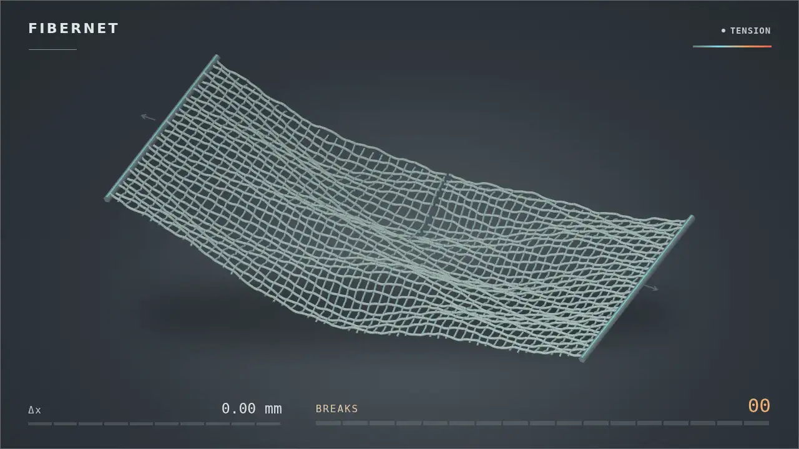
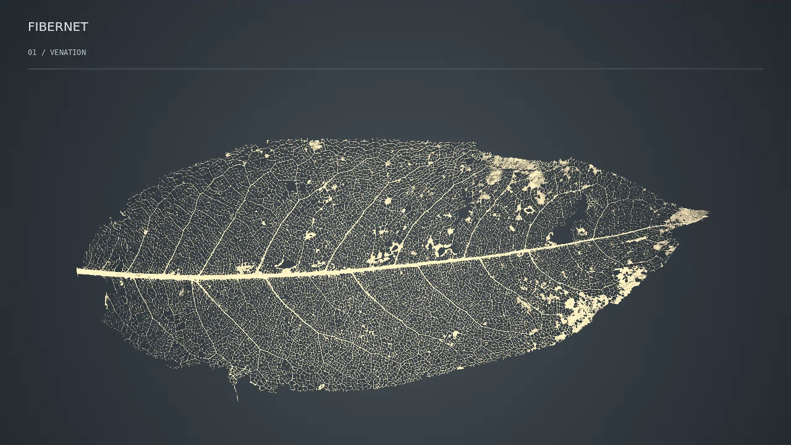
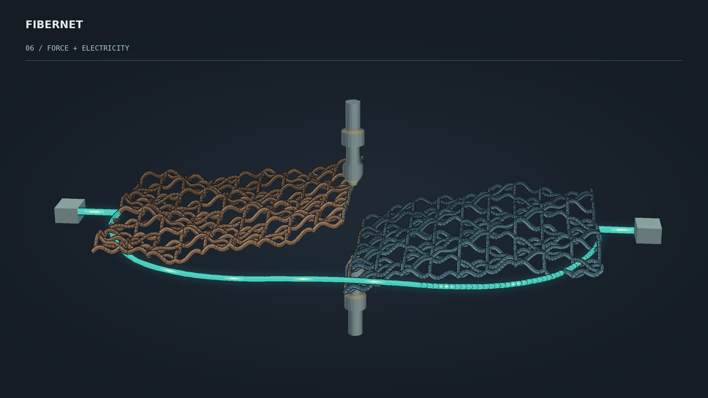
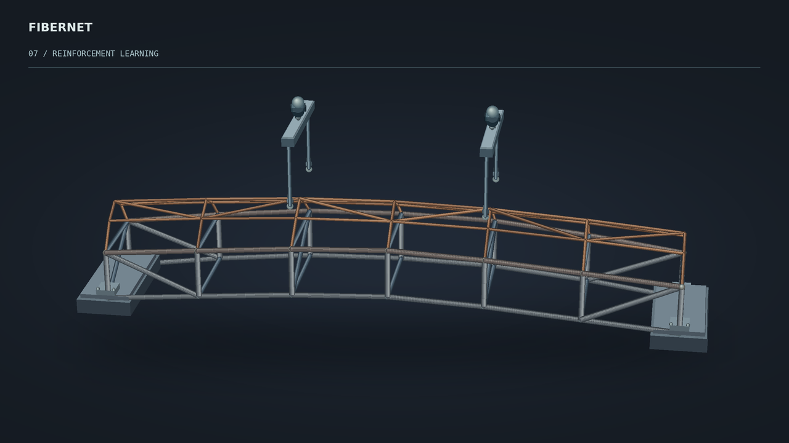
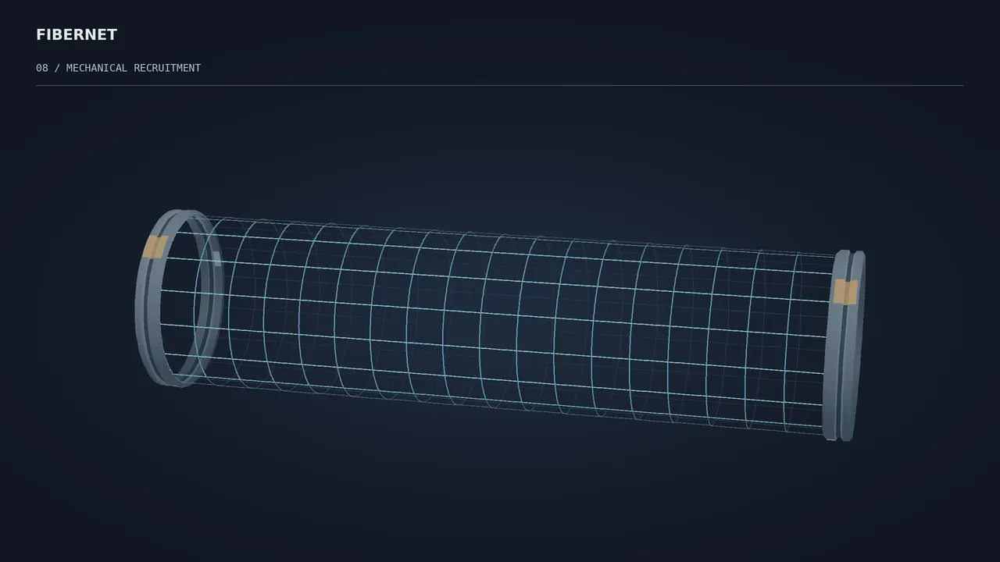
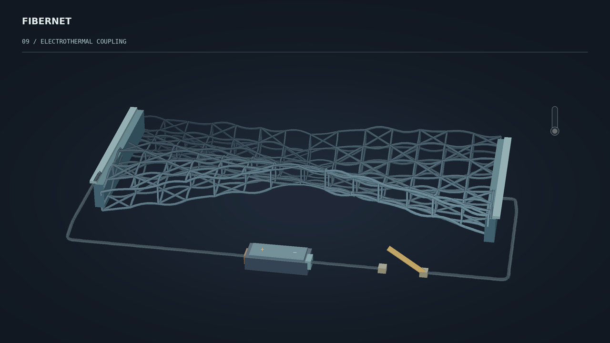

# FiberNet

Generate, simulate, and design fiber networks in Python.

[Quick start](#quick-start) · [Examples](examples/README.md) · [Animations](#animations) · [Gallery](docs/MEDIA_GALLERY.md) · [中文](#fibernet-zh)

<a name="animations"></a>

### [Same network, new shape](docs/MEDIA_GALLERY.md#one-topology-two-shapes)

<table>
<tr><td align="center">

</td></tr>
</table>

### [A tear opens under tension](docs/MEDIA_GALLERY.md#tensile-fracture-of-a-notched-weave)



### [From orientation to fibers](docs/MEDIA_GALLERY.md#from-orientation-field-to-fibers)


### [From leaf veins to a graph neural network](docs/MEDIA_GALLERY.md#from-leaf-venation-to-a-graph-neural-network)



### [Flow through a 3D fiber network](docs/MEDIA_GALLERY.md#flow-through-a-3d-fiber-network)


### [Current reroutes when fibers touch](docs/MEDIA_GALLERY.md#electric-current-reroutes-under-compression)



### [Learning where to brace a bridge](docs/MEDIA_GALLERY.md#learning-where-to-brace-a-bridge)



### [Twisting reveals helical load paths](docs/MEDIA_GALLERY.md#from-a-cylindrical-mesh-to-helical-load-paths)



### [Current stops, heat lingers](docs/MEDIA_GALLERY.md#current-stops-heat-lingers)



<a name="fibernet-zh"></a>

<details>
<summary>中文</summary>

<!-- locale:zh:start -->
## 快速开始

Python 3.9+ · [PyPI](https://pypi.org/project/fibernet/) · 算例输出：`fibernet_demo/`

```bash
python -m pip install fibernet
python -m fibernet.examples.basic_usage --output-dir fibernet_demo
```

## 接下来可以做什么

- **建模与模拟：**[二维/三维生成](docs/METHODS_3D_GENERATION_PARAMETERS.md) · [三维力学](docs/TET4_STATIC.md)。
- **变形与输运：**[纤维网络电阻](docs/DEFORMED_TRANSPORT_PREPARATION.md) · [三维实体电阻](examples/README.md#predicting-strain-induced-resistance-in-a-fused-solid-lattice) · [孔隙流动](examples/README.md#how-solid-deformation-changes-pore-flow)。
- **用 `StructureGraph` 学习与制造：**[模型训练](examples/physical_learning_workflow.py) · [闭合路径](docs/MANUFACTURING_GRAPH_MAPPING.md) · [多段路径](docs/MULTISTROKE_MANUFACTURING.md)。

[动图画廊](docs/MEDIA_GALLERY.md) · [本地 MCP（Linux）](adapters/mcp/README.md)

<details>
<summary>从源码运行仓库算例</summary>

**开发版源码：4.41.0**

```bash
git clone https://github.com/GellmanSparrowS/fibernet.git
cd fibernet
python -m pip install -e .
python -m examples.open_source_workflow --output-dir demo_output
```

[更多算例与可选依赖](examples/README.md) · [流程索引](docs/api/WORKFLOW_MAP.md) · [接口与求解器](docs/API_LAYERS.md)

</details>

[FiberScope 桌面应用](FiberScope/README.md) · [更新记录](CHANGELOG.md) · [参与贡献](.github/CONTRIBUTING.md) · [MIT 许可证](LICENSE)
<!-- locale:zh:end -->

</details>

<details open>
<summary>English</summary>

<!-- locale:en:start -->
## Quick start

Python 3.9+ · [PyPI](https://pypi.org/project/fibernet/) · Example output: `fibernet_demo/`

```bash
python -m pip install fibernet
python -m fibernet.examples.basic_usage --output-dir fibernet_demo
```

## Choose a workflow

- **Build and simulate:** [2D/3D generation](docs/METHODS_3D_GENERATION_PARAMETERS.md) · [3D mechanics](docs/TET4_STATIC.md).
- **Deformation and transport:** [Fiber resistance](docs/DEFORMED_TRANSPORT_PREPARATION.md) · [Solid resistance](examples/README.md#predicting-strain-induced-resistance-in-a-fused-solid-lattice) · [Pore flow](examples/README.md#how-solid-deformation-changes-pore-flow).
- **Learn and fabricate with `StructureGraph`:** [Model training](examples/physical_learning_workflow.py) · [Closed routes](docs/MANUFACTURING_GRAPH_MAPPING.md) · [Multi-stroke routes](docs/MULTISTROKE_MANUFACTURING.md).

[Gallery](docs/MEDIA_GALLERY.md) · [Local MCP (Linux)](adapters/mcp/README.md)

<details>
<summary>Run repository examples from source</summary>

**Development checkout: 4.41.0**

```bash
git clone https://github.com/GellmanSparrowS/fibernet.git
cd fibernet
python -m pip install -e .
python -m examples.open_source_workflow --output-dir demo_output
```

[More examples and optional dependencies](examples/README.md) · [Workflow map](docs/api/WORKFLOW_MAP.md) · [API layers and solvers](docs/API_LAYERS.md)

</details>

[FiberScope desktop app](FiberScope/README.md) · [Changelog](CHANGELOG.md) · [Contributing](.github/CONTRIBUTING.md) · [MIT license](LICENSE)
<!-- locale:en:end -->

</details>
