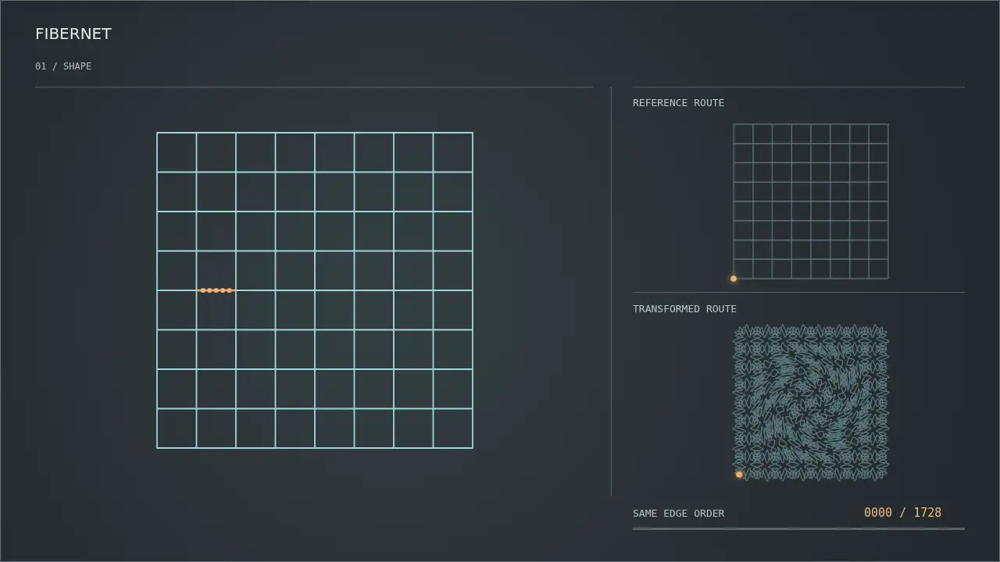
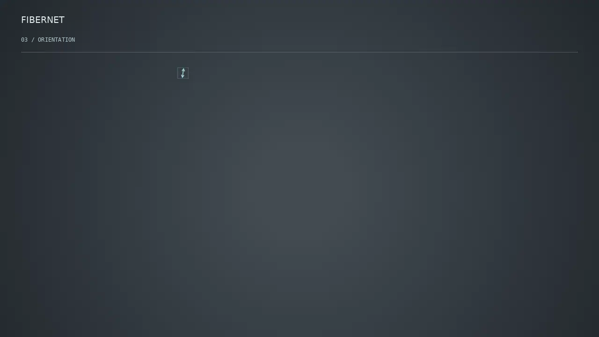
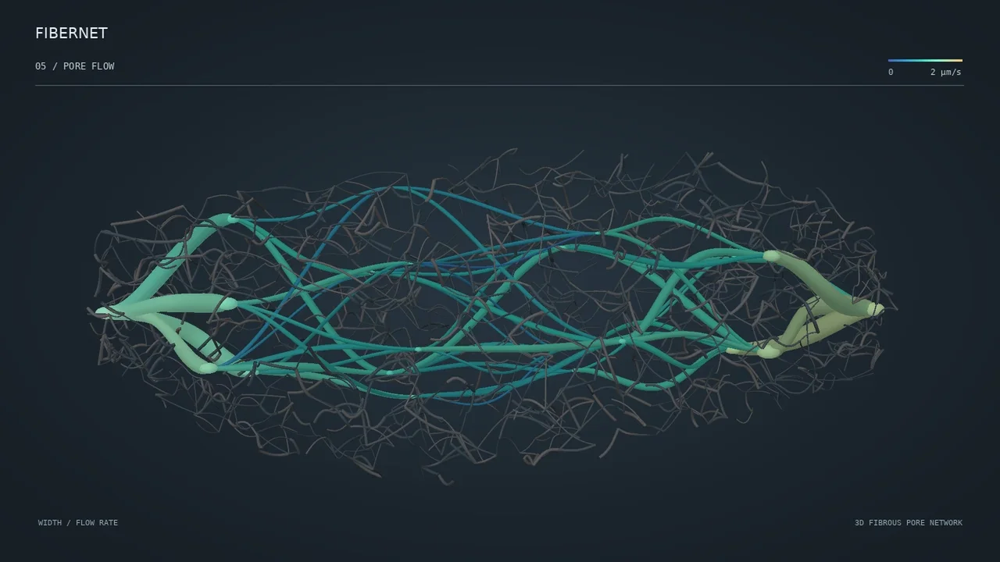

# FiberNet

A Python library for generating fiber networks and studying how their architecture affects deformation and transport. Reuse the same network for analysis, learning, and fabrication planning.

[Quick start](#quick-start) · [Examples](examples/README.md) · [Animations](#animations) · [中文](#fibernet-zh)

<a name="animations"></a>

<table>
<tr><td align="center">

</td></tr>
</table>

**Same network, new shape.** Five control points change each fiber's geometry while the two closed routes visit the same 1,728 edge segments in the same order.

### Mechanics in motion


**A tear opens under tension.** A notched woven network stretches as the grips separate. The demo replays a reduced spring-network calculation. [See the visual notes](docs/MEDIA_GALLERY.md#tensile-fracture-of-a-notched-weave) · [More animations](docs/MEDIA_GALLERY.md).


### From orientation to fibers



**Start with a plane of fiber orientations.** Lift the matrix into a layered 3D orientation field and trace fibers through it. [See the visual notes](docs/MEDIA_GALLERY.md#from-orientation-field-to-fibers).

### From leaf veins to a graph neural network


**Turn part of a leaf into a graph.** Extract junctions and veins, encode the connections in an adjacency matrix, and show messages passing between neighbors on the same graph. [Visual notes and photo credit](docs/MEDIA_GALLERY.md#from-leaf-venation-to-a-graph-neural-network).

### Flow through a 3D fiber network



**Follow a tracer pulse through shifting pores.** Its paths split and rejoin across successive pore shapes. [See the visual notes](docs/MEDIA_GALLERY.md#flow-through-a-3d-fiber-network).

<a name="fibernet-zh"></a>

<details>
<summary>中文</summary>

<!-- locale:zh:start -->
## 快速开始

用 Python 3.9 或更高版本，从 [PyPI](https://pypi.org/project/fibernet/) 安装。内置算例会生成一个网络，计算小变形响应，并把结构、图和结果存到 `fibernet_demo/`。

```bash
python -m pip install fibernet
python -m fibernet.examples.basic_usage --output-dir fibernet_demo
```

## 接下来可以做什么

- **建立与加载网络：**生成[二维或三维网络](docs/METHODS_3D_GENERATION_PARAMETERS.md)，在[三维实体网格](docs/TET4_STATIC.md)上计算小变形响应。
- **看受力后电阻怎么变：**[360 杆网络](docs/DEFORMED_TRANSPORT_PREPARATION.md)和[含熔合节点的三通路实体网络](examples/README.md#predicting-strain-induced-resistance-in-a-fused-solid-lattice)都在变形后的几何上重算电阻。孔隙流动可从[变形前后流量对比](examples/README.md#how-solid-deformation-changes-pore-flow)入手。
- **继续分析、学习或制造：**用同一个 `StructureGraph` [训练模型](examples/physical_learning_workflow.py)，或生成[闭合路径](docs/MANUFACTURING_GRAPH_MAPPING.md)和[多段路径](docs/MULTISTROKE_MANUFACTURING.md)。

[动图画廊与说明](docs/MEDIA_GALLERY.md)。

用 AI 客户端做拓扑分析，可从 [本地 MCP 快速上手](adapters/mcp/README.md) 开始（Linux，需配套安装）。

<details>
<summary>从源码运行仓库算例</summary>

**开发版源码：4.41.0**

```bash
git clone https://github.com/GellmanSparrowS/fibernet.git
cd fibernet
python -m pip install -e .
python -m examples.open_source_workflow --output-dir demo_output
```

[更多算例与可选依赖](examples/README.md) · [流程索引](docs/api/WORKFLOW_MAP.md) · [接口与求解器](docs/API_LAYERS.md)

</details>

[FiberScope 桌面应用](FiberScope/README.md) · [更新记录](CHANGELOG.md) · [参与贡献](.github/CONTRIBUTING.md) · [MIT 许可证](LICENSE)
<!-- locale:zh:end -->

</details>

<details open>
<summary>English</summary>

<!-- locale:en:start -->
## Quick start

Install from [PyPI](https://pypi.org/project/fibernet/) with Python 3.9 or newer. The built-in example generates a network, computes its small-deformation response, and saves the structure, a figure, and results in `fibernet_demo/`.

```bash
python -m pip install fibernet
python -m fibernet.examples.basic_usage --output-dir fibernet_demo
```

## Choose a workflow

- **Build and load a network:** generate a [2D or 3D network](docs/METHODS_3D_GENERATION_PARAMETERS.md), or compute small-deformation response on a [3D solid mesh](docs/TET4_STATIC.md).
- **See how loading changes resistance:** recompute resistance on the deformed geometry of a [360-member network](docs/DEFORMED_TRANSPORT_PREPARATION.md) or a [three-path solid network with fused joints](examples/README.md#predicting-strain-induced-resistance-in-a-fused-solid-lattice). For fluids, [compare flow before and after deformation](examples/README.md#how-solid-deformation-changes-pore-flow).
- **Reuse the network:** use the same `StructureGraph` to [train models](examples/physical_learning_workflow.py) or plan [closed](docs/MANUFACTURING_GRAPH_MAPPING.md) and [multi-stroke routes](docs/MULTISTROKE_MANUFACTURING.md).

[Animation gallery and visual notes](docs/MEDIA_GALLERY.md).

For topology analysis from an AI client, start with the [local MCP quickstart](adapters/mcp/README.md) (Linux, matching source installs required).

<details>
<summary>Run repository examples from source</summary>

**Development checkout: 4.41.0**

```bash
git clone https://github.com/GellmanSparrowS/fibernet.git
cd fibernet
python -m pip install -e .
python -m examples.open_source_workflow --output-dir demo_output
```

[More examples and optional dependencies](examples/README.md) · [Workflow map](docs/api/WORKFLOW_MAP.md) · [API layers and solvers](docs/API_LAYERS.md)

</details>

[FiberScope desktop app](FiberScope/README.md) · [Changelog](CHANGELOG.md) · [Contributing](.github/CONTRIBUTING.md) · [MIT license](LICENSE)
<!-- locale:en:end -->

</details>
