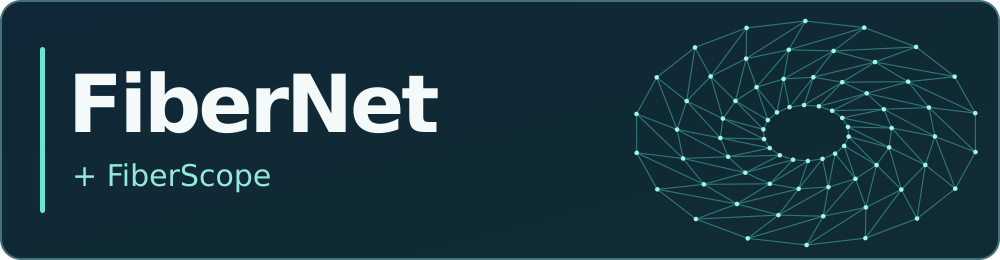

<table>
<tr><td align="center">

<a href="#quick-start"></a>
</td></tr>
</table>

<details>
<summary>中文</summary>

<!-- locale:zh:start -->
[快速开始](#快速开始) · [生成](#1-生成网络) → [模拟](#2-模拟响应) → [分析与学习](#3-分析与学习) → [设计与导出](#4-设计与导出) · [功能索引](#选择研究流程)

FiberNet 提供纤维网络建模的 Python 工具，FiberScope 提供桌面界面。

## 快速开始

### 安装 Python 库

**已发布版本：4.2.0**

```bash
python -m pip install fibernet==4.2.0
```

**开发版源码：4.3.0**

```bash
git clone https://github.com/GellmanSparrowS/fibernet.git
cd fibernet
python -m pip install -e .
```

需要 Python 3.9 及以上版本。可选依赖包括 `.[ml]` 和 `.[manufacturing]`。

### 开发版源码示例：生成、模拟、保存

以下示例需要上方通过 `python -m pip install -e .` 安装的开发版源码。已发布的 PyPI 4.2.0 不支持这里的 `stretch_ratio` 参数。

```python
import fibernet as fn

# SI units: coordinates and radius in m; E in Pa; forces in N.
graph = fn.pattern_2d(
    unit="honeycomb", box=(10, 10), grid=(2, 2), radius=0.05, seed=23
)
fn.show(graph, save_path="network.png")

result = fn.simulate(
    graph, backend="fem", mode="stretch", stretch_ratio=1.01,
    nonlinear=False, E=1e9, nu=0.3,
)
result.save("fem_result.json", detailed=True)
print(graph.num_nodes, graph.num_edges, result.max_displacement)
```

`stretch_ratio=1.01` 指 1% 伸长；`nonlinear=False` 明确选择小变形线性梁 FEM。坐标和半径按米解释，`E=1e9` Pa，`nu=0.3` 无量纲，输出位移为米、力为牛顿；程序不自动换算单位，也不从图的材料记录读取模量。省略拉伸比仍使用兼容默认值 2.0，二维会进入未验证最终平衡的实验增量路径，不适合作为线性入门调用。[FEM 接口约定](docs/METHODS_BEAM_FEM_CONTRACT.md)

在源码目录运行完整流程：

```bash
python -m examples.open_source_workflow --output-dir demo_output
```

[示例与输出](examples/open_source_workflow.py)

## 1. 生成网络


[几何示例与参数](docs/MEDIA_GALLERY.md#three-dimensional-topology) · [制造几何](docs/METHODS_MANUFACTURING_UNIFIED.md)

## 2. 模拟响应


简化模型中的拉伸与边招募。[模型与轨迹](docs/HOMEPAGE_OVERVIEW_MEDIA.md#tensile-recruitment) · [LAMMPS / Taichi 示例](docs/media/new/backends/README.md) · [黏弹性、断裂与热过程](docs/media/new/README.md)

## 3. 分析与学习


GINE 电导学习，按母体划分训练与评估数据。[研究与结果](docs/media/new/learning/README.md) · [图训练接口约定](docs/GRAPH_TRAINING_CONTRACT.md) · [方向与阈值分析](docs/RECRUITMENT_SENSITIVITY_2026-09-24.md)

## 4. 设计与导出


将已有 `StructureGraph` 导出为闭合路径或多段路径，保留毫米坐标 CSV 与稳定 ID 映射 JSON。[闭合路径约束](docs/MANUFACTURING_GRAPH_MAPPING.md#geometry-and-ownership) · [多段路径约束](docs/MULTISTROKE_MANUFACTURING.md#scope-and-input-validation)

[目标曲线设计](examples/curve_inverse_workflow.py) · [保路径结构干预](docs/HOMEPAGE_OVERVIEW_MEDIA.md#static-interventions) · [跨模型研究结果](docs/INDEPENDENT_FEM_CYCLE_INTERVENTION_2026-09-24.md)

## 选择研究流程

| 研究目标 | Python 入口 | 指南或可执行示例 |
| --- | --- | --- |
| 生成二维、三维结构 | `pattern_2d`、`pattern_3d`、`StructureGraph` | [参数化生成](fibernet/gen/pattern.py) |
| 研究变形与力学响应 | 显式 FEM 或 Taichi 路径；共享简化模型使用 `ReducedBeamSolver` | [接口层次、单位与模型选择](docs/API_LAYERS.md) |
| 量化结构与招募行为 | `SnapshotFeatureExtractor`、`analyze_tensile_recruitment` | [快照特征](examples/snapshot_features_workflow.py) · [招募分析](examples/tensile_recruitment_quickstart.py) |
| 沿用当前 `StructureGraph` 导出路径 | `manufacturing_from_graph` → `export_mapped_route`；`manufacturing_trails_from_graph` → `export_mapped_trails` | [闭合路径与稳定 ID](docs/MANUFACTURING_GRAPH_MAPPING.md) · [多段路径与适用范围](docs/MULTISTROKE_MANUFACTURING.md) |
| 构建复用基元与连续路径 | `CustomCellRegistry`、`compile_planar`、`compile_surface` | [自定义基元方法](docs/METHODS_CUSTOM_CELL_UNIFIED.md) · [制造几何](docs/METHODS_MANUFACTURING_UNIFIED.md) |
| 从模拟响应中学习 | `PlanarPhysicalDataset`、`light_features`、`PhysicalRegressor` | [可续算标签生成](examples/physical_dataset_workflow.py) · [代理模型学习](examples/physical_learning_workflow.py) |
| 搜索目标响应结构 | `CurveInverseDesigner`；可选 `fibernet.rl` 工具 | [目标曲线搜索](examples/curve_inverse_workflow.py) · [学习与搜索方法](docs/METHODS_CURVE_INVERSE_UNIFIED.md) |

更多接口：[时变力学](docs/DYNAMIC_AXIAL_VISCOELASTICITY.md) · [传输与热过程](docs/ONE_WAY_JOULE_HEATING.md) · [LAMMPS 集成](docs/integrations/LAMMPS_HARMONIC_CLI.md) · [断裂](docs/FRACTURE_METHODS.md) · [GINE 适配器](docs/integrations/EDGE_GINE.md)

## 桌面应用

下载 [FiberScope 3.1.0 Windows x64 版](https://github.com/GellmanSparrowS/fibernet/releases/tag/v4.2.0)，完整解压 ZIP 后运行 `FiberScope.exe`，所需运行时已包含在内。


[桌面使用指南](FiberScope/README.md) · [界面与图表来源](docs/HOMEPAGE_OVERVIEW_MEDIA.md) · [中英文截图](FiberScope/docs/screenshots/README.md) · [可选训练配置](docs/INTEGRATION_REPO_MAP.md)

## 方法与复现

[模型范围](docs/HOMEPAGE_EXAMPLE_SCOPE.md) · [完整动图、源数据与渲染器](docs/MEDIA_GALLERY.md) · [示例参数](docs/HOMEPAGE_EXAMPLE_NOTES.md) · [Taichi 1.7.4 生命周期](docs/architecture/taichi-lifecycle-audit.md) · [示例索引](examples/README.md) · [版本记录](CHANGELOG.md)

## 许可与引用

[MIT 许可证](LICENSE) · [第三方声明](FiberScope/THIRD_PARTY_NOTICES.md) · [Nature Communications 论文](https://www.nature.com/articles/s41467-026-76045-x)
<!-- locale:zh:end -->

</details>

<details open>
<summary>English</summary>

<!-- locale:en:start -->
[Quick start](#quick-start) · [Generate](#1-generate-networks) → [Simulate](#2-simulate-response) → [Analyze / Learn](#3-analyze-and-learn) → [Design / Export](#4-design-and-export) · [API index](#choose-a-workflow)

FiberNet is a Python library for fiber-network modeling. FiberScope provides a desktop interface.

## Quick start

### Install the Python library

**Published release: 4.2.0**

```bash
python -m pip install fibernet==4.2.0
```

**Development checkout: 4.3.0**

```bash
git clone https://github.com/GellmanSparrowS/fibernet.git
cd fibernet
python -m pip install -e .
```

Python 3.9+. Optional extras include `.[ml]` and `.[manufacturing]`.

### Development-checkout example: generate, simulate, and save

Use the development checkout installed with `python -m pip install -e .` above for this example. The published PyPI 4.2.0 API does not accept the `stretch_ratio` keyword.

```python
import fibernet as fn

# SI units: coordinates and radius in m; E in Pa; forces in N.
graph = fn.pattern_2d(
    unit="honeycomb", box=(10, 10), grid=(2, 2), radius=0.05, seed=23
)
fn.show(graph, save_path="network.png")

result = fn.simulate(
    graph, backend="fem", mode="stretch", stretch_ratio=1.01,
    nonlinear=False, E=1e9, nu=0.3,
)
result.save("fem_result.json", detailed=True)
print(graph.num_nodes, graph.num_edges, result.max_displacement)
```

`stretch_ratio=1.01` means 1% extension; `nonlinear=False` explicitly selects small-deformation linear beam FEM. Coordinates and radii are in m, `E=1e9` is in Pa, and `nu=0.3` is dimensionless; displacements are in m and forces in N. Units are not converted automatically, and graph material records do not supply the modulus. Omitting the ratio retains the legacy default 2.0, which selects an experimental 2-D incremental path with unverified final equilibrium, not the linear introductory example. [FEM contract](docs/METHODS_BEAM_FEM_CONTRACT.md)

Complete workflow, from the checkout:

```bash
python -m examples.open_source_workflow --output-dir demo_output
```

[Example and outputs](examples/open_source_workflow.py)

## 1. Generate networks


[Geometry examples and parameters](docs/MEDIA_GALLERY.md#three-dimensional-topology) · [Manufacturing geometry](docs/METHODS_MANUFACTURING_UNIFIED.md)

## 2. Simulate response


Reduced-model stretching and edge recruitment. [Model and trajectory](docs/HOMEPAGE_OVERVIEW_MEDIA.md#tensile-recruitment) · [LAMMPS / Taichi examples](docs/media/new/backends/README.md) · [Viscoelasticity, fracture and heating](docs/media/new/README.md)

## 3. Analyze and learn


GINE conductance learning, with parent-separated evaluation. [Study and results](docs/media/new/learning/README.md) · [Graph training contract](docs/GRAPH_TRAINING_CONTRACT.md) · [Directional and threshold analysis](docs/RECRUITMENT_SENSITIVITY_2026-09-24.md)

## 4. Design and export


Export an existing `StructureGraph` as a closed route or multiple strokes, with mm-coordinate CSV and stable-ID mapping JSON. [Closed-route constraints](docs/MANUFACTURING_GRAPH_MAPPING.md#geometry-and-ownership) · [Multi-stroke constraints](docs/MULTISTROKE_MANUFACTURING.md#scope-and-input-validation)

[Target-curve design](examples/curve_inverse_workflow.py) · [Route-preserving interventions](docs/HOMEPAGE_OVERVIEW_MEDIA.md#static-interventions) · [Cross-model findings](docs/INDEPENDENT_FEM_CYCLE_INTERVENTION_2026-09-24.md)

## Choose a workflow

| Your goal | Python entry point | Guide or runnable example |
| --- | --- | --- |
| Generate 2D/3D structures | `pattern_2d`, `pattern_3d`, `StructureGraph` | [Pattern generation](fibernet/gen/pattern.py) |
| Study deformation and mechanics | Explicit FEM or Taichi route; `ReducedBeamSolver` for the shared reduced model | [API layers, units, and model selection](docs/API_LAYERS.md) |
| Quantify structure and recruitment | `SnapshotFeatureExtractor`, `analyze_tensile_recruitment` | [Snapshot features](examples/snapshot_features_workflow.py) · [Recruitment](examples/tensile_recruitment_quickstart.py) |
| Export routes from the current `StructureGraph` | `manufacturing_from_graph` → `export_mapped_route`; `manufacturing_trails_from_graph` → `export_mapped_trails` | [Closed routes and stable IDs](docs/MANUFACTURING_GRAPH_MAPPING.md) · [Multi-stroke routes and limits](docs/MULTISTROKE_MANUFACTURING.md) |
| Build reusable cells and continuous routes | `CustomCellRegistry`, `compile_planar`, `compile_surface` | [Custom-cell methods](docs/METHODS_CUSTOM_CELL_UNIFIED.md) · [Manufacturing](docs/METHODS_MANUFACTURING_UNIFIED.md) |
| Learn from simulated responses | `PlanarPhysicalDataset`, `light_features`, `PhysicalRegressor` | [Resumable labels](examples/physical_dataset_workflow.py) · [Surrogate learning](examples/physical_learning_workflow.py) |
| Search for a target response | `CurveInverseDesigner`; optional `fibernet.rl` tools | [Target-curve search](examples/curve_inverse_workflow.py) · [Learning and search methods](docs/METHODS_CURVE_INVERSE_UNIFIED.md) |

More: [time-dependent mechanics](docs/DYNAMIC_AXIAL_VISCOELASTICITY.md) · [transport and heating](docs/ONE_WAY_JOULE_HEATING.md) · [LAMMPS integration](docs/integrations/LAMMPS_HARMONIC_CLI.md) · [fracture](docs/FRACTURE_METHODS.md) · [GINE adapters](docs/integrations/EDGE_GINE.md)

## Desktop application

Download [FiberScope 3.1.0 for Windows x64](https://github.com/GellmanSparrowS/fibernet/releases/tag/v4.2.0), extract the complete ZIP, and run `FiberScope.exe`. Its runtime is included.


[Desktop guide](FiberScope/README.md) · [Interface and figure sources](docs/HOMEPAGE_OVERVIEW_MEDIA.md) · [English / Chinese screenshots](FiberScope/docs/screenshots/README.md) · [Optional training setup](docs/INTEGRATION_REPO_MAP.md)

## Methods and reproducibility

[Model scopes](docs/HOMEPAGE_EXAMPLE_SCOPE.md) · [All animations, source data and renderers](docs/MEDIA_GALLERY.md) · [Example parameters](docs/HOMEPAGE_EXAMPLE_NOTES.md) · [Taichi 1.7.4 lifecycle](docs/architecture/taichi-lifecycle-audit.md) · [Examples index](examples/README.md) · [Release history](CHANGELOG.md)

## License and attribution

[MIT license](LICENSE) · [Third-party notices](FiberScope/THIRD_PARTY_NOTICES.md) · [Nature Communications paper](https://www.nature.com/articles/s41467-026-76045-x)
<!-- locale:en:end -->

</details>

### RL compatibility

The root `fibernet.train_rl` is a historical random-rollout wrapper, not a policy
trainer. Its built-in E*/ν* environment is unavailable and now rejects calls
before simulation instead of reporting failed evaluations as rewards. The
separate `fibernet.rl.train_rl` policy trainer still accepts caller-managed
environments. See [RL entry points and compatibility](docs/RL_COMPATIBILITY.md).
