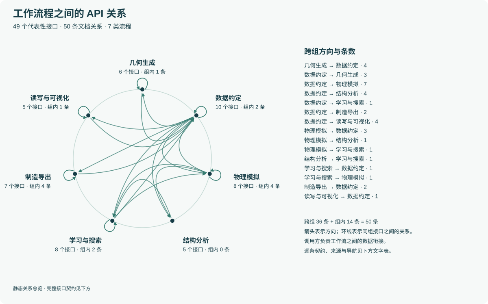
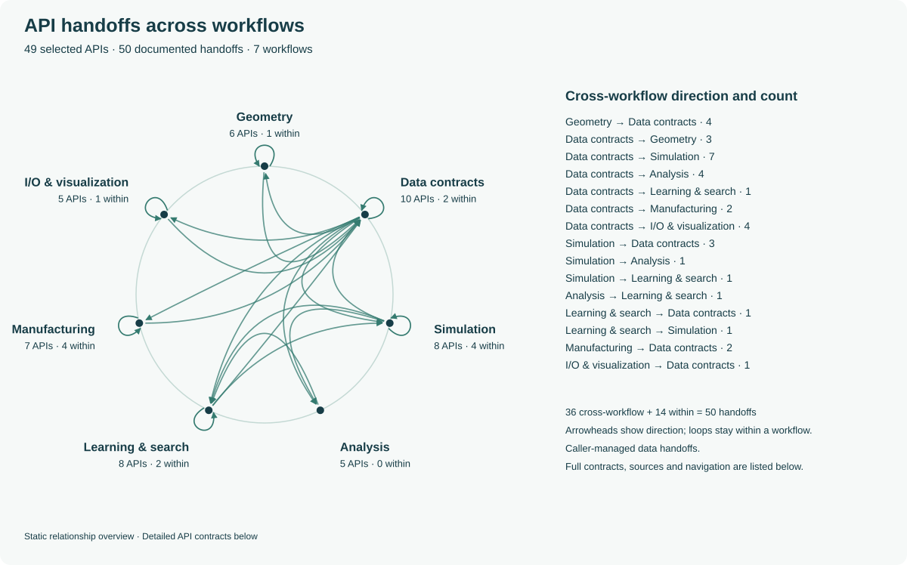

<table>
<tr><td align="center">

<a href="#quick-start"></a>
</td></tr>
</table>

[Feature availability and checked dataset selections](docs/FEATURE_AVAILABILITY.md)

<details>
<summary>中文</summary>

<!-- locale:zh:start --><!-- api-navigation:zh:start -->

## API 关系导航

按 7 类工作流程浏览 49 个代表性接口。展开条目可查看准确命名空间、输入输出及数据传递关系；模块清单见 [`code_registry.json`](code_registry.json)。



上图是静态有向弦图，不提供图内点击，也不是运行时调用图。下方原生折叠条目提供接口说明和关系链接。

<details>
<summary>完整数据传递表 · 50 条</summary>

每行均为有向 dataflow 关系，由调用方完成衔接；不是自动转换或运行时调用记录。来源列链接到两端接口的源码，不能替代逐条契约。

| 来源接口 | 目标接口 | 数据传递契约 | 源码参考 |
| --- | --- | --- | --- |
| [`fibernet.octet_fcc_v1`](#user-content-api-zh-octet) | [`fibernet.StructureGraph`](#user-content-api-zh-graph) | 生成版本化几何 | [来源][api-zh-src-octet] / [目标][api-zh-src-graph] |
| [`fibernet.pattern_2d`](#user-content-api-zh-pattern_2d) | [`fibernet.StructureGraph`](#user-content-api-zh-graph) | 生成二维图 | [来源][api-zh-src-pattern_2d] / [目标][api-zh-src-graph] |
| [`fibernet.pattern_3d`](#user-content-api-zh-pattern_3d) | [`fibernet.StructureGraph`](#user-content-api-zh-graph) | 生成三维图 | [来源][api-zh-src-pattern_3d] / [目标][api-zh-src-graph] |
| [`fibernet.register_unit`](#user-content-api-zh-register_unit) | [`fibernet.pattern_2d`](#user-content-api-zh-pattern_2d) | 注册基元工厂 | [来源][api-zh-src-register_unit] / [目标][api-zh-src-pattern_2d] |
| [`fibernet.tile_2d`](#user-content-api-zh-tile) | [`fibernet.StructureGraph`](#user-content-api-zh-graph) | 平铺后的图 | [来源][api-zh-src-tile] / [目标][api-zh-src-graph] |
| [`fibernet.sim.prepare_nodal_controls`](#user-content-api-zh-controls) | [`fibernet.sim.PreparedNodalControls`](#user-content-api-zh-prepared_controls) | 返回已准备的控制 | [来源][api-zh-src-controls] / [目标][api-zh-src-prepared_controls] |
| [`fibernet.StructureGraph`](#user-content-api-zh-graph) | [`fibernet.sim.prepare_nodal_controls`](#user-content-api-zh-controls) | 绑定支座与载荷 ID | [来源][api-zh-src-graph] / [目标][api-zh-src-controls] |
| [`fibernet.StructureGraph`](#user-content-api-zh-graph) | [`fibernet.render_deformation`](#user-content-api-zh-deformation) | 原图与调用方提供的变形图 | [来源][api-zh-src-graph] / [目标][api-zh-src-deformation] |
| [`fibernet.StructureGraph`](#user-content-api-zh-graph) | [`fibernet.GraphFeatureExtractor`](#user-content-api-zh-features94) | 受支持的特征输入 | [来源][api-zh-src-graph] / [目标][api-zh-src-features94] |
| [`fibernet.StructureGraph`](#user-content-api-zh-graph) | [`fibernet.ml.graph_batch`](#user-content-api-zh-graph_batch) | 创建主结构图快照 | [来源][api-zh-src-graph] / [目标][api-zh-src-graph_batch] |
| [`fibernet.StructureGraph`](#user-content-api-zh-graph) | [`fibernet.integrations.lammps_backend.prepare_harmonic_beads`](#user-content-api-zh-lammps_prepare) | 明确的三维几何 | [来源][api-zh-src-graph] / [目标][api-zh-src-lammps_prepare] |
| [`fibernet.StructureGraph`](#user-content-api-zh-graph) | [`fibernet.StructureGraph.to_networkx_lossless`](#user-content-api-zh-networkx) | 携带原生记录的 MultiGraph 视图 | [来源][api-zh-src-graph] / [目标][api-zh-src-networkx] |
| [`fibernet.StructureGraph`](#user-content-api-zh-graph) | [`fibernet.analysis.analyze_geometry_paths`](#user-content-api-zh-paths) | 已保存的 XYZ 几何 | [来源][api-zh-src-graph] / [目标][api-zh-src-paths] |
| [`fibernet.StructureGraph`](#user-content-api-zh-graph) | [`fibernet.ReducedBeamSolver`](#user-content-api-zh-reduced) | 同一 XY 平面；拒绝非空 internal_points；调用方需先准备实际图节点与直边 | [来源][api-zh-src-graph] / [目标][api-zh-src-reduced] |
| [`fibernet.StructureGraph`](#user-content-api-zh-graph) | [`fibernet.manufacturing_from_graph`](#user-content-api-zh-route_from_graph) | 连通全偶度图 | [来源][api-zh-src-graph] / [目标][api-zh-src-route_from_graph] |
| [`fibernet.StructureGraph`](#user-content-api-zh-graph) | [`fibernet.StructureGraph.save_json`](#user-content-api-zh-save_graph) | 原生图序列化 | [来源][api-zh-src-graph] / [目标][api-zh-src-save_graph] |
| [`fibernet.StructureGraph`](#user-content-api-zh-graph) | [`fibernet.show`](#user-content-api-zh-show) | 图声明的维度 | [来源][api-zh-src-graph] / [目标][api-zh-src-show] |
| [`fibernet.StructureGraph`](#user-content-api-zh-graph) | [`fibernet.simulate`](#user-content-api-zh-simulate) | 几何输入；spring/taichi 默认采用 reject_internal_points；显式 endpoint_chord 只计算端点弦 | [来源][api-zh-src-graph] / [目标][api-zh-src-simulate] |
| [`fibernet.StructureGraph`](#user-content-api-zh-graph) | [`fibernet.analysis.SnapshotFeatureExtractor`](#user-content-api-zh-snapshot) | extract_graph(graph) | [来源][api-zh-src-graph] / [目标][api-zh-src-snapshot] |
| [`fibernet.StructureGraph`](#user-content-api-zh-graph) | [`fibernet.tile_2d`](#user-content-api-zh-tile) | 基元图输入 | [来源][api-zh-src-graph] / [目标][api-zh-src-tile] |
| [`fibernet.StructureGraph`](#user-content-api-zh-graph) | [`fibernet.analysis.analyze_topology`](#user-content-api-zh-topology) | 物理拓扑 | [来源][api-zh-src-graph] / [目标][api-zh-src-topology] |
| [`fibernet.StructureGraph`](#user-content-api-zh-graph) | [`fibernet.manufacturing_trails_from_graph`](#user-content-api-zh-trails_from_graph) | 允许奇度节点的连通图 | [来源][api-zh-src-graph] / [目标][api-zh-src-trails_from_graph] |
| [`fibernet.StructureGraph`](#user-content-api-zh-graph) | [`fibernet.solve_linear_transport`](#user-content-api-zh-transport) | 几何与稳定 ID | [来源][api-zh-src-graph] / [目标][api-zh-src-transport] |
| [`fibernet.Material`](#user-content-api-zh-material) | [`fibernet.pattern_2d`](#user-content-api-zh-pattern_2d) | 显式材料参数 | [来源][api-zh-src-material] / [目标][api-zh-src-pattern_2d] |
| [`fibernet.Material`](#user-content-api-zh-material) | [`fibernet.pattern_3d`](#user-content-api-zh-pattern_3d) | 显式材料参数 | [来源][api-zh-src-material] / [目标][api-zh-src-pattern_3d] |
| [`fibernet.sim.PreparedNodalControls`](#user-content-api-zh-prepared_controls) | [`fibernet.ml.BeamFrameFEM`](#user-content-api-zh-fem) | 通过 fem_kwargs(graph) 传入原始求解 | [来源][api-zh-src-prepared_controls] / [目标][api-zh-src-fem] |
| [`fibernet.sim.PreparedNodalControls`](#user-content-api-zh-prepared_controls) | [`fibernet.TaichiEngine`](#user-content-api-zh-taichi) | taichi_kwargs(graph) | [来源][api-zh-src-prepared_controls] / [目标][api-zh-src-taichi] |
| [`fibernet.LinearViscoelasticMaterial`](#user-content-api-zh-visco_material) | [`fibernet.ml.BeamFrameFEM`](#user-content-api-zh-fem) | history(material=...) | [来源][api-zh-src-visco_material] / [目标][api-zh-src-fem] |
| [`fibernet.ml.BeamFrameFEM`](#user-content-api-zh-fem) | [`fibernet.SimResult`](#user-content-api-zh-sim_result) | 通过 to_sim_result(...) 转换 | [来源][api-zh-src-fem] / [目标][api-zh-src-sim_result] |
| [`fibernet.integrations.lammps_backend.prepare_harmonic_beads`](#user-content-api-zh-lammps_prepare) | [`fibernet.integrations.lammps_backend.LAMMPSTask`](#user-content-api-zh-lammps_task) | PreparedRun | [来源][api-zh-src-lammps_prepare] / [目标][api-zh-src-lammps_task] |
| [`fibernet.ReducedBeamSolver`](#user-content-api-zh-reduced) | [`fibernet.ml.PlanarPhysicalDataset`](#user-content-api-zh-physical_dataset) | 所配置的物理标签 | [来源][api-zh-src-reduced] / [目标][api-zh-src-physical_dataset] |
| [`fibernet.ReducedBeamSolver`](#user-content-api-zh-reduced) | [`fibernet.analysis.analyze_tensile_recruitment`](#user-content-api-zh-recruitment) | 提取对齐的应变、边与夹持数组 | [来源][api-zh-src-reduced] / [目标][api-zh-src-recruitment] |
| [`fibernet.simulate`](#user-content-api-zh-simulate) | [`fibernet.ml.BeamFrameFEM`](#user-content-api-zh-fem) | fem 路径 | [来源][api-zh-src-simulate] / [目标][api-zh-src-fem] |
| [`fibernet.simulate`](#user-content-api-zh-simulate) | [`fibernet.SimResult`](#user-content-api-zh-sim_result) | 受支持的力学结果 | [来源][api-zh-src-simulate] / [目标][api-zh-src-sim_result] |
| [`fibernet.simulate`](#user-content-api-zh-simulate) | [`fibernet.TaichiEngine`](#user-content-api-zh-taichi) | spring/taichi 路径 | [来源][api-zh-src-simulate] / [目标][api-zh-src-taichi] |
| [`fibernet.TaichiEngine`](#user-content-api-zh-taichi) | [`fibernet.SimResult`](#user-content-api-zh-sim_result) | 弹簧结果 | [来源][api-zh-src-taichi] / [目标][api-zh-src-sim_result] |
| [`fibernet.solve_linear_transport`](#user-content-api-zh-transport) | [`fibernet.run_joule_heating`](#user-content-api-zh-joule) | 以电结果构造热源 | [来源][api-zh-src-transport] / [目标][api-zh-src-joule] |
| [`fibernet.GraphFeatureExtractor`](#user-content-api-zh-features94) | [`fibernet.ml.FiberNetDataset`](#user-content-api-zh-dataset) | 将特征值与 feature_contract 元数据封装为 DatasetSample 记录 | [来源][api-zh-src-features94] / [目标][api-zh-src-dataset] |
| [`fibernet.ml.CurveInverseDesigner`](#user-content-api-zh-curve_inverse) | [`fibernet.ReducedBeamSolver`](#user-content-api-zh-reduced) | 默认候选评估器 | [来源][api-zh-src-curve_inverse] / [目标][api-zh-src-reduced] |
| [`fibernet.ml.graph_batch`](#user-content-api-zh-graph_batch) | [`fibernet.ml.GraphBatch`](#user-content-api-zh-graph_batch_type) | 返回 GraphBatch | [来源][api-zh-src-graph_batch] / [目标][api-zh-src-graph_batch_type] |
| [`fibernet.ml.light_features`](#user-content-api-zh-light_features) | [`fibernet.ml.PhysicalRegressor`](#user-content-api-zh-regressor) | 将 14 维向量逐行组成 X，并提供对应的 Y 标签 | [来源][api-zh-src-light_features] / [目标][api-zh-src-regressor] |
| [`fibernet.ml.PlanarPhysicalDataset`](#user-content-api-zh-physical_dataset) | [`fibernet.ml.PhysicalRegressor`](#user-content-api-zh-regressor) | arrays()：X 与 Y | [来源][api-zh-src-physical_dataset] / [目标][api-zh-src-regressor] |
| [`fibernet.PlanarManufacturingConfig`](#user-content-api-zh-manufacturing_config) | [`fibernet.compile_planar`](#user-content-api-zh-compile_planar) | 配置或工厂 | [来源][api-zh-src-manufacturing_config] / [目标][api-zh-src-compile_planar] |
| [`fibernet.PlanarManufacturingConfig`](#user-content-api-zh-manufacturing_config) | [`fibernet.compile_surface`](#user-content-api-zh-compile_surface) | 配置或工厂 | [来源][api-zh-src-manufacturing_config] / [目标][api-zh-src-compile_surface] |
| [`fibernet.manufacturing_from_graph`](#user-content-api-zh-route_from_graph) | [`fibernet.export_mapped_route`](#user-content-api-zh-export_route) | network 与绑定快照 | [来源][api-zh-src-route_from_graph] / [目标][api-zh-src-export_route] |
| [`fibernet.manufacturing_from_graph`](#user-content-api-zh-route_from_graph) | [`fibernet.ml.GraphBatch`](#user-content-api-zh-graph_batch_type) | 返回来源快照 | [来源][api-zh-src-route_from_graph] / [目标][api-zh-src-graph_batch_type] |
| [`fibernet.manufacturing_trails_from_graph`](#user-content-api-zh-trails_from_graph) | [`fibernet.export_mapped_trails`](#user-content-api-zh-export_trails) | trails 与绑定快照 | [来源][api-zh-src-trails_from_graph] / [目标][api-zh-src-export_trails] |
| [`fibernet.manufacturing_trails_from_graph`](#user-content-api-zh-trails_from_graph) | [`fibernet.ml.GraphBatch`](#user-content-api-zh-graph_batch_type) | 返回来源快照 | [来源][api-zh-src-trails_from_graph] / [目标][api-zh-src-graph_batch_type] |
| [`fibernet.StructureGraph.load_json`](#user-content-api-zh-load_graph) | [`fibernet.StructureGraph`](#user-content-api-zh-graph) | 重建的结构图 | [来源][api-zh-src-load_graph] / [目标][api-zh-src-graph] |
| [`fibernet.StructureGraph.save_json`](#user-content-api-zh-save_graph) | [`fibernet.StructureGraph.load_json`](#user-content-api-zh-load_graph) | 配套原生 JSON 文件 | [来源][api-zh-src-save_graph] / [目标][api-zh-src-load_graph] |

**记录归属（containment，非数据传递）：**
- [`fibernet.StructureGraph`](#user-content-api-zh-graph) → [`fibernet.SNode`](#user-content-api-zh-snode) — 拥有节点记录
- [`fibernet.StructureGraph`](#user-content-api-zh-graph) → [`fibernet.SEdge`](#user-content-api-zh-sedge) — 拥有物理边记录

另有 49 条接口与流程分组的归属关系，见下方分支；分组不表示类继承。

[api-zh-src-compile_planar]: https://github.com/GellmanSparrowS/fibernet/blob/d8148d0cebc0b337c310479c2756afb9de578a08/fibernet/gen/manufacturing.py#L291
[api-zh-src-compile_surface]: https://github.com/GellmanSparrowS/fibernet/blob/d8148d0cebc0b337c310479c2756afb9de578a08/fibernet/gen/manufacturing.py#L400
[api-zh-src-controls]: https://github.com/GellmanSparrowS/fibernet/blob/d8148d0cebc0b337c310479c2756afb9de578a08/fibernet/sim/nodal_controls.py#L74
[api-zh-src-curve_inverse]: https://github.com/GellmanSparrowS/fibernet/blob/d8148d0cebc0b337c310479c2756afb9de578a08/fibernet/ml/curve_inverse.py#L248
[api-zh-src-dataset]: https://github.com/GellmanSparrowS/fibernet/blob/d8148d0cebc0b337c310479c2756afb9de578a08/fibernet/ml/dataset.py#L230
[api-zh-src-deformation]: https://github.com/GellmanSparrowS/fibernet/blob/d8148d0cebc0b337c310479c2756afb9de578a08/fibernet/viz/render.py#L388
[api-zh-src-export_route]: https://github.com/GellmanSparrowS/fibernet/blob/d8148d0cebc0b337c310479c2756afb9de578a08/fibernet/gen/manufacturing_bridge.py#L296
[api-zh-src-export_trails]: https://github.com/GellmanSparrowS/fibernet/blob/d8148d0cebc0b337c310479c2756afb9de578a08/fibernet/gen/manufacturing_trails.py#L282
[api-zh-src-features94]: https://github.com/GellmanSparrowS/fibernet/blob/d8148d0cebc0b337c310479c2756afb9de578a08/fibernet/analysis/graph_features.py#L98
[api-zh-src-fem]: https://github.com/GellmanSparrowS/fibernet/blob/d8148d0cebc0b337c310479c2756afb9de578a08/fibernet/ml/beam_frame_fem.py#L47
[api-zh-src-graph]: https://github.com/GellmanSparrowS/fibernet/blob/d8148d0cebc0b337c310479c2756afb9de578a08/fibernet/core/structure_graph.py#L234
[api-zh-src-graph_batch]: https://github.com/GellmanSparrowS/fibernet/blob/d8148d0cebc0b337c310479c2756afb9de578a08/fibernet/ml/graph_data.py#L210
[api-zh-src-graph_batch_type]: https://github.com/GellmanSparrowS/fibernet/blob/d8148d0cebc0b337c310479c2756afb9de578a08/fibernet/ml/graph_data.py#L118
[api-zh-src-joule]: https://github.com/GellmanSparrowS/fibernet/blob/d8148d0cebc0b337c310479c2756afb9de578a08/fibernet/sim/joule_heating.py#L384
[api-zh-src-lammps_prepare]: https://github.com/GellmanSparrowS/fibernet/blob/d8148d0cebc0b337c310479c2756afb9de578a08/fibernet/integrations/lammps_backend.py#L135
[api-zh-src-lammps_task]: https://github.com/GellmanSparrowS/fibernet/blob/d8148d0cebc0b337c310479c2756afb9de578a08/fibernet/integrations/lammps_backend.py#L692
[api-zh-src-light_features]: https://github.com/GellmanSparrowS/fibernet/blob/d8148d0cebc0b337c310479c2756afb9de578a08/fibernet/ml/physical_surrogate.py#L4
[api-zh-src-load_graph]: https://github.com/GellmanSparrowS/fibernet/blob/d8148d0cebc0b337c310479c2756afb9de578a08/fibernet/core/structure_graph.py#L1155
[api-zh-src-manufacturing_config]: https://github.com/GellmanSparrowS/fibernet/blob/d8148d0cebc0b337c310479c2756afb9de578a08/fibernet/gen/manufacturing.py#L20
[api-zh-src-material]: https://github.com/GellmanSparrowS/fibernet/blob/d8148d0cebc0b337c310479c2756afb9de578a08/fibernet/core/material.py#L14
[api-zh-src-networkx]: https://github.com/GellmanSparrowS/fibernet/blob/d8148d0cebc0b337c310479c2756afb9de578a08/fibernet/core/structure_graph.py#L906
[api-zh-src-octet]: https://github.com/GellmanSparrowS/fibernet/blob/d8148d0cebc0b337c310479c2756afb9de578a08/fibernet/gen/standard_lattice.py#L99
[api-zh-src-paths]: https://github.com/GellmanSparrowS/fibernet/blob/d8148d0cebc0b337c310479c2756afb9de578a08/fibernet/analysis/geometry_paths.py#L74
[api-zh-src-pattern_2d]: https://github.com/GellmanSparrowS/fibernet/blob/d8148d0cebc0b337c310479c2756afb9de578a08/fibernet/gen/pattern.py#L1888
[api-zh-src-pattern_3d]: https://github.com/GellmanSparrowS/fibernet/blob/d8148d0cebc0b337c310479c2756afb9de578a08/fibernet/gen/pattern.py#L2331
[api-zh-src-physical_dataset]: https://github.com/GellmanSparrowS/fibernet/blob/d8148d0cebc0b337c310479c2756afb9de578a08/fibernet/ml/physical_dataset.py#L208
[api-zh-src-prepared_controls]: https://github.com/GellmanSparrowS/fibernet/blob/d8148d0cebc0b337c310479c2756afb9de578a08/fibernet/sim/nodal_controls.py#L27
[api-zh-src-recruitment]: https://github.com/GellmanSparrowS/fibernet/blob/d8148d0cebc0b337c310479c2756afb9de578a08/fibernet/analysis/tensile_recruitment.py#L166
[api-zh-src-reduced]: https://github.com/GellmanSparrowS/fibernet/blob/d8148d0cebc0b337c310479c2756afb9de578a08/fibernet/sim/reduced_beam.py#L128
[api-zh-src-register_unit]: https://github.com/GellmanSparrowS/fibernet/blob/d8148d0cebc0b337c310479c2756afb9de578a08/fibernet/gen/pattern.py#L1102
[api-zh-src-regressor]: https://github.com/GellmanSparrowS/fibernet/blob/d8148d0cebc0b337c310479c2756afb9de578a08/fibernet/ml/physical_learning.py#L109
[api-zh-src-route_from_graph]: https://github.com/GellmanSparrowS/fibernet/blob/d8148d0cebc0b337c310479c2756afb9de578a08/fibernet/gen/manufacturing_bridge.py#L154
[api-zh-src-save_graph]: https://github.com/GellmanSparrowS/fibernet/blob/d8148d0cebc0b337c310479c2756afb9de578a08/fibernet/core/structure_graph.py#L1143
[api-zh-src-show]: https://github.com/GellmanSparrowS/fibernet/blob/d8148d0cebc0b337c310479c2756afb9de578a08/fibernet/easy.py#L65
[api-zh-src-sim_result]: https://github.com/GellmanSparrowS/fibernet/blob/d8148d0cebc0b337c310479c2756afb9de578a08/fibernet/sim/accelerated.py#L630
[api-zh-src-simulate]: https://github.com/GellmanSparrowS/fibernet/blob/d8148d0cebc0b337c310479c2756afb9de578a08/fibernet/easy.py#L122
[api-zh-src-snapshot]: https://github.com/GellmanSparrowS/fibernet/blob/d8148d0cebc0b337c310479c2756afb9de578a08/fibernet/analysis/snapshot_features.py#L677
[api-zh-src-taichi]: https://github.com/GellmanSparrowS/fibernet/blob/d8148d0cebc0b337c310479c2756afb9de578a08/fibernet/sim/accelerated.py#L1251
[api-zh-src-tile]: https://github.com/GellmanSparrowS/fibernet/blob/d8148d0cebc0b337c310479c2756afb9de578a08/fibernet/core/tiling.py#L253
[api-zh-src-topology]: https://github.com/GellmanSparrowS/fibernet/blob/d8148d0cebc0b337c310479c2756afb9de578a08/fibernet/analysis/topology_metrics.py#L36
[api-zh-src-trails_from_graph]: https://github.com/GellmanSparrowS/fibernet/blob/d8148d0cebc0b337c310479c2756afb9de578a08/fibernet/gen/manufacturing_trails.py#L149
[api-zh-src-transport]: https://github.com/GellmanSparrowS/fibernet/blob/d8148d0cebc0b337c310479c2756afb9de578a08/fibernet/sim/linear_transport.py#L125
[api-zh-src-visco_material]: https://github.com/GellmanSparrowS/fibernet/blob/d8148d0cebc0b337c310479c2756afb9de578a08/fibernet/core/viscoelastic.py#L21

</details>


<details>
<summary><strong>几何生成</strong> · 6 个接口</summary>

<a name="api-zh-pattern_2d"></a>

<details>
<summary><code>pattern_2d</code> — 平面结构生成</summary>

构建平面基元，变换并平铺为结构图。

- **命名空间:** `fibernet.pattern_2d`
- **输入:** 基元名称或点列、尺寸、网格数、半径、材料、随机种子。
- **输出:** 二维 StructureGraph。

> n_pts_per_side 生成图节点；n_internal 保存边内点。自定义 points 使用 fit_to_box=True 时，要求 n_pts_per_side=0，point_displacements 为 None、空列表、空元组或形状为 (0, 2) 的空数组。若需添加中间节点或位移，请先显式缩放源点，再使用 fit_to_box=False。

<details>
<summary>文档中的数据传递 · 3</summary>

- → [`fibernet.StructureGraph`](#user-content-api-zh-graph) — 生成二维图 · [源码](https://github.com/GellmanSparrowS/fibernet/blob/d8148d0cebc0b337c310479c2756afb9de578a08/fibernet/core/structure_graph.py#L234)
- ← [`fibernet.register_unit`](#user-content-api-zh-register_unit) — 注册基元工厂 · [源码](https://github.com/GellmanSparrowS/fibernet/blob/d8148d0cebc0b337c310479c2756afb9de578a08/fibernet/gen/pattern.py#L1102)
- ← [`fibernet.Material`](#user-content-api-zh-material) — 显式材料参数 · [源码](https://github.com/GellmanSparrowS/fibernet/blob/d8148d0cebc0b337c310479c2756afb9de578a08/fibernet/core/material.py#L14)

</details>

[源码](https://github.com/GellmanSparrowS/fibernet/blob/d8148d0cebc0b337c310479c2756afb9de578a08/fibernet/gen/pattern.py#L1888) · [公共导出](https://github.com/GellmanSparrowS/fibernet/blob/d8148d0cebc0b337c310479c2756afb9de578a08/fibernet/__init__.py) · [文档](https://github.com/GellmanSparrowS/fibernet/blob/d8148d0cebc0b337c310479c2756afb9de578a08/README.md)

</details>

<a name="api-zh-pattern_3d"></a>

<details>
<summary><code>pattern_3d</code> — 三维结构生成</summary>

构建并平铺已注册的三维基元。

- **命名空间:** `fibernet.pattern_3d`
- **输入:** 三维基元、尺寸、网格数、半径、材料和随机种子。
- **输出:** 三维 StructureGraph。

> HCP、TPMS 平铺后的连接修复有单独记录，不代表力学稳定性已验证。

<details>
<summary>文档中的数据传递 · 2</summary>

- → [`fibernet.StructureGraph`](#user-content-api-zh-graph) — 生成三维图 · [源码](https://github.com/GellmanSparrowS/fibernet/blob/d8148d0cebc0b337c310479c2756afb9de578a08/fibernet/core/structure_graph.py#L234)
- ← [`fibernet.Material`](#user-content-api-zh-material) — 显式材料参数 · [源码](https://github.com/GellmanSparrowS/fibernet/blob/d8148d0cebc0b337c310479c2756afb9de578a08/fibernet/core/material.py#L14)

</details>

[源码](https://github.com/GellmanSparrowS/fibernet/blob/d8148d0cebc0b337c310479c2756afb9de578a08/fibernet/gen/pattern.py#L2331) · [公共导出](https://github.com/GellmanSparrowS/fibernet/blob/d8148d0cebc0b337c310479c2756afb9de578a08/fibernet/__init__.py) · [文档](https://github.com/GellmanSparrowS/fibernet/blob/d8148d0cebc0b337c310479c2756afb9de578a08/README.md)

</details>

<a name="api-zh-octet"></a>

<details>
<summary><code>octet_fcc_v1</code> — 版本化 FCC 晶格</summary>

按 v1 定义生成有限、闭边界的 FCC 最近邻结构图。

- **命名空间:** `fibernet.octet_fcc_v1`
- **输入:** 以米为单位的 a 与半径、整数网格数、Material。
- **输出:** 采用 SI 米制的版本化 StructureGraph。

> 与历史 pattern_3d(unit='octet') 几何定义不同。

<details>
<summary>文档中的数据传递 · 1</summary>

- → [`fibernet.StructureGraph`](#user-content-api-zh-graph) — 生成版本化几何 · [源码](https://github.com/GellmanSparrowS/fibernet/blob/d8148d0cebc0b337c310479c2756afb9de578a08/fibernet/core/structure_graph.py#L234)

</details>

[源码](https://github.com/GellmanSparrowS/fibernet/blob/d8148d0cebc0b337c310479c2756afb9de578a08/fibernet/gen/standard_lattice.py#L99) · [公共导出](https://github.com/GellmanSparrowS/fibernet/blob/d8148d0cebc0b337c310479c2756afb9de578a08/fibernet/__init__.py) · [文档](https://github.com/GellmanSparrowS/fibernet/blob/d8148d0cebc0b337c310479c2756afb9de578a08/docs/API_LAYERS.md)

</details>

<a name="api-zh-register_unit"></a>

<details>
<summary><code>register_unit</code> — 注册自定义基元</summary>

将可调用的二维基元工厂加入 pattern 名称表。

- **命名空间:** `fibernet.register_unit`
- **输入:** 名称和可调用的基元工厂。
- **输出:** 更新后的名称表供 pattern_2d 使用。

> 允许替换已有名称；这不是求解器注册表。

<details>
<summary>文档中的数据传递 · 1</summary>

- → [`fibernet.pattern_2d`](#user-content-api-zh-pattern_2d) — 注册基元工厂 · [源码](https://github.com/GellmanSparrowS/fibernet/blob/d8148d0cebc0b337c310479c2756afb9de578a08/fibernet/gen/pattern.py#L1888)

</details>

[源码](https://github.com/GellmanSparrowS/fibernet/blob/d8148d0cebc0b337c310479c2756afb9de578a08/fibernet/gen/pattern.py#L1102) · [公共导出](https://github.com/GellmanSparrowS/fibernet/blob/d8148d0cebc0b337c310479c2756afb9de578a08/fibernet/__init__.py) · [文档](https://github.com/GellmanSparrowS/fibernet/blob/d8148d0cebc0b337c310479c2756afb9de578a08/fibernet/gen/pattern.py)

</details>

<a name="api-zh-tile"></a>

<details>
<summary><code>tile_2d</code> — 平铺与节点焊接</summary>

平铺已有基元图，保留独立的平行物理纤维。

- **命名空间:** `fibernet.tile_2d`
- **输入:** 基元 StructureGraph、网格数、尺寸和容差。
- **输出:** 节点焊接后的平铺 StructureGraph。

> 只有物理记录与有向几何匹配时才合并共享纤维。

<details>
<summary>文档中的数据传递 · 2</summary>

- ← [`fibernet.StructureGraph`](#user-content-api-zh-graph) — 基元图输入 · [源码](https://github.com/GellmanSparrowS/fibernet/blob/d8148d0cebc0b337c310479c2756afb9de578a08/fibernet/core/structure_graph.py#L234)
- → [`fibernet.StructureGraph`](#user-content-api-zh-graph) — 平铺后的图 · [源码](https://github.com/GellmanSparrowS/fibernet/blob/d8148d0cebc0b337c310479c2756afb9de578a08/fibernet/core/structure_graph.py#L234)

</details>

[源码](https://github.com/GellmanSparrowS/fibernet/blob/d8148d0cebc0b337c310479c2756afb9de578a08/fibernet/core/tiling.py#L253) · [公共导出](https://github.com/GellmanSparrowS/fibernet/blob/d8148d0cebc0b337c310479c2756afb9de578a08/fibernet/__init__.py) · [文档](https://github.com/GellmanSparrowS/fibernet/blob/d8148d0cebc0b337c310479c2756afb9de578a08/fibernet/core/tiling.py)

</details>

<a name="api-zh-custom_cells"></a>

<details>
<summary><code>CustomCellRegistry</code> — 可复用基元记录</summary>

读写现有的“名称—基元”JSON 格式。

- **命名空间:** `fibernet.gen.custom_cells.CustomCellRegistry`
- **输入:** 注册文件路径和有效 CustomCell 记录。
- **输出:** 命名基元；通过 CustomCell.to_graph() 生成几何。

> 保存的基元名称不会自动变成包根目录的 API。

[源码](https://github.com/GellmanSparrowS/fibernet/blob/d8148d0cebc0b337c310479c2756afb9de578a08/fibernet/gen/custom_cells.py#L90) · [公共导出](https://github.com/GellmanSparrowS/fibernet/blob/d8148d0cebc0b337c310479c2756afb9de578a08/fibernet/gen/custom_cells.py) · [文档](https://github.com/GellmanSparrowS/fibernet/blob/d8148d0cebc0b337c310479c2756afb9de578a08/docs/METHODS_CUSTOM_CELL_UNIFIED.md)

</details>

</details>

<details>
<summary><strong>数据约定</strong> · 10 个接口</summary>

<a name="api-zh-graph"></a>

<details>
<summary><code>StructureGraph</code> — 共享结构</summary>

统一保存二维、三维几何、稳定节点与边 ID 及来源信息。

- **命名空间:** `fibernet.StructureGraph`
- **输入:** 维度、合并容差、节点和物理边。
- **输出:** 供下游接口复用的 StructureGraph。

```python
import fibernet as fn

graph = fn.pattern_2d(
    unit="honeycomb", box=(10, 10), grid=(2, 2), radius=0.05, seed=23
)
```

> 保存几何不等于选择物理模型，也不会自动换算单位。

<details>
<summary>文档中的数据传递 · 22</summary>

- ← [`fibernet.pattern_2d`](#user-content-api-zh-pattern_2d) — 生成二维图 · [源码](https://github.com/GellmanSparrowS/fibernet/blob/d8148d0cebc0b337c310479c2756afb9de578a08/fibernet/gen/pattern.py#L1888)
- ← [`fibernet.pattern_3d`](#user-content-api-zh-pattern_3d) — 生成三维图 · [源码](https://github.com/GellmanSparrowS/fibernet/blob/d8148d0cebc0b337c310479c2756afb9de578a08/fibernet/gen/pattern.py#L2331)
- ← [`fibernet.octet_fcc_v1`](#user-content-api-zh-octet) — 生成版本化几何 · [源码](https://github.com/GellmanSparrowS/fibernet/blob/d8148d0cebc0b337c310479c2756afb9de578a08/fibernet/gen/standard_lattice.py#L99)
- → [`fibernet.tile_2d`](#user-content-api-zh-tile) — 基元图输入 · [源码](https://github.com/GellmanSparrowS/fibernet/blob/d8148d0cebc0b337c310479c2756afb9de578a08/fibernet/core/tiling.py#L253)
- ← [`fibernet.tile_2d`](#user-content-api-zh-tile) — 平铺后的图 · [源码](https://github.com/GellmanSparrowS/fibernet/blob/d8148d0cebc0b337c310479c2756afb9de578a08/fibernet/core/tiling.py#L253)
- → [`fibernet.sim.prepare_nodal_controls`](#user-content-api-zh-controls) — 绑定支座与载荷 ID · [源码](https://github.com/GellmanSparrowS/fibernet/blob/d8148d0cebc0b337c310479c2756afb9de578a08/fibernet/sim/nodal_controls.py#L74)
- → [`fibernet.simulate`](#user-content-api-zh-simulate) — 几何输入；spring/taichi 默认采用 reject_internal_points；显式 endpoint_chord 只计算端点弦 · [源码](https://github.com/GellmanSparrowS/fibernet/blob/d8148d0cebc0b337c310479c2756afb9de578a08/fibernet/easy.py#L122)
- → [`fibernet.ReducedBeamSolver`](#user-content-api-zh-reduced) — 同一 XY 平面；拒绝非空 internal_points；调用方需先准备实际图节点与直边 · [源码](https://github.com/GellmanSparrowS/fibernet/blob/d8148d0cebc0b337c310479c2756afb9de578a08/fibernet/sim/reduced_beam.py#L128)
- → [`fibernet.solve_linear_transport`](#user-content-api-zh-transport) — 几何与稳定 ID · [源码](https://github.com/GellmanSparrowS/fibernet/blob/d8148d0cebc0b337c310479c2756afb9de578a08/fibernet/sim/linear_transport.py#L125)
- → [`fibernet.integrations.lammps_backend.prepare_harmonic_beads`](#user-content-api-zh-lammps_prepare) — 明确的三维几何 · [源码](https://github.com/GellmanSparrowS/fibernet/blob/d8148d0cebc0b337c310479c2756afb9de578a08/fibernet/integrations/lammps_backend.py#L135)
- → [`fibernet.GraphFeatureExtractor`](#user-content-api-zh-features94) — 受支持的特征输入 · [源码](https://github.com/GellmanSparrowS/fibernet/blob/d8148d0cebc0b337c310479c2756afb9de578a08/fibernet/analysis/graph_features.py#L98)
- → [`fibernet.analysis.SnapshotFeatureExtractor`](#user-content-api-zh-snapshot) — extract_graph(graph) · [源码](https://github.com/GellmanSparrowS/fibernet/blob/d8148d0cebc0b337c310479c2756afb9de578a08/fibernet/analysis/snapshot_features.py#L677)
- → [`fibernet.analysis.analyze_topology`](#user-content-api-zh-topology) — 物理拓扑 · [源码](https://github.com/GellmanSparrowS/fibernet/blob/d8148d0cebc0b337c310479c2756afb9de578a08/fibernet/analysis/topology_metrics.py#L36)
- → [`fibernet.analysis.analyze_geometry_paths`](#user-content-api-zh-paths) — 已保存的 XYZ 几何 · [源码](https://github.com/GellmanSparrowS/fibernet/blob/d8148d0cebc0b337c310479c2756afb9de578a08/fibernet/analysis/geometry_paths.py#L74)
- → [`fibernet.ml.graph_batch`](#user-content-api-zh-graph_batch) — 创建主结构图快照 · [源码](https://github.com/GellmanSparrowS/fibernet/blob/d8148d0cebc0b337c310479c2756afb9de578a08/fibernet/ml/graph_data.py#L210)
- → [`fibernet.manufacturing_from_graph`](#user-content-api-zh-route_from_graph) — 连通全偶度图 · [源码](https://github.com/GellmanSparrowS/fibernet/blob/d8148d0cebc0b337c310479c2756afb9de578a08/fibernet/gen/manufacturing_bridge.py#L154)
- → [`fibernet.manufacturing_trails_from_graph`](#user-content-api-zh-trails_from_graph) — 允许奇度节点的连通图 · [源码](https://github.com/GellmanSparrowS/fibernet/blob/d8148d0cebc0b337c310479c2756afb9de578a08/fibernet/gen/manufacturing_trails.py#L149)
- → [`fibernet.StructureGraph.save_json`](#user-content-api-zh-save_graph) — 原生图序列化 · [源码](https://github.com/GellmanSparrowS/fibernet/blob/d8148d0cebc0b337c310479c2756afb9de578a08/fibernet/core/structure_graph.py#L1143)
- ← [`fibernet.StructureGraph.load_json`](#user-content-api-zh-load_graph) — 重建的结构图 · [源码](https://github.com/GellmanSparrowS/fibernet/blob/d8148d0cebc0b337c310479c2756afb9de578a08/fibernet/core/structure_graph.py#L1155)
- → [`fibernet.StructureGraph.to_networkx_lossless`](#user-content-api-zh-networkx) — 携带原生记录的 MultiGraph 视图 · [源码](https://github.com/GellmanSparrowS/fibernet/blob/d8148d0cebc0b337c310479c2756afb9de578a08/fibernet/core/structure_graph.py#L906)
- → [`fibernet.show`](#user-content-api-zh-show) — 图声明的维度 · [源码](https://github.com/GellmanSparrowS/fibernet/blob/d8148d0cebc0b337c310479c2756afb9de578a08/fibernet/easy.py#L65)
- → [`fibernet.render_deformation`](#user-content-api-zh-deformation) — 原图与调用方提供的变形图 · [源码](https://github.com/GellmanSparrowS/fibernet/blob/d8148d0cebc0b337c310479c2756afb9de578a08/fibernet/viz/render.py#L388)

</details>

[源码](https://github.com/GellmanSparrowS/fibernet/blob/d8148d0cebc0b337c310479c2756afb9de578a08/fibernet/core/structure_graph.py#L234) · [公共导出](https://github.com/GellmanSparrowS/fibernet/blob/d8148d0cebc0b337c310479c2756afb9de578a08/fibernet/__init__.py) · [文档](https://github.com/GellmanSparrowS/fibernet/blob/d8148d0cebc0b337c310479c2756afb9de578a08/docs/API_LAYERS.md)

</details>

<a name="api-zh-snode"></a>

<details>
<summary><code>SNode</code> — 节点与几何边界</summary>

保存节点坐标、稳定 ID、边界面标记和元数据。

- **命名空间:** `fibernet.SNode`
- **输入:** 坐标、node_id、六个边界面标记和元数据。
- **输出:** StructureGraph 中的节点记录。

> 边界标记描述几何面，不是力学支座约束。

[源码](https://github.com/GellmanSparrowS/fibernet/blob/d8148d0cebc0b337c310479c2756afb9de578a08/fibernet/core/structure_graph.py#L171) · [公共导出](https://github.com/GellmanSparrowS/fibernet/blob/d8148d0cebc0b337c310479c2756afb9de578a08/fibernet/__init__.py) · [文档](https://github.com/GellmanSparrowS/fibernet/blob/d8148d0cebc0b337c310479c2756afb9de578a08/docs/STABLE_NODAL_CONTROLS.md)

</details>

<a name="api-zh-sedge"></a>

<details>
<summary><code>SEdge</code> — 物理边</summary>

保存端点、稳定边 ID、半径、材料和边内几何。

- **命名空间:** `fibernet.SEdge`
- **输入:** 端点 ID、半径、Material、internal_points 与 segments。
- **输出:** 物理边记录；平行边可以保留独立身份。

> 保存曲线内点不代表所有求解器都支持曲梁。

[源码](https://github.com/GellmanSparrowS/fibernet/blob/d8148d0cebc0b337c310479c2756afb9de578a08/fibernet/core/structure_graph.py#L198) · [公共导出](https://github.com/GellmanSparrowS/fibernet/blob/d8148d0cebc0b337c310479c2756afb9de578a08/fibernet/__init__.py) · [文档](https://github.com/GellmanSparrowS/fibernet/blob/d8148d0cebc0b337c310479c2756afb9de578a08/docs/API_LAYERS.md)

</details>

<a name="api-zh-material"></a>

<details>
<summary><code>Material</code> — 材料属性记录</summary>

记录力学、热学和电学材料属性。

- **命名空间:** `fibernet.Material`
- **输入:** E、密度、电导率等带有物理含义的属性。
- **输出:** 可附于边或传入明确接口的 Material 记录。

> 图中的材料记录不会自动提供 FEM 模量、弹簧系数或边电导。

<details>
<summary>文档中的数据传递 · 2</summary>

- → [`fibernet.pattern_2d`](#user-content-api-zh-pattern_2d) — 显式材料参数 · [源码](https://github.com/GellmanSparrowS/fibernet/blob/d8148d0cebc0b337c310479c2756afb9de578a08/fibernet/gen/pattern.py#L1888)
- → [`fibernet.pattern_3d`](#user-content-api-zh-pattern_3d) — 显式材料参数 · [源码](https://github.com/GellmanSparrowS/fibernet/blob/d8148d0cebc0b337c310479c2756afb9de578a08/fibernet/gen/pattern.py#L2331)

</details>

[源码](https://github.com/GellmanSparrowS/fibernet/blob/d8148d0cebc0b337c310479c2756afb9de578a08/fibernet/core/material.py#L14) · [公共导出](https://github.com/GellmanSparrowS/fibernet/blob/d8148d0cebc0b337c310479c2756afb9de578a08/fibernet/__init__.py) · [文档](https://github.com/GellmanSparrowS/fibernet/blob/d8148d0cebc0b337c310479c2756afb9de578a08/docs/API_LAYERS.md)

</details>

<a name="api-zh-visco_material"></a>

<details>
<summary><code>LinearViscoelasticMaterial</code> — 线性黏弹性材料</summary>

组合平衡弹簧、Maxwell 分支与可选并联黏壶。

- **命名空间:** `fibernet.LinearViscoelasticMaterial`
- **输入:** Pa 单位的模量、s 单位的松弛时间、Pa·s 单位的黏度。
- **输出:** 供受支持历史或动力学路径使用的本构记录。

> 数值阻尼不是材料黏度；该记录不代表已经完成材料标定。

<details>
<summary>文档中的数据传递 · 1</summary>

- → [`fibernet.ml.BeamFrameFEM`](#user-content-api-zh-fem) — history(material=...) · [源码](https://github.com/GellmanSparrowS/fibernet/blob/d8148d0cebc0b337c310479c2756afb9de578a08/fibernet/ml/beam_frame_fem.py#L47)

</details>

[源码](https://github.com/GellmanSparrowS/fibernet/blob/d8148d0cebc0b337c310479c2756afb9de578a08/fibernet/core/viscoelastic.py#L21) · [公共导出](https://github.com/GellmanSparrowS/fibernet/blob/d8148d0cebc0b337c310479c2756afb9de578a08/fibernet/__init__.py) · [文档](https://github.com/GellmanSparrowS/fibernet/blob/d8148d0cebc0b337c310479c2756afb9de578a08/docs/DYNAMIC_AXIAL_VISCOELASTICITY.md)

</details>

<a name="api-zh-units"></a>

<details>
<summary><code>convert_length</code> — 显式单位换算</summary>

按指定的源单位与目标单位换算长度。

- **命名空间:** `fibernet.units.convert_length`
- **输入:** 数值、from_unit 和 to_unit。
- **输出:** 换算后的长度数值。

> 不会自动缩放图、材料、结果或求解器输入。

[源码](https://github.com/GellmanSparrowS/fibernet/blob/d8148d0cebc0b337c310479c2756afb9de578a08/fibernet/units.py#L40) · [公共导出](https://github.com/GellmanSparrowS/fibernet/blob/d8148d0cebc0b337c310479c2756afb9de578a08/fibernet/units.py) · [文档](https://github.com/GellmanSparrowS/fibernet/blob/d8148d0cebc0b337c310479c2756afb9de578a08/docs/API_LAYERS.md)

</details>

<a name="api-zh-controls"></a>

<details>
<summary><code>prepare_nodal_controls</code> — 支座与节点载荷</summary>

将稳定 ID 的支座与节点力映射为已有求解器的行控制参数。

- **命名空间:** `fibernet.sim.prepare_nodal_controls`
- **输入:** 图、fixed_node_ids、forces_by_id 和维度。
- **输出:** PreparedNodalControls。

> 图修改或重新读取后须重新准备；不换算单位，也不保证不同模型等价。

<details>
<summary>文档中的数据传递 · 2</summary>

- ← [`fibernet.StructureGraph`](#user-content-api-zh-graph) — 绑定支座与载荷 ID · [源码](https://github.com/GellmanSparrowS/fibernet/blob/d8148d0cebc0b337c310479c2756afb9de578a08/fibernet/core/structure_graph.py#L234)
- → [`fibernet.sim.PreparedNodalControls`](#user-content-api-zh-prepared_controls) — 返回已准备的控制 · [源码](https://github.com/GellmanSparrowS/fibernet/blob/d8148d0cebc0b337c310479c2756afb9de578a08/fibernet/sim/nodal_controls.py#L27)

</details>

[源码](https://github.com/GellmanSparrowS/fibernet/blob/d8148d0cebc0b337c310479c2756afb9de578a08/fibernet/sim/nodal_controls.py#L74) · [公共导出](https://github.com/GellmanSparrowS/fibernet/blob/d8148d0cebc0b337c310479c2756afb9de578a08/fibernet/sim/__init__.py) · [文档](https://github.com/GellmanSparrowS/fibernet/blob/d8148d0cebc0b337c310479c2756afb9de578a08/docs/STABLE_NODAL_CONTROLS.md)

</details>

<a name="api-zh-prepared_controls"></a>

<details>
<summary><code>PreparedNodalControls</code> — 经过校验的控制交接</summary>

保留图绑定，并提供 Taichi、FEM 的行序关键字参数。

- **命名空间:** `fibernet.sim.PreparedNodalControls`
- **输入:** prepare_nodal_controls 的返回值。
- **输出:** taichi_kwargs(graph)、fem_kwargs(graph) 与来源记录。

> 来源记录不是可执行的重启检查点。

<details>
<summary>文档中的数据传递 · 3</summary>

- ← [`fibernet.sim.prepare_nodal_controls`](#user-content-api-zh-controls) — 返回已准备的控制 · [源码](https://github.com/GellmanSparrowS/fibernet/blob/d8148d0cebc0b337c310479c2756afb9de578a08/fibernet/sim/nodal_controls.py#L74)
- → [`fibernet.TaichiEngine`](#user-content-api-zh-taichi) — taichi_kwargs(graph) · [源码](https://github.com/GellmanSparrowS/fibernet/blob/d8148d0cebc0b337c310479c2756afb9de578a08/fibernet/sim/accelerated.py#L1251)
- → [`fibernet.ml.BeamFrameFEM`](#user-content-api-zh-fem) — 通过 fem_kwargs(graph) 传入原始求解 · [源码](https://github.com/GellmanSparrowS/fibernet/blob/d8148d0cebc0b337c310479c2756afb9de578a08/fibernet/ml/beam_frame_fem.py#L47)

</details>

[源码](https://github.com/GellmanSparrowS/fibernet/blob/d8148d0cebc0b337c310479c2756afb9de578a08/fibernet/sim/nodal_controls.py#L27) · [公共导出](https://github.com/GellmanSparrowS/fibernet/blob/d8148d0cebc0b337c310479c2756afb9de578a08/fibernet/sim/__init__.py) · [文档](https://github.com/GellmanSparrowS/fibernet/blob/d8148d0cebc0b337c310479c2756afb9de578a08/docs/STABLE_NODAL_CONTROLS.md)

</details>

<a name="api-zh-sim_result"></a>

<details>
<summary><code>SimResult</code> — 含身份映射的力学结果</summary>

保存位移、边响应与后端专属元数据。

- **命名空间:** `fibernet.SimResult`
- **输入:** 受支持的弹簧、FEM 或 LAMMPS 路径输出。
- **输出:** 结果数组、身份映射与可选详细 JSON。

> 不同模型的能量与力含义不同；save() 默认保存摘要，不是重启状态。

<details>
<summary>文档中的数据传递 · 3</summary>

- ← [`fibernet.simulate`](#user-content-api-zh-simulate) — 受支持的力学结果 · [源码](https://github.com/GellmanSparrowS/fibernet/blob/d8148d0cebc0b337c310479c2756afb9de578a08/fibernet/easy.py#L122)
- ← [`fibernet.TaichiEngine`](#user-content-api-zh-taichi) — 弹簧结果 · [源码](https://github.com/GellmanSparrowS/fibernet/blob/d8148d0cebc0b337c310479c2756afb9de578a08/fibernet/sim/accelerated.py#L1251)
- ← [`fibernet.ml.BeamFrameFEM`](#user-content-api-zh-fem) — 通过 to_sim_result(...) 转换 · [源码](https://github.com/GellmanSparrowS/fibernet/blob/d8148d0cebc0b337c310479c2756afb9de578a08/fibernet/ml/beam_frame_fem.py#L47)

</details>

[源码](https://github.com/GellmanSparrowS/fibernet/blob/d8148d0cebc0b337c310479c2756afb9de578a08/fibernet/sim/accelerated.py#L630) · [公共导出](https://github.com/GellmanSparrowS/fibernet/blob/d8148d0cebc0b337c310479c2756afb9de578a08/fibernet/__init__.py) · [文档](https://github.com/GellmanSparrowS/fibernet/blob/d8148d0cebc0b337c310479c2756afb9de578a08/docs/API_LAYERS.md)

</details>

<a name="api-zh-graph_batch_type"></a>

<details>
<summary><code>GraphBatch</code> — 独立的图快照</summary>

对齐保存几何、物理边身份、双向消息及可选来源信息。

- **命名空间:** `fibernet.ml.GraphBatch`
- **输入:** graph_batch 校验后的输出。
- **输出:** 供接口和学习输入使用的只读数值快照。

> 它是派生视图，不是第二套可编辑图，也不是完整图存储格式。

<details>
<summary>文档中的数据传递 · 3</summary>

- ← [`fibernet.ml.graph_batch`](#user-content-api-zh-graph_batch) — 返回 GraphBatch · [源码](https://github.com/GellmanSparrowS/fibernet/blob/d8148d0cebc0b337c310479c2756afb9de578a08/fibernet/ml/graph_data.py#L210)
- ← [`fibernet.manufacturing_from_graph`](#user-content-api-zh-route_from_graph) — 返回来源快照 · [源码](https://github.com/GellmanSparrowS/fibernet/blob/d8148d0cebc0b337c310479c2756afb9de578a08/fibernet/gen/manufacturing_bridge.py#L154)
- ← [`fibernet.manufacturing_trails_from_graph`](#user-content-api-zh-trails_from_graph) — 返回来源快照 · [源码](https://github.com/GellmanSparrowS/fibernet/blob/d8148d0cebc0b337c310479c2756afb9de578a08/fibernet/gen/manufacturing_trails.py#L149)

</details>

[源码](https://github.com/GellmanSparrowS/fibernet/blob/d8148d0cebc0b337c310479c2756afb9de578a08/fibernet/ml/graph_data.py#L118) · [公共导出](https://github.com/GellmanSparrowS/fibernet/blob/d8148d0cebc0b337c310479c2756afb9de578a08/fibernet/ml/__init__.py) · [文档](https://github.com/GellmanSparrowS/fibernet/blob/d8148d0cebc0b337c310479c2756afb9de578a08/docs/GRAPH_TRAINING_CONTRACT.md)

</details>

</details>

<details>
<summary><strong>物理模拟</strong> · 8 个接口</summary>

<a name="api-zh-simulate"></a>

<details>
<summary><code>simulate</code> — 选择明确的模拟路径</summary>

分派受支持的后端、加载方式与材料控制组合。

- **命名空间:** `fibernet.simulate`
- **输入:** StructureGraph、明确的 backend/mode 及对应控制参数。
- **输出:** 按路径返回 SimResult 或 ViscoelasticResult。

> stretch_ratio=1.01 表示 1% 伸长；省略时仍为 2.0。spring/taichi 默认采用 geometry_policy='reject_internal_points'；显式选择 'endpoint_chord' 会在力学计算中忽略边内部点，并不提供曲纤维力学。各后端不能任意互换。

<details>
<summary>文档中的数据传递 · 4</summary>

- ← [`fibernet.StructureGraph`](#user-content-api-zh-graph) — 几何输入；spring/taichi 默认采用 reject_internal_points；显式 endpoint_chord 只计算端点弦 · [源码](https://github.com/GellmanSparrowS/fibernet/blob/d8148d0cebc0b337c310479c2756afb9de578a08/fibernet/core/structure_graph.py#L234)
- → [`fibernet.TaichiEngine`](#user-content-api-zh-taichi) — spring/taichi 路径 · [源码](https://github.com/GellmanSparrowS/fibernet/blob/d8148d0cebc0b337c310479c2756afb9de578a08/fibernet/sim/accelerated.py#L1251)
- → [`fibernet.ml.BeamFrameFEM`](#user-content-api-zh-fem) — fem 路径 · [源码](https://github.com/GellmanSparrowS/fibernet/blob/d8148d0cebc0b337c310479c2756afb9de578a08/fibernet/ml/beam_frame_fem.py#L47)
- → [`fibernet.SimResult`](#user-content-api-zh-sim_result) — 受支持的力学结果 · [源码](https://github.com/GellmanSparrowS/fibernet/blob/d8148d0cebc0b337c310479c2756afb9de578a08/fibernet/sim/accelerated.py#L630)

</details>

[源码](https://github.com/GellmanSparrowS/fibernet/blob/d8148d0cebc0b337c310479c2756afb9de578a08/fibernet/easy.py#L122) · [公共导出](https://github.com/GellmanSparrowS/fibernet/blob/d8148d0cebc0b337c310479c2756afb9de578a08/fibernet/__init__.py) · [文档](https://github.com/GellmanSparrowS/fibernet/blob/d8148d0cebc0b337c310479c2756afb9de578a08/docs/API_LAYERS.md)

</details>

<a name="api-zh-taichi"></a>

<details>
<summary><code>TaichiEngine</code> — 轴向弹簧动力学</summary>

采用明确设备与物理输入运行 Taichi 轴向弹簧路径。

- **命名空间:** `fibernet.TaichiEngine`
- **输入:** 图、系数、质量、支座、力和时间控制。
- **输出:** 包含所选历史或状态记录的 SimResult。

> dynamics() 和 stretch_test() 均默认采用 geometry_policy='reject_internal_points'；显式选择 'endpoint_chord' 会在力学计算中忽略边内部点，并不提供曲纤维力学。需要受支持的 Taichi 运行时；导入成功不证明运行就绪或 GPU 加速效果。

<details>
<summary>文档中的数据传递 · 3</summary>

- ← [`fibernet.sim.PreparedNodalControls`](#user-content-api-zh-prepared_controls) — taichi_kwargs(graph) · [源码](https://github.com/GellmanSparrowS/fibernet/blob/d8148d0cebc0b337c310479c2756afb9de578a08/fibernet/sim/nodal_controls.py#L27)
- ← [`fibernet.simulate`](#user-content-api-zh-simulate) — spring/taichi 路径 · [源码](https://github.com/GellmanSparrowS/fibernet/blob/d8148d0cebc0b337c310479c2756afb9de578a08/fibernet/easy.py#L122)
- → [`fibernet.SimResult`](#user-content-api-zh-sim_result) — 弹簧结果 · [源码](https://github.com/GellmanSparrowS/fibernet/blob/d8148d0cebc0b337c310479c2756afb9de578a08/fibernet/sim/accelerated.py#L630)

</details>

[源码](https://github.com/GellmanSparrowS/fibernet/blob/d8148d0cebc0b337c310479c2756afb9de578a08/fibernet/sim/accelerated.py#L1251) · [公共导出](https://github.com/GellmanSparrowS/fibernet/blob/d8148d0cebc0b337c310479c2756afb9de578a08/fibernet/__init__.py) · [文档](https://github.com/GellmanSparrowS/fibernet/blob/d8148d0cebc0b337c310479c2756afb9de578a08/docs/TAICHI_API_DISPATCH.md)

</details>

<a name="api-zh-fem"></a>

<details>
<summary><code>BeamFrameFEM</code> — 梁框架力学</summary>

提供梁框架原始求解与明确的二维黏弹性历史路径。

- **命名空间:** `fibernet.ml.BeamFrameFEM`
- **输入:** E/nu 或历史材料、几何、自由度约束与载荷。
- **输出:** 原始框架结果、SimResult 转换结果或 ViscoelasticResult。

> 三维拉伸只支持线性；原始行控制与稳定 ID 历史控制不同。

<details>
<summary>文档中的数据传递 · 4</summary>

- ← [`fibernet.sim.PreparedNodalControls`](#user-content-api-zh-prepared_controls) — 通过 fem_kwargs(graph) 传入原始求解 · [源码](https://github.com/GellmanSparrowS/fibernet/blob/d8148d0cebc0b337c310479c2756afb9de578a08/fibernet/sim/nodal_controls.py#L27)
- ← [`fibernet.simulate`](#user-content-api-zh-simulate) — fem 路径 · [源码](https://github.com/GellmanSparrowS/fibernet/blob/d8148d0cebc0b337c310479c2756afb9de578a08/fibernet/easy.py#L122)
- → [`fibernet.SimResult`](#user-content-api-zh-sim_result) — 通过 to_sim_result(...) 转换 · [源码](https://github.com/GellmanSparrowS/fibernet/blob/d8148d0cebc0b337c310479c2756afb9de578a08/fibernet/sim/accelerated.py#L630)
- ← [`fibernet.LinearViscoelasticMaterial`](#user-content-api-zh-visco_material) — history(material=...) · [源码](https://github.com/GellmanSparrowS/fibernet/blob/d8148d0cebc0b337c310479c2756afb9de578a08/fibernet/core/viscoelastic.py#L21)

</details>

[源码](https://github.com/GellmanSparrowS/fibernet/blob/d8148d0cebc0b337c310479c2756afb9de578a08/fibernet/ml/beam_frame_fem.py#L47) · [公共导出](https://github.com/GellmanSparrowS/fibernet/blob/d8148d0cebc0b337c310479c2756afb9de578a08/fibernet/ml/__init__.py) · [文档](https://github.com/GellmanSparrowS/fibernet/blob/d8148d0cebc0b337c310479c2756afb9de578a08/docs/METHODS_BEAM_FEM_CONTRACT.md)

</details>

<a name="api-zh-reduced"></a>

<details>
<summary><code>ReducedBeamSolver</code> — 共享简化模型</summary>

运行共享的 NumPy 轴向、二度节点弯曲与节点接触简化模型。

- **命名空间:** `fibernet.ReducedBeamSolver`
- **输入:** 位于同一 XY 平面的图，边为直线且 internal_points 为空；ReducedBeamConfig。
- **输出:** ReducedBeamResult：帧、边应变、力曲线和能量记录。

> 采用此路径前，应将存储的曲线点表示为实际图节点与直边，不会自动转换。这是简化模型，不是通用非线性梁或接触求解器。

<details>
<summary>文档中的数据传递 · 4</summary>

- ← [`fibernet.StructureGraph`](#user-content-api-zh-graph) — 同一 XY 平面；拒绝非空 internal_points；调用方需先准备实际图节点与直边 · [源码](https://github.com/GellmanSparrowS/fibernet/blob/d8148d0cebc0b337c310479c2756afb9de578a08/fibernet/core/structure_graph.py#L234)
- → [`fibernet.analysis.analyze_tensile_recruitment`](#user-content-api-zh-recruitment) — 提取对齐的应变、边与夹持数组 · [源码](https://github.com/GellmanSparrowS/fibernet/blob/d8148d0cebc0b337c310479c2756afb9de578a08/fibernet/analysis/tensile_recruitment.py#L166)
- → [`fibernet.ml.PlanarPhysicalDataset`](#user-content-api-zh-physical_dataset) — 所配置的物理标签 · [源码](https://github.com/GellmanSparrowS/fibernet/blob/d8148d0cebc0b337c310479c2756afb9de578a08/fibernet/ml/physical_dataset.py#L208)
- ← [`fibernet.ml.CurveInverseDesigner`](#user-content-api-zh-curve_inverse) — 默认候选评估器 · [源码](https://github.com/GellmanSparrowS/fibernet/blob/d8148d0cebc0b337c310479c2756afb9de578a08/fibernet/ml/curve_inverse.py#L248)

</details>

[源码](https://github.com/GellmanSparrowS/fibernet/blob/d8148d0cebc0b337c310479c2756afb9de578a08/fibernet/sim/reduced_beam.py#L128) · [公共导出](https://github.com/GellmanSparrowS/fibernet/blob/d8148d0cebc0b337c310479c2756afb9de578a08/fibernet/__init__.py) · [文档](https://github.com/GellmanSparrowS/fibernet/blob/d8148d0cebc0b337c310479c2756afb9de578a08/docs/METHODS_CURVE_INVERSE_UNIFIED.md)

</details>

<a name="api-zh-transport"></a>

<details>
<summary><code>solve_linear_transport</code> — 电传输</summary>

用显式边电导与电压边界求解电阻网络。

- **命名空间:** `fibernet.solve_linear_transport`
- **输入:** 图、按边 ID 给出的 conductance_S、节点电压、length_unit。
- **输出:** 含 ID 对齐电压、电流和功率的 LinearTransportResult。

> 输入是 S 单位的边电导，不从 S/m 电导率推断；浮置分量会被拒绝。

<details>
<summary>文档中的数据传递 · 2</summary>

- ← [`fibernet.StructureGraph`](#user-content-api-zh-graph) — 几何与稳定 ID · [源码](https://github.com/GellmanSparrowS/fibernet/blob/d8148d0cebc0b337c310479c2756afb9de578a08/fibernet/core/structure_graph.py#L234)
- → [`fibernet.run_joule_heating`](#user-content-api-zh-joule) — 以电结果构造热源 · [源码](https://github.com/GellmanSparrowS/fibernet/blob/d8148d0cebc0b337c310479c2756afb9de578a08/fibernet/sim/joule_heating.py#L384)

</details>

[源码](https://github.com/GellmanSparrowS/fibernet/blob/d8148d0cebc0b337c310479c2756afb9de578a08/fibernet/sim/linear_transport.py#L125) · [公共导出](https://github.com/GellmanSparrowS/fibernet/blob/d8148d0cebc0b337c310479c2756afb9de578a08/fibernet/__init__.py) · [文档](https://github.com/GellmanSparrowS/fibernet/blob/d8148d0cebc0b337c310479c2756afb9de578a08/docs/ONE_WAY_JOULE_HEATING.md)

</details>

<a name="api-zh-joule"></a>

<details>
<summary><code>run_joule_heating</code> — 单向焦耳热</summary>

将已有电求解结果作为热源，计算瞬态温度演化。

- **命名空间:** `fibernet.run_joule_heating`
- **输入:** 原始 graph、electrical_result、J/K 热容、W/K 热导、初始温度、times_s，以及必填的 endpoint_weights 和 length_unit。
- **输出:** 含 heat_load 与热结果的 JouleHeatingRun。

> 单向耦合：温度不会反向更新电导。

<details>
<summary>文档中的数据传递 · 1</summary>

- ← [`fibernet.solve_linear_transport`](#user-content-api-zh-transport) — 以电结果构造热源 · [源码](https://github.com/GellmanSparrowS/fibernet/blob/d8148d0cebc0b337c310479c2756afb9de578a08/fibernet/sim/linear_transport.py#L125)

</details>

[源码](https://github.com/GellmanSparrowS/fibernet/blob/d8148d0cebc0b337c310479c2756afb9de578a08/fibernet/sim/joule_heating.py#L384) · [公共导出](https://github.com/GellmanSparrowS/fibernet/blob/d8148d0cebc0b337c310479c2756afb9de578a08/fibernet/__init__.py) · [文档](https://github.com/GellmanSparrowS/fibernet/blob/d8148d0cebc0b337c310479c2756afb9de578a08/docs/ONE_WAY_JOULE_HEATING.md)

</details>

<a name="api-zh-lammps_prepare"></a>

<details>
<summary><code>prepare_harmonic_beads</code> — 准备有界 LAMMPS 模型</summary>

编译明确指定的三维珠粒—谐键模型，不启动原生运行。

- **命名空间:** `fibernet.integrations.lammps_backend.prepare_harmonic_beads`
- **输入:** Graph、length_unit、maximum_bond_length_m、masses_kg、HarmonicBond 映射及 RunSpec；可选控制项与有界 profile。
- **输出:** 包含模型与身份记录的 PreparedRun。

> 限直边、非周期三维几何；不自动生成化学模型或将材料转换为力场。

<details>
<summary>文档中的数据传递 · 2</summary>

- ← [`fibernet.StructureGraph`](#user-content-api-zh-graph) — 明确的三维几何 · [源码](https://github.com/GellmanSparrowS/fibernet/blob/d8148d0cebc0b337c310479c2756afb9de578a08/fibernet/core/structure_graph.py#L234)
- → [`fibernet.integrations.lammps_backend.LAMMPSTask`](#user-content-api-zh-lammps_task) — PreparedRun · [源码](https://github.com/GellmanSparrowS/fibernet/blob/d8148d0cebc0b337c310479c2756afb9de578a08/fibernet/integrations/lammps_backend.py#L692)

</details>

[源码](https://github.com/GellmanSparrowS/fibernet/blob/d8148d0cebc0b337c310479c2756afb9de578a08/fibernet/integrations/lammps_backend.py#L135) · [公共导出](https://github.com/GellmanSparrowS/fibernet/blob/d8148d0cebc0b337c310479c2756afb9de578a08/fibernet/integrations/lammps_backend.py) · [文档](https://github.com/GellmanSparrowS/fibernet/blob/d8148d0cebc0b337c310479c2756afb9de578a08/docs/integrations/LAMMPS_HARMONIC_CLI.md)

</details>

<a name="api-zh-lammps_task"></a>

<details>
<summary><code>LAMMPSTask</code> — 有界原生任务</summary>

管理明确的一次性原生 CLI 生命周期并解析有界输出。

- **命名空间:** `fibernet.integrations.lammps_backend.LAMMPSTask`
- **输入:** PreparedRun、RuntimeSpec、专用工作目录与 ResourceLimits。
- **输出:** 任务状态及成功完成后的 LAMMPSRunResult。

> 运行就绪与物理适用性需要独立证据；构造对象不会运行引擎。

<details>
<summary>文档中的数据传递 · 1</summary>

- ← [`fibernet.integrations.lammps_backend.prepare_harmonic_beads`](#user-content-api-zh-lammps_prepare) — PreparedRun · [源码](https://github.com/GellmanSparrowS/fibernet/blob/d8148d0cebc0b337c310479c2756afb9de578a08/fibernet/integrations/lammps_backend.py#L135)

</details>

[源码](https://github.com/GellmanSparrowS/fibernet/blob/d8148d0cebc0b337c310479c2756afb9de578a08/fibernet/integrations/lammps_backend.py#L692) · [公共导出](https://github.com/GellmanSparrowS/fibernet/blob/d8148d0cebc0b337c310479c2756afb9de578a08/fibernet/integrations/lammps_backend.py) · [文档](https://github.com/GellmanSparrowS/fibernet/blob/d8148d0cebc0b337c310479c2756afb9de578a08/docs/integrations/LAMMPS_HARMONIC_CLI.md)

</details>

</details>

<details>
<summary><strong>结构分析</strong> · 5 个接口</summary>

<a name="api-zh-features94"></a>

<details>
<summary><code>GraphFeatureExtractor</code> — 含可用性状态的特征</summary>

通过 extract_with_status() 取得旧版 94 特征及其状态。

- **命名空间:** `fibernet.GraphFeatureExtractor`
- **输入:** 受支持的图与栅格、提取参数。
- **输出:** 数值、模式、参数与逐特征状态。

> 可用性约定覆盖其中 63 项；缺少依赖不等于测得零值。

<details>
<summary>文档中的数据传递 · 2</summary>

- ← [`fibernet.StructureGraph`](#user-content-api-zh-graph) — 受支持的特征输入 · [源码](https://github.com/GellmanSparrowS/fibernet/blob/d8148d0cebc0b337c310479c2756afb9de578a08/fibernet/core/structure_graph.py#L234)
- → [`fibernet.ml.FiberNetDataset`](#user-content-api-zh-dataset) — 将特征值与 feature_contract 元数据封装为 DatasetSample 记录 · [源码](https://github.com/GellmanSparrowS/fibernet/blob/d8148d0cebc0b337c310479c2756afb9de578a08/fibernet/ml/dataset.py#L230)

</details>

[源码](https://github.com/GellmanSparrowS/fibernet/blob/d8148d0cebc0b337c310479c2756afb9de578a08/fibernet/analysis/graph_features.py#L98) · [公共导出](https://github.com/GellmanSparrowS/fibernet/blob/d8148d0cebc0b337c310479c2756afb9de578a08/fibernet/__init__.py) · [文档](https://github.com/GellmanSparrowS/fibernet/blob/d8148d0cebc0b337c310479c2756afb9de578a08/docs/FEATURE_AVAILABILITY.md)

</details>

<a name="api-zh-snapshot"></a>

<details>
<summary><code>SnapshotFeatureExtractor</code> — 平面快照特征</summary>

在给定规模内测量结构、平面孔隙与可选有限宽度重叠。

- **命名空间:** `fibernet.analysis.SnapshotFeatureExtractor`
- **输入:** 平面直边图，或坐标与稠密行边数组；可选区域与接触设置。
- **输出:** 快照特征字典。

> extract_graph 要求 StructureGraph 的边不含非空 internal_points。采样路径需显式表示为图节点和直边，这会改变节点数与边数。沿用调用方的长度单位；不是旧版 94 特征模式。

<details>
<summary>文档中的数据传递 · 1</summary>

- ← [`fibernet.StructureGraph`](#user-content-api-zh-graph) — extract_graph(graph) · [源码](https://github.com/GellmanSparrowS/fibernet/blob/d8148d0cebc0b337c310479c2756afb9de578a08/fibernet/core/structure_graph.py#L234)

</details>

[源码](https://github.com/GellmanSparrowS/fibernet/blob/d8148d0cebc0b337c310479c2756afb9de578a08/fibernet/analysis/snapshot_features.py#L677) · [公共导出](https://github.com/GellmanSparrowS/fibernet/blob/d8148d0cebc0b337c310479c2756afb9de578a08/fibernet/analysis/__init__.py) · [文档](https://github.com/GellmanSparrowS/fibernet/blob/d8148d0cebc0b337c310479c2756afb9de578a08/examples/snapshot_features_workflow.py)

</details>

<a name="api-zh-topology"></a>

<details>
<summary><code>analyze_topology</code> — 物理拓扑度量</summary>

基于主结构图中的物理边统计拓扑。

- **命名空间:** `fibernet.analysis.analyze_topology`
- **输入:** StructureGraph。
- **输出:** TopologyMetricsV1。

> 拓扑度量不能证明刚度、平衡或材料响应。

<details>
<summary>文档中的数据传递 · 1</summary>

- ← [`fibernet.StructureGraph`](#user-content-api-zh-graph) — 物理拓扑 · [源码](https://github.com/GellmanSparrowS/fibernet/blob/d8148d0cebc0b337c310479c2756afb9de578a08/fibernet/core/structure_graph.py#L234)

</details>

[源码](https://github.com/GellmanSparrowS/fibernet/blob/d8148d0cebc0b337c310479c2756afb9de578a08/fibernet/analysis/topology_metrics.py#L36) · [公共导出](https://github.com/GellmanSparrowS/fibernet/blob/d8148d0cebc0b337c310479c2756afb9de578a08/fibernet/analysis/__init__.py) · [文档](https://github.com/GellmanSparrowS/fibernet/blob/d8148d0cebc0b337c310479c2756afb9de578a08/docs/architecture/topology-metrics.md)

</details>

<a name="api-zh-paths"></a>

<details>
<summary><code>analyze_geometry_paths</code> — 几何与路径</summary>

测量 XYZ 弦长、折线长及指定节点对的无向最短路径。

- **命名空间:** `fibernet.analysis.analyze_geometry_paths`
- **输入:** 图、明确的长度单位与坐标系、节点对和 distance_mode。
- **输出:** GeometryPathMetricsV1。

> 折线指已保存点列，不是推断的光滑曲线；规模预算需明确。

<details>
<summary>文档中的数据传递 · 1</summary>

- ← [`fibernet.StructureGraph`](#user-content-api-zh-graph) — 已保存的 XYZ 几何 · [源码](https://github.com/GellmanSparrowS/fibernet/blob/d8148d0cebc0b337c310479c2756afb9de578a08/fibernet/core/structure_graph.py#L234)

</details>

[源码](https://github.com/GellmanSparrowS/fibernet/blob/d8148d0cebc0b337c310479c2756afb9de578a08/fibernet/analysis/geometry_paths.py#L74) · [公共导出](https://github.com/GellmanSparrowS/fibernet/blob/d8148d0cebc0b337c310479c2756afb9de578a08/fibernet/analysis/__init__.py) · [文档](https://github.com/GellmanSparrowS/fibernet/blob/d8148d0cebc0b337c310479c2756afb9de578a08/docs/architecture/geometry-paths.md)

</details>

<a name="api-zh-recruitment"></a>

<details>
<summary><code>analyze_tensile_recruitment</code> — 应变招募分析</summary>

逐帧分析正应变边的招募与夹持端间连通路径。

- **命名空间:** `fibernet.analysis.analyze_tensile_recruitment`
- **输入:** 帧×边应变、对齐边数组、夹持节点行号和阈值参数。
- **输出:** PercolationResult。

> 应变列与边行必须对齐；阈值定义招募规则，不是新的本构定律。

<details>
<summary>文档中的数据传递 · 1</summary>

- ← [`fibernet.ReducedBeamSolver`](#user-content-api-zh-reduced) — 提取对齐的应变、边与夹持数组 · [源码](https://github.com/GellmanSparrowS/fibernet/blob/d8148d0cebc0b337c310479c2756afb9de578a08/fibernet/sim/reduced_beam.py#L128)

</details>

[源码](https://github.com/GellmanSparrowS/fibernet/blob/d8148d0cebc0b337c310479c2756afb9de578a08/fibernet/analysis/tensile_recruitment.py#L166) · [公共导出](https://github.com/GellmanSparrowS/fibernet/blob/d8148d0cebc0b337c310479c2756afb9de578a08/fibernet/analysis/__init__.py) · [文档](https://github.com/GellmanSparrowS/fibernet/blob/d8148d0cebc0b337c310479c2756afb9de578a08/examples/tensile_recruitment_quickstart.py)

</details>

</details>

<details>
<summary><strong>学习与搜索</strong> · 8 个接口</summary>

<a name="api-zh-graph_batch"></a>

<details>
<summary><code>graph_batch</code> — 图到学习输入的交接</summary>

保留物理边身份及双向消息，生成图的独立快照。

- **命名空间:** `fibernet.ml.graph_batch`
- **输入:** 图集合、graph_ids、单位与坐标系、可选边特征和来源记录。
- **输出:** GraphBatch v1 或含来源记录的 v2。

> 不推断标签、力学约束或数值材料特征。

<details>
<summary>文档中的数据传递 · 2</summary>

- ← [`fibernet.StructureGraph`](#user-content-api-zh-graph) — 创建主结构图快照 · [源码](https://github.com/GellmanSparrowS/fibernet/blob/d8148d0cebc0b337c310479c2756afb9de578a08/fibernet/core/structure_graph.py#L234)
- → [`fibernet.ml.GraphBatch`](#user-content-api-zh-graph_batch_type) — 返回 GraphBatch · [源码](https://github.com/GellmanSparrowS/fibernet/blob/d8148d0cebc0b337c310479c2756afb9de578a08/fibernet/ml/graph_data.py#L118)

</details>

[源码](https://github.com/GellmanSparrowS/fibernet/blob/d8148d0cebc0b337c310479c2756afb9de578a08/fibernet/ml/graph_data.py#L210) · [公共导出](https://github.com/GellmanSparrowS/fibernet/blob/d8148d0cebc0b337c310479c2756afb9de578a08/fibernet/ml/__init__.py) · [文档](https://github.com/GellmanSparrowS/fibernet/blob/d8148d0cebc0b337c310479c2756afb9de578a08/docs/GRAPH_TRAINING_CONTRACT.md)

</details>

<a name="api-zh-dataset"></a>

<details>
<summary><code>FiberNetDataset</code> — 特征与标签数据集</summary>

用配套读写接口保存样本、特征选择、目标和来源信息。

- **命名空间:** `fibernet.ml.FiberNetDataset`
- **输入:** DatasetSample 记录、feature_names 与 target_names。
- **输出:** 所选矩阵、数据划分和保存的数据集文件。

> 显式可用性检查使用 feature_matrix_checked()；普通矩阵仍沿用原有行为。

<details>
<summary>文档中的数据传递 · 1</summary>

- ← [`fibernet.GraphFeatureExtractor`](#user-content-api-zh-features94) — 将特征值与 feature_contract 元数据封装为 DatasetSample 记录 · [源码](https://github.com/GellmanSparrowS/fibernet/blob/d8148d0cebc0b337c310479c2756afb9de578a08/fibernet/analysis/graph_features.py#L98)

</details>

[源码](https://github.com/GellmanSparrowS/fibernet/blob/d8148d0cebc0b337c310479c2756afb9de578a08/fibernet/ml/dataset.py#L230) · [公共导出](https://github.com/GellmanSparrowS/fibernet/blob/d8148d0cebc0b337c310479c2756afb9de578a08/fibernet/ml/__init__.py) · [文档](https://github.com/GellmanSparrowS/fibernet/blob/d8148d0cebc0b337c310479c2756afb9de578a08/docs/FEATURE_AVAILABILITY.md)

</details>

<a name="api-zh-physical_dataset"></a>

<details>
<summary><code>PlanarPhysicalDataset</code> — 可续算物理标签</summary>

通过共享简化求解流程生成受限规模的平面样本。

- **命名空间:** `fibernet.ml.PlanarPhysicalDataset`
- **输入:** 平面配置、种子、模式、采样策略和可选缓存路径。
- **输出:** X：14 个特征；Y：最大力、刚度与力—伸长比积分。

> 标签属于所配置的简化模型，不是通用材料属性。

<details>
<summary>文档中的数据传递 · 2</summary>

- → [`fibernet.ml.PhysicalRegressor`](#user-content-api-zh-regressor) — arrays()：X 与 Y · [源码](https://github.com/GellmanSparrowS/fibernet/blob/d8148d0cebc0b337c310479c2756afb9de578a08/fibernet/ml/physical_learning.py#L109)
- ← [`fibernet.ReducedBeamSolver`](#user-content-api-zh-reduced) — 所配置的物理标签 · [源码](https://github.com/GellmanSparrowS/fibernet/blob/d8148d0cebc0b337c310479c2756afb9de578a08/fibernet/sim/reduced_beam.py#L128)

</details>

[源码](https://github.com/GellmanSparrowS/fibernet/blob/d8148d0cebc0b337c310479c2756afb9de578a08/fibernet/ml/physical_dataset.py#L208) · [公共导出](https://github.com/GellmanSparrowS/fibernet/blob/d8148d0cebc0b337c310479c2756afb9de578a08/fibernet/ml/__init__.py) · [文档](https://github.com/GellmanSparrowS/fibernet/blob/d8148d0cebc0b337c310479c2756afb9de578a08/examples/physical_dataset_workflow.py)

</details>

<a name="api-zh-light_features"></a>

<details>
<summary><code>light_features</code> — 14 维结构描述符</summary>

用 NumPy 计算基于端点的平面结构描述符。

- **命名空间:** `fibernet.ml.light_features`
- **输入:** 有限坐标与整数稠密行端点对。
- **输出:** 14 维 float64 特征向量。

> 输入边使用行索引，不是任意稳定 ID。

<details>
<summary>文档中的数据传递 · 1</summary>

- → [`fibernet.ml.PhysicalRegressor`](#user-content-api-zh-regressor) — 将 14 维向量逐行组成 X，并提供对应的 Y 标签 · [源码](https://github.com/GellmanSparrowS/fibernet/blob/d8148d0cebc0b337c310479c2756afb9de578a08/fibernet/ml/physical_learning.py#L109)

</details>

[源码](https://github.com/GellmanSparrowS/fibernet/blob/d8148d0cebc0b337c310479c2756afb9de578a08/fibernet/ml/physical_surrogate.py#L4) · [公共导出](https://github.com/GellmanSparrowS/fibernet/blob/d8148d0cebc0b337c310479c2756afb9de578a08/fibernet/ml/__init__.py) · [文档](https://github.com/GellmanSparrowS/fibernet/blob/d8148d0cebc0b337c310479c2756afb9de578a08/examples/physical_learning_workflow.py)

</details>

<a name="api-zh-regressor"></a>

<details>
<summary><code>PhysicalRegressor</code> — 物理响应代理模型</summary>

用仅训练集拟合的归一化与留出行训练三目标回归模型。

- **命名空间:** `fibernet.ml.PhysicalRegressor`
- **输入:** train(X, Y)：X 至少包含五行有限样本，Y 为行数对应的三列目标矩阵。
- **输出:** 拟合后的预测器、训练历史与留出信息。

> 性能取决于数据和划分；API 存在不代表预测精度已获验证。

<details>
<summary>文档中的数据传递 · 2</summary>

- ← [`fibernet.ml.PlanarPhysicalDataset`](#user-content-api-zh-physical_dataset) — arrays()：X 与 Y · [源码](https://github.com/GellmanSparrowS/fibernet/blob/d8148d0cebc0b337c310479c2756afb9de578a08/fibernet/ml/physical_dataset.py#L208)
- ← [`fibernet.ml.light_features`](#user-content-api-zh-light_features) — 将 14 维向量逐行组成 X，并提供对应的 Y 标签 · [源码](https://github.com/GellmanSparrowS/fibernet/blob/d8148d0cebc0b337c310479c2756afb9de578a08/fibernet/ml/physical_surrogate.py#L4)

</details>

[源码](https://github.com/GellmanSparrowS/fibernet/blob/d8148d0cebc0b337c310479c2756afb9de578a08/fibernet/ml/physical_learning.py#L109) · [公共导出](https://github.com/GellmanSparrowS/fibernet/blob/d8148d0cebc0b337c310479c2756afb9de578a08/fibernet/ml/__init__.py) · [文档](https://github.com/GellmanSparrowS/fibernet/blob/d8148d0cebc0b337c310479c2756afb9de578a08/examples/physical_learning_workflow.py)

</details>

<a name="api-zh-curve_inverse"></a>

<details>
<summary><code>CurveInverseDesigner</code> — 目标曲线搜索</summary>

在固定评估预算内搜索图构建参数。

- **命名空间:** `fibernet.ml.CurveInverseDesigner`
- **输入:** 构造时传入 factory_builder(unit, pert, line_displacements) -> graph，可选 unit_keys 和预算。调用 .run(target_name=..., evaluator=...) 时选择 `J`、`C`、`linear`、`max_peak`、`min_peak`、`max_stiffness`、`min_stiffness` 或 `max_toughness`。
- **输出:** 搜索记录与当前最优候选。

> 不接受目标曲线数组。构造时提供 unit_keys，或向 .run() 提供 fixed_unit。evaluator(graph, target_name) 必须返回 (objective_to_minimize, run)，其中目标值须为有限标量，越小越好；自定义最大化分数应先取负再返回。当前最优候选不代表全局最优或制造可行性保证。

<details>
<summary>文档中的数据传递 · 1</summary>

- → [`fibernet.ReducedBeamSolver`](#user-content-api-zh-reduced) — 默认候选评估器 · [源码](https://github.com/GellmanSparrowS/fibernet/blob/d8148d0cebc0b337c310479c2756afb9de578a08/fibernet/sim/reduced_beam.py#L128)

</details>

[源码](https://github.com/GellmanSparrowS/fibernet/blob/d8148d0cebc0b337c310479c2756afb9de578a08/fibernet/ml/curve_inverse.py#L248) · [公共导出](https://github.com/GellmanSparrowS/fibernet/blob/d8148d0cebc0b337c310479c2756afb9de578a08/fibernet/ml/__init__.py) · [文档](https://github.com/GellmanSparrowS/fibernet/blob/d8148d0cebc0b337c310479c2756afb9de578a08/docs/METHODS_CURVE_INVERSE_UNIFIED.md)

</details>

<a name="api-zh-rl_train"></a>

<details>
<summary><code>rl.train_rl</code> — 策略训练</summary>

通过可选 SB3 包装器，在调用方管理的兼容环境中训练策略。

- **命名空间:** `fibernet.rl.train_rl`
- **输入:** 环境、算法、步数预算与可选独立 eval_env。
- **输出:** 训练后的策略模型与训练元数据。

> 物理评估器由调用方提供；此接口与 fibernet.train_rl 不同。

[源码](https://github.com/GellmanSparrowS/fibernet/blob/d8148d0cebc0b337c310479c2756afb9de578a08/fibernet/rl/algorithms.py#L243) · [公共导出](https://github.com/GellmanSparrowS/fibernet/blob/d8148d0cebc0b337c310479c2756afb9de578a08/fibernet/rl/__init__.py) · [文档](https://github.com/GellmanSparrowS/fibernet/blob/d8148d0cebc0b337c310479c2756afb9de578a08/docs/RL_COMPATIBILITY.md)

</details>

<a name="api-zh-legacy_rl"></a>

<details>
<summary><code>train_rl (legacy)</code> — 历史随机采样包装器</summary>

保留旧的随机采样入口名称，不训练策略。

- **命名空间:** `fibernet.train_rl`
- **输入:** 历史 env_config 与回合数。
- **输出:** 当前内置 E*/ν* 路径在模拟前抛出 NotImplementedError。

> 当前不可用：安装可选依赖也不能启用这条内置路径。

[源码](https://github.com/GellmanSparrowS/fibernet/blob/d8148d0cebc0b337c310479c2756afb9de578a08/fibernet/easy.py#L1050) · [公共导出](https://github.com/GellmanSparrowS/fibernet/blob/d8148d0cebc0b337c310479c2756afb9de578a08/fibernet/__init__.py) · [文档](https://github.com/GellmanSparrowS/fibernet/blob/d8148d0cebc0b337c310479c2756afb9de578a08/docs/RL_COMPATIBILITY.md)

</details>

</details>

<details>
<summary><strong>制造导出</strong> · 7 个接口</summary>

<a name="api-zh-manufacturing_config"></a>

<details>
<summary><code>PlanarManufacturingConfig</code> — 平面路径配置</summary>

配置库中共享的平面拓扑与几何变形参数。

- **命名空间:** `fibernet.PlanarManufacturingConfig`
- **输入:** 基元、网格数、种子、位移谱和拓扑。
- **输出:** 供 compile_planar()/manufacturable_graph() 使用的配置。

> 输入坐标的基元尺度为 10；满足路径约束不等于通过可打印性验证。

<details>
<summary>文档中的数据传递 · 2</summary>

- → [`fibernet.compile_planar`](#user-content-api-zh-compile_planar) — 配置或工厂 · [源码](https://github.com/GellmanSparrowS/fibernet/blob/d8148d0cebc0b337c310479c2756afb9de578a08/fibernet/gen/manufacturing.py#L291)
- → [`fibernet.compile_surface`](#user-content-api-zh-compile_surface) — 配置或工厂 · [源码](https://github.com/GellmanSparrowS/fibernet/blob/d8148d0cebc0b337c310479c2756afb9de578a08/fibernet/gen/manufacturing.py#L400)

</details>

[源码](https://github.com/GellmanSparrowS/fibernet/blob/d8148d0cebc0b337c310479c2756afb9de578a08/fibernet/gen/manufacturing.py#L20) · [公共导出](https://github.com/GellmanSparrowS/fibernet/blob/d8148d0cebc0b337c310479c2756afb9de578a08/fibernet/__init__.py) · [文档](https://github.com/GellmanSparrowS/fibernet/blob/d8148d0cebc0b337c310479c2756afb9de578a08/docs/METHODS_MANUFACTURING_UNIFIED.md)

</details>

<a name="api-zh-compile_planar"></a>

<details>
<summary><code>compile_planar</code> — 编译平面路径模型</summary>

从配置或工厂构建共享的制造拓扑。

- **命名空间:** `fibernet.compile_planar`
- **输入:** 平面配置或工厂及 boundary_twins 选项。
- **输出:** ManufacturingNetwork。

> 该生成器会构建自己的拓扑；保留已有图不变应使用图适配接口。

<details>
<summary>文档中的数据传递 · 1</summary>

- ← [`fibernet.PlanarManufacturingConfig`](#user-content-api-zh-manufacturing_config) — 配置或工厂 · [源码](https://github.com/GellmanSparrowS/fibernet/blob/d8148d0cebc0b337c310479c2756afb9de578a08/fibernet/gen/manufacturing.py#L20)

</details>

[源码](https://github.com/GellmanSparrowS/fibernet/blob/d8148d0cebc0b337c310479c2756afb9de578a08/fibernet/gen/manufacturing.py#L291) · [公共导出](https://github.com/GellmanSparrowS/fibernet/blob/d8148d0cebc0b337c310479c2756afb9de578a08/fibernet/__init__.py) · [文档](https://github.com/GellmanSparrowS/fibernet/blob/d8148d0cebc0b337c310479c2756afb9de578a08/docs/METHODS_MANUFACTURING_UNIFIED.md)

</details>

<a name="api-zh-compile_surface"></a>

<details>
<summary><code>compile_surface</code> — 将基元映射到曲面</summary>

将闭合基元映射到通过校验的四边形曲面网格。

- **命名空间:** `fibernet.compile_surface`
- **输入:** 三维顶点、四边形面、配置或工厂及 overscale。
- **输出:** 曲面 ManufacturingNetwork。

> 仅共享规定的网格角点身份；须满足规模预算和几何检查。

<details>
<summary>文档中的数据传递 · 1</summary>

- ← [`fibernet.PlanarManufacturingConfig`](#user-content-api-zh-manufacturing_config) — 配置或工厂 · [源码](https://github.com/GellmanSparrowS/fibernet/blob/d8148d0cebc0b337c310479c2756afb9de578a08/fibernet/gen/manufacturing.py#L20)

</details>

[源码](https://github.com/GellmanSparrowS/fibernet/blob/d8148d0cebc0b337c310479c2756afb9de578a08/fibernet/gen/manufacturing.py#L400) · [公共导出](https://github.com/GellmanSparrowS/fibernet/blob/d8148d0cebc0b337c310479c2756afb9de578a08/fibernet/__init__.py) · [文档](https://github.com/GellmanSparrowS/fibernet/blob/d8148d0cebc0b337c310479c2756afb9de578a08/docs/METHODS_MANUFACTURING_UNIFIED.md)

</details>

<a name="api-zh-route_from_graph"></a>

<details>
<summary><code>manufacturing_from_graph</code> — 从原图生成闭合路径</summary>

将已有连通、全偶度图转换为路径，不修补拓扑。

- **命名空间:** `fibernet.manufacturing_from_graph`
- **输入:** StructureGraph、graph_id、明确的 m/mm 单位与坐标系。
- **输出:** (ManufacturingNetwork, GraphBatch v2 快照)。

> 拒绝非空边内点；保留 ID、材料和半径来源记录。

<details>
<summary>文档中的数据传递 · 3</summary>

- ← [`fibernet.StructureGraph`](#user-content-api-zh-graph) — 连通全偶度图 · [源码](https://github.com/GellmanSparrowS/fibernet/blob/d8148d0cebc0b337c310479c2756afb9de578a08/fibernet/core/structure_graph.py#L234)
- → [`fibernet.export_mapped_route`](#user-content-api-zh-export_route) — network 与绑定快照 · [源码](https://github.com/GellmanSparrowS/fibernet/blob/d8148d0cebc0b337c310479c2756afb9de578a08/fibernet/gen/manufacturing_bridge.py#L296)
- → [`fibernet.ml.GraphBatch`](#user-content-api-zh-graph_batch_type) — 返回来源快照 · [源码](https://github.com/GellmanSparrowS/fibernet/blob/d8148d0cebc0b337c310479c2756afb9de578a08/fibernet/ml/graph_data.py#L118)

</details>

[源码](https://github.com/GellmanSparrowS/fibernet/blob/d8148d0cebc0b337c310479c2756afb9de578a08/fibernet/gen/manufacturing_bridge.py#L154) · [公共导出](https://github.com/GellmanSparrowS/fibernet/blob/d8148d0cebc0b337c310479c2756afb9de578a08/fibernet/__init__.py) · [文档](https://github.com/GellmanSparrowS/fibernet/blob/d8148d0cebc0b337c310479c2756afb9de578a08/docs/MANUFACTURING_GRAPH_MAPPING.md)

</details>

<a name="api-zh-export_route"></a>

<details>
<summary><code>export_mapped_route</code> — 导出带映射的闭合路径</summary>

输出毫米坐标 CSV 与稳定 ID 映射 JSON。

- **命名空间:** `fibernet.export_mapped_route`
- **输入:** 绑定的 network/snapshot 对与两个全新目标路径。
- **输出:** CSV、配套 JSON 与返回的映射元数据。

> CSV 旧列名中的 ID 为稠密行号，稳定 ID 由 JSON 映射；不是 G-code 或设备认证。

<details>
<summary>文档中的数据传递 · 1</summary>

- ← [`fibernet.manufacturing_from_graph`](#user-content-api-zh-route_from_graph) — network 与绑定快照 · [源码](https://github.com/GellmanSparrowS/fibernet/blob/d8148d0cebc0b337c310479c2756afb9de578a08/fibernet/gen/manufacturing_bridge.py#L154)

</details>

[源码](https://github.com/GellmanSparrowS/fibernet/blob/d8148d0cebc0b337c310479c2756afb9de578a08/fibernet/gen/manufacturing_bridge.py#L296) · [公共导出](https://github.com/GellmanSparrowS/fibernet/blob/d8148d0cebc0b337c310479c2756afb9de578a08/fibernet/__init__.py) · [文档](https://github.com/GellmanSparrowS/fibernet/blob/d8148d0cebc0b337c310479c2756afb9de578a08/docs/MANUFACTURING_GRAPH_MAPPING.md)

</details>

<a name="api-zh-trails_from_graph"></a>

<details>
<summary><code>manufacturing_trails_from_graph</code> — 物理边仅走一次的多段路径</summary>

为连通的奇度图生成多段路径，不添加物理纤维。

- **命名空间:** `fibernet.manufacturing_trails_from_graph`
- **输入:** 连通非空图、graph_id、明确的 m/mm 单位与坐标系。
- **输出:** (ManufacturingTrails, GraphBatch v2 快照)。

> 分段处是明确断点，不会自动生成段间行程。

<details>
<summary>文档中的数据传递 · 3</summary>

- ← [`fibernet.StructureGraph`](#user-content-api-zh-graph) — 允许奇度节点的连通图 · [源码](https://github.com/GellmanSparrowS/fibernet/blob/d8148d0cebc0b337c310479c2756afb9de578a08/fibernet/core/structure_graph.py#L234)
- → [`fibernet.export_mapped_trails`](#user-content-api-zh-export_trails) — trails 与绑定快照 · [源码](https://github.com/GellmanSparrowS/fibernet/blob/d8148d0cebc0b337c310479c2756afb9de578a08/fibernet/gen/manufacturing_trails.py#L282)
- → [`fibernet.ml.GraphBatch`](#user-content-api-zh-graph_batch_type) — 返回来源快照 · [源码](https://github.com/GellmanSparrowS/fibernet/blob/d8148d0cebc0b337c310479c2756afb9de578a08/fibernet/ml/graph_data.py#L118)

</details>

[源码](https://github.com/GellmanSparrowS/fibernet/blob/d8148d0cebc0b337c310479c2756afb9de578a08/fibernet/gen/manufacturing_trails.py#L149) · [公共导出](https://github.com/GellmanSparrowS/fibernet/blob/d8148d0cebc0b337c310479c2756afb9de578a08/fibernet/__init__.py) · [文档](https://github.com/GellmanSparrowS/fibernet/blob/d8148d0cebc0b337c310479c2756afb9de578a08/docs/MULTISTROKE_MANUFACTURING.md)

</details>

<a name="api-zh-export_trails"></a>

<details>
<summary><code>export_mapped_trails</code> — 导出带映射的多段路径</summary>

输出含分段信息的毫米 CSV 与完整稳定 ID JSON 映射。

- **命名空间:** `fibernet.export_mapped_trails`
- **输入:** 绑定的 trails/snapshot 对与两个全新目标路径。
- **输出:** 分段 CSV、配套 JSON 和映射元数据。

> 各段之间没有连接；有效 JSON 与匹配 CSV 哈希共同表示导出完成。

<details>
<summary>文档中的数据传递 · 1</summary>

- ← [`fibernet.manufacturing_trails_from_graph`](#user-content-api-zh-trails_from_graph) — trails 与绑定快照 · [源码](https://github.com/GellmanSparrowS/fibernet/blob/d8148d0cebc0b337c310479c2756afb9de578a08/fibernet/gen/manufacturing_trails.py#L149)

</details>

[源码](https://github.com/GellmanSparrowS/fibernet/blob/d8148d0cebc0b337c310479c2756afb9de578a08/fibernet/gen/manufacturing_trails.py#L282) · [公共导出](https://github.com/GellmanSparrowS/fibernet/blob/d8148d0cebc0b337c310479c2756afb9de578a08/fibernet/__init__.py) · [文档](https://github.com/GellmanSparrowS/fibernet/blob/d8148d0cebc0b337c310479c2756afb9de578a08/docs/MULTISTROKE_MANUFACTURING.md)

</details>

</details>

<details>
<summary><strong>读写与可视化</strong> · 5 个接口</summary>

<a name="api-zh-save_graph"></a>

<details>
<summary><code>StructureGraph.save_json</code> — 保存主结构图</summary>

在打开目标文件前完成原生图记录序列化。

- **命名空间:** `fibernet.StructureGraph.save_json`
- **输入:** StructureGraph 与父目录已存在的目标路径。
- **输出:** 原生图 JSON 文件。

> 不是原子文件事务，也不是求解器重启检查点。

<details>
<summary>文档中的数据传递 · 2</summary>

- ← [`fibernet.StructureGraph`](#user-content-api-zh-graph) — 原生图序列化 · [源码](https://github.com/GellmanSparrowS/fibernet/blob/d8148d0cebc0b337c310479c2756afb9de578a08/fibernet/core/structure_graph.py#L234)
- → [`fibernet.StructureGraph.load_json`](#user-content-api-zh-load_graph) — 配套原生 JSON 文件 · [源码](https://github.com/GellmanSparrowS/fibernet/blob/d8148d0cebc0b337c310479c2756afb9de578a08/fibernet/core/structure_graph.py#L1155)

</details>

[源码](https://github.com/GellmanSparrowS/fibernet/blob/d8148d0cebc0b337c310479c2756afb9de578a08/fibernet/core/structure_graph.py#L1143) · [公共导出](https://github.com/GellmanSparrowS/fibernet/blob/d8148d0cebc0b337c310479c2756afb9de578a08/fibernet/__init__.py) · [文档](https://github.com/GellmanSparrowS/fibernet/blob/d8148d0cebc0b337c310479c2756afb9de578a08/fibernet/core/structure_graph.py)

</details>

<a name="api-zh-load_graph"></a>

<details>
<summary><code>StructureGraph.load_json</code> — 重新读取原生几何</summary>

从配套的原生 JSON 模式重建图。

- **命名空间:** `fibernet.StructureGraph.load_json`
- **输入:** 原生 StructureGraph JSON 路径。
- **输出:** StructureGraph。

> 重新读取后须重新准备行控制，不能假设仍是旧的插入顺序。

<details>
<summary>文档中的数据传递 · 2</summary>

- ← [`fibernet.StructureGraph.save_json`](#user-content-api-zh-save_graph) — 配套原生 JSON 文件 · [源码](https://github.com/GellmanSparrowS/fibernet/blob/d8148d0cebc0b337c310479c2756afb9de578a08/fibernet/core/structure_graph.py#L1143)
- → [`fibernet.StructureGraph`](#user-content-api-zh-graph) — 重建的结构图 · [源码](https://github.com/GellmanSparrowS/fibernet/blob/d8148d0cebc0b337c310479c2756afb9de578a08/fibernet/core/structure_graph.py#L234)

</details>

[源码](https://github.com/GellmanSparrowS/fibernet/blob/d8148d0cebc0b337c310479c2756afb9de578a08/fibernet/core/structure_graph.py#L1155) · [公共导出](https://github.com/GellmanSparrowS/fibernet/blob/d8148d0cebc0b337c310479c2756afb9de578a08/fibernet/__init__.py) · [文档](https://github.com/GellmanSparrowS/fibernet/blob/d8148d0cebc0b337c310479c2756afb9de578a08/docs/STABLE_NODAL_CONTROLS.md)

</details>

<a name="api-zh-networkx"></a>

<details>
<summary><code>StructureGraph.to_networkx_lossless</code> — 原生 NetworkX 互换</summary>

导出携带 native-v1 记录的独立 MultiGraph。

- **命名空间:** `fibernet.StructureGraph.to_networkx_lossless`
- **输入:** StructureGraph。
- **输出:** 含稳定身份与顺序记录的 NetworkX MultiGraph。

> 通过 from_networkx_lossless 回读；任意 NetworkX 拓扑编辑不在该协议范围内。

<details>
<summary>文档中的数据传递 · 1</summary>

- ← [`fibernet.StructureGraph`](#user-content-api-zh-graph) — 携带原生记录的 MultiGraph 视图 · [源码](https://github.com/GellmanSparrowS/fibernet/blob/d8148d0cebc0b337c310479c2756afb9de578a08/fibernet/core/structure_graph.py#L234)

</details>

[源码](https://github.com/GellmanSparrowS/fibernet/blob/d8148d0cebc0b337c310479c2756afb9de578a08/fibernet/core/structure_graph.py#L906) · [公共导出](https://github.com/GellmanSparrowS/fibernet/blob/d8148d0cebc0b337c310479c2756afb9de578a08/fibernet/__init__.py) · [文档](https://github.com/GellmanSparrowS/fibernet/blob/d8148d0cebc0b337c310479c2756afb9de578a08/docs/API_LAYERS.md)

</details>

<a name="api-zh-show"></a>

<details>
<summary><code>show</code> — 绘制结构图</summary>

按图声明的维度选择二维或三维绘制器。

- **命名空间:** `fibernet.show`
- **输入:** StructureGraph、主题与可选图片路径。
- **输出:** Matplotlib Figure 与可选保存的图片。

> 不同维度的绘制参数不同；该调用不进行模拟。

<details>
<summary>文档中的数据传递 · 1</summary>

- ← [`fibernet.StructureGraph`](#user-content-api-zh-graph) — 图声明的维度 · [源码](https://github.com/GellmanSparrowS/fibernet/blob/d8148d0cebc0b337c310479c2756afb9de578a08/fibernet/core/structure_graph.py#L234)

</details>

[源码](https://github.com/GellmanSparrowS/fibernet/blob/d8148d0cebc0b337c310479c2756afb9de578a08/fibernet/easy.py#L65) · [公共导出](https://github.com/GellmanSparrowS/fibernet/blob/d8148d0cebc0b337c310479c2756afb9de578a08/fibernet/__init__.py) · [文档](https://github.com/GellmanSparrowS/fibernet/blob/d8148d0cebc0b337c310479c2756afb9de578a08/README.md)

</details>

<a name="api-zh-deformation"></a>

<details>
<summary><code>render_deformation</code> — 比较几何状态</summary>

并排绘制原始与变形后的结构图。

- **命名空间:** `fibernet.render_deformation`
- **输入:** 两张图；可选位移数组与 node_ids。
- **输出:** Matplotlib Figure。

> 变形图与身份对齐数据由调用方提供；绘图不是求解。

<details>
<summary>文档中的数据传递 · 1</summary>

- ← [`fibernet.StructureGraph`](#user-content-api-zh-graph) — 原图与调用方提供的变形图 · [源码](https://github.com/GellmanSparrowS/fibernet/blob/d8148d0cebc0b337c310479c2756afb9de578a08/fibernet/core/structure_graph.py#L234)

</details>

[源码](https://github.com/GellmanSparrowS/fibernet/blob/d8148d0cebc0b337c310479c2756afb9de578a08/fibernet/viz/render.py#L388) · [公共导出](https://github.com/GellmanSparrowS/fibernet/blob/d8148d0cebc0b337c310479c2756afb9de578a08/fibernet/__init__.py) · [文档](https://github.com/GellmanSparrowS/fibernet/blob/d8148d0cebc0b337c310479c2756afb9de578a08/docs/architecture/result-identity-contract.md)

</details>

</details>

分支表示工作流程分组，不表示继承关系。关系链接指向本语言区的接口条目，源码链接单独保留。若目标条目仍被折叠，请展开对应分组；数据传递关系说明需要由调用方完成的衔接。

<!-- api-navigation:zh:end -->
[快速开始](#快速开始) · [生成](#1-生成网络) → [模拟](#2-模拟响应) → [分析与学习](#3-分析与学习) → [设计与导出](#4-设计与导出) · [功能索引](#选择研究流程)

FiberNet 提供纤维网络建模的 Python 工具，FiberScope 提供桌面界面。

## 快速开始

### 安装并运行源码入门示例

**开发版源码：4.3.0——本页推荐入口**

```bash
git clone https://github.com/GellmanSparrowS/fibernet.git
cd fibernet
python -m pip install -e .
python -m examples.open_source_workflow --output-dir demo_output
```

需要 Python 3.9 及以上版本和基础依赖，本例不需要 Torch 或 Taichi。运行成功后，终端会显示 **18 个节点、22 条边**，`demo_output/` 中会生成 `network.png`、`fem_result.json` 和 `summary.json`。流程会保存并重新读取 FEM 结果，再进行招募分析。[示例与输出](examples/open_source_workflow.py)

可选依赖包括 `.[ml]` 和 `.[manufacturing]`。

### Python 示例：生成、模拟、保存

完成上方源码安装后，可在 Python 或 Notebook 中运行：

```python
import fibernet as fn

# SI units: coordinates and radius in m; E in Pa; forces in N.
graph = fn.pattern_2d(
    unit="honeycomb", box=(10, 10), grid=(2, 2), radius=0.05, seed=23
)
fn.show(graph, save_path="network.png")

result = fn.simulate(
    graph, backend="fem", mode="stretch", stretch_ratio=1.01,
    nonlinear=False, E=1e9, nu=0.3,
)
result.save("fem_result.json", detailed=True)
print(graph.num_nodes, graph.num_edges, result.max_displacement)
```

`stretch_ratio=1.01` 指 1% 伸长；`nonlinear=False` 明确选择小变形线性梁 FEM。坐标和半径按米解释，`E=1e9` Pa，`nu=0.3` 无量纲，输出位移为米、力为牛顿；程序不自动换算单位，也不从图的材料记录读取模量。省略拉伸比仍使用兼容默认值 2.0，二维会进入未验证最终平衡的实验增量路径，不适合作为线性入门调用。[FEM 接口约定](docs/METHODS_BEAM_FEM_CONTRACT.md)

### 已发布版本：4.2.0

如果应用使用已发布的 API，可选择下面的安装方式，**无需再安装上方源码版**：

```bash
python -m pip install fibernet==4.2.0
```

请使用与版本对应的 [4.2.0 入门示例](https://github.com/GellmanSparrowS/fibernet/blob/v4.2.0/PYPI_README.md#generate-simulate-save-and-analyze)。该版本的 FEM 示例使用 `strain=1.01`，上方源码示例使用 `stretch_ratio=1.01`。

## 1. 生成网络


[几何示例与参数](docs/MEDIA_GALLERY.md#three-dimensional-topology) · [制造几何](docs/METHODS_MANUFACTURING_UNIFIED.md)

## 2. 模拟响应


简化模型中的拉伸与边招募。[模型与轨迹](docs/HOMEPAGE_OVERVIEW_MEDIA.md#tensile-recruitment) · [LAMMPS / Taichi 示例](docs/media/new/backends/README.md) · [黏弹性、断裂与热过程](docs/media/new/README.md)

## 3. 分析与学习


GINE 电导学习，按母体划分训练与评估数据。[研究与结果](docs/media/new/learning/README.md) · [图训练接口约定](docs/GRAPH_TRAINING_CONTRACT.md) · [方向与阈值分析](docs/RECRUITMENT_SENSITIVITY_2026-09-24.md)

## 4. 设计与导出


将已有 `StructureGraph` 导出为闭合路径或多段路径，保留毫米坐标 CSV 与稳定 ID 映射 JSON。[闭合路径约束](docs/MANUFACTURING_GRAPH_MAPPING.md#geometry-and-ownership) · [多段路径约束](docs/MULTISTROKE_MANUFACTURING.md#scope-and-input-validation)

[目标曲线设计](examples/curve_inverse_workflow.py) · [保路径结构干预](docs/HOMEPAGE_OVERVIEW_MEDIA.md#static-interventions) · [跨模型研究结果](docs/INDEPENDENT_FEM_CYCLE_INTERVENTION_2026-09-24.md)

## 选择研究流程

| 研究目标 | Python 入口 | 指南或可执行示例 |
| --- | --- | --- |
| 生成二维、三维结构 | `pattern_2d`、`pattern_3d`、`StructureGraph` | [参数化生成](fibernet/gen/pattern.py) |
| 研究变形与力学响应 | 显式 FEM 或 Taichi 路径；共享简化模型使用 `ReducedBeamSolver` | [接口层次、单位与模型选择](docs/API_LAYERS.md) |
| 量化结构与招募行为 | `SnapshotFeatureExtractor`、`analyze_tensile_recruitment` | [快照特征](examples/snapshot_features_workflow.py) · [招募分析](examples/tensile_recruitment_quickstart.py) |
| 沿用当前 `StructureGraph` 导出路径 | `manufacturing_from_graph` → `export_mapped_route`；`manufacturing_trails_from_graph` → `export_mapped_trails` | [闭合路径与稳定 ID](docs/MANUFACTURING_GRAPH_MAPPING.md) · [多段路径与适用范围](docs/MULTISTROKE_MANUFACTURING.md) |
| 构建复用基元与连续路径 | `CustomCellRegistry`、`compile_planar`、`compile_surface` | [自定义基元方法](docs/METHODS_CUSTOM_CELL_UNIFIED.md) · [制造几何](docs/METHODS_MANUFACTURING_UNIFIED.md) |
| 从模拟响应中学习 | `PlanarPhysicalDataset`、`light_features`、`PhysicalRegressor` | [可续算标签生成](examples/physical_dataset_workflow.py) · [代理模型学习](examples/physical_learning_workflow.py) |
| 搜索目标响应结构 | `CurveInverseDesigner`；可选 `fibernet.rl` 工具 | [目标曲线搜索](examples/curve_inverse_workflow.py) · [学习与搜索方法](docs/METHODS_CURVE_INVERSE_UNIFIED.md) |

更多接口：[时变力学](docs/DYNAMIC_AXIAL_VISCOELASTICITY.md) · [传输与热过程](docs/ONE_WAY_JOULE_HEATING.md) · [LAMMPS 集成](docs/integrations/LAMMPS_HARMONIC_CLI.md) · [断裂](docs/FRACTURE_METHODS.md) · [GINE 适配器](docs/integrations/EDGE_GINE.md)

## 桌面应用

下载 [FiberScope 3.1.0 Windows x64 版](https://github.com/GellmanSparrowS/fibernet/releases/tag/v4.2.0)，完整解压 ZIP 后运行 `FiberScope.exe`，所需运行时已包含在内。


[桌面使用指南](FiberScope/README.md) · [界面与图表来源](docs/HOMEPAGE_OVERVIEW_MEDIA.md) · [中英文截图](FiberScope/docs/screenshots/README.md) · [可选训练配置](docs/INTEGRATION_REPO_MAP.md)

## 方法与复现

[模型范围](docs/HOMEPAGE_EXAMPLE_SCOPE.md) · [完整动图、源数据与渲染器](docs/MEDIA_GALLERY.md) · [示例参数](docs/HOMEPAGE_EXAMPLE_NOTES.md) · [Taichi 1.7.4 生命周期](docs/architecture/taichi-lifecycle-audit.md) · [示例索引](examples/README.md) · [版本记录](CHANGELOG.md)

## 许可与引用

[MIT 许可证](LICENSE) · [第三方声明](FiberScope/THIRD_PARTY_NOTICES.md) · [Nature Communications 论文](https://www.nature.com/articles/s41467-026-76045-x)
<!-- locale:zh:end -->

</details>

<details open>
<summary>English</summary>

<!-- locale:en:start --><!-- api-navigation:en:start -->

## API relationship map

Browse 49 representative interfaces across 7 workflows. Expand an entry for its exact namespace, inputs, outputs and documented handoffs; see [`code_registry.json`](code_registry.json) for the module inventory.



The image is a static directed chord summary, not clickable navigation or a runtime call graph. Native disclosures below provide interface details and relationship links.

<details>
<summary>All documented handoffs · 50 relations</summary>

Each row is a directed dataflow handoff supplied by the caller, not an automatic conversion or a runtime call. Source references identify both endpoint declarations; read the stated contract.

| From API | To API | Handoff contract | Source references |
| --- | --- | --- | --- |
| [`fibernet.octet_fcc_v1`](#user-content-api-en-octet) | [`fibernet.StructureGraph`](#user-content-api-en-graph) | produces versioned geometry | [From][api-en-src-octet] / [To][api-en-src-graph] |
| [`fibernet.pattern_2d`](#user-content-api-en-pattern_2d) | [`fibernet.StructureGraph`](#user-content-api-en-graph) | produces 2D graph | [From][api-en-src-pattern_2d] / [To][api-en-src-graph] |
| [`fibernet.pattern_3d`](#user-content-api-en-pattern_3d) | [`fibernet.StructureGraph`](#user-content-api-en-graph) | produces 3D graph | [From][api-en-src-pattern_3d] / [To][api-en-src-graph] |
| [`fibernet.register_unit`](#user-content-api-en-register_unit) | [`fibernet.pattern_2d`](#user-content-api-en-pattern_2d) | registers a unit factory | [From][api-en-src-register_unit] / [To][api-en-src-pattern_2d] |
| [`fibernet.tile_2d`](#user-content-api-en-tile) | [`fibernet.StructureGraph`](#user-content-api-en-graph) | tiled graph | [From][api-en-src-tile] / [To][api-en-src-graph] |
| [`fibernet.sim.prepare_nodal_controls`](#user-content-api-en-controls) | [`fibernet.sim.PreparedNodalControls`](#user-content-api-en-prepared_controls) | returns prepared controls | [From][api-en-src-controls] / [To][api-en-src-prepared_controls] |
| [`fibernet.StructureGraph`](#user-content-api-en-graph) | [`fibernet.sim.prepare_nodal_controls`](#user-content-api-en-controls) | binds support/load IDs | [From][api-en-src-graph] / [To][api-en-src-controls] |
| [`fibernet.StructureGraph`](#user-content-api-en-graph) | [`fibernet.render_deformation`](#user-content-api-en-deformation) | original + caller's deformed graph | [From][api-en-src-graph] / [To][api-en-src-deformation] |
| [`fibernet.StructureGraph`](#user-content-api-en-graph) | [`fibernet.GraphFeatureExtractor`](#user-content-api-en-features94) | supported feature input | [From][api-en-src-graph] / [To][api-en-src-features94] |
| [`fibernet.StructureGraph`](#user-content-api-en-graph) | [`fibernet.ml.graph_batch`](#user-content-api-en-graph_batch) | snapshots authoritative graphs | [From][api-en-src-graph] / [To][api-en-src-graph_batch] |
| [`fibernet.StructureGraph`](#user-content-api-en-graph) | [`fibernet.integrations.lammps_backend.prepare_harmonic_beads`](#user-content-api-en-lammps_prepare) | explicit 3D geometry | [From][api-en-src-graph] / [To][api-en-src-lammps_prepare] |
| [`fibernet.StructureGraph`](#user-content-api-en-graph) | [`fibernet.StructureGraph.to_networkx_lossless`](#user-content-api-en-networkx) | native-record MultiGraph view | [From][api-en-src-graph] / [To][api-en-src-networkx] |
| [`fibernet.StructureGraph`](#user-content-api-en-graph) | [`fibernet.analysis.analyze_geometry_paths`](#user-content-api-en-paths) | stored XYZ geometry | [From][api-en-src-graph] / [To][api-en-src-paths] |
| [`fibernet.StructureGraph`](#user-content-api-en-graph) | [`fibernet.ReducedBeamSolver`](#user-content-api-en-reduced) | one XY plane; reject nonempty internal_points; caller supplies graph nodes and straight edges first | [From][api-en-src-graph] / [To][api-en-src-reduced] |
| [`fibernet.StructureGraph`](#user-content-api-en-graph) | [`fibernet.manufacturing_from_graph`](#user-content-api-en-route_from_graph) | connected all-even graph | [From][api-en-src-graph] / [To][api-en-src-route_from_graph] |
| [`fibernet.StructureGraph`](#user-content-api-en-graph) | [`fibernet.StructureGraph.save_json`](#user-content-api-en-save_graph) | native graph serialization | [From][api-en-src-graph] / [To][api-en-src-save_graph] |
| [`fibernet.StructureGraph`](#user-content-api-en-graph) | [`fibernet.show`](#user-content-api-en-show) | declared graph dimension | [From][api-en-src-graph] / [To][api-en-src-show] |
| [`fibernet.StructureGraph`](#user-content-api-en-graph) | [`fibernet.simulate`](#user-content-api-en-simulate) | geometry input; spring/taichi defaults to reject_internal_points; explicit endpoint_chord is endpoint-only | [From][api-en-src-graph] / [To][api-en-src-simulate] |
| [`fibernet.StructureGraph`](#user-content-api-en-graph) | [`fibernet.analysis.SnapshotFeatureExtractor`](#user-content-api-en-snapshot) | extract_graph(graph) | [From][api-en-src-graph] / [To][api-en-src-snapshot] |
| [`fibernet.StructureGraph`](#user-content-api-en-graph) | [`fibernet.tile_2d`](#user-content-api-en-tile) | unit-cell input | [From][api-en-src-graph] / [To][api-en-src-tile] |
| [`fibernet.StructureGraph`](#user-content-api-en-graph) | [`fibernet.analysis.analyze_topology`](#user-content-api-en-topology) | physical topology | [From][api-en-src-graph] / [To][api-en-src-topology] |
| [`fibernet.StructureGraph`](#user-content-api-en-graph) | [`fibernet.manufacturing_trails_from_graph`](#user-content-api-en-trails_from_graph) | connected graph, odd degrees allowed | [From][api-en-src-graph] / [To][api-en-src-trails_from_graph] |
| [`fibernet.StructureGraph`](#user-content-api-en-graph) | [`fibernet.solve_linear_transport`](#user-content-api-en-transport) | geometry and stable IDs | [From][api-en-src-graph] / [To][api-en-src-transport] |
| [`fibernet.Material`](#user-content-api-en-material) | [`fibernet.pattern_2d`](#user-content-api-en-pattern_2d) | explicit material argument | [From][api-en-src-material] / [To][api-en-src-pattern_2d] |
| [`fibernet.Material`](#user-content-api-en-material) | [`fibernet.pattern_3d`](#user-content-api-en-pattern_3d) | explicit material argument | [From][api-en-src-material] / [To][api-en-src-pattern_3d] |
| [`fibernet.sim.PreparedNodalControls`](#user-content-api-en-prepared_controls) | [`fibernet.ml.BeamFrameFEM`](#user-content-api-en-fem) | fem_kwargs(graph) for raw solve | [From][api-en-src-prepared_controls] / [To][api-en-src-fem] |
| [`fibernet.sim.PreparedNodalControls`](#user-content-api-en-prepared_controls) | [`fibernet.TaichiEngine`](#user-content-api-en-taichi) | taichi_kwargs(graph) | [From][api-en-src-prepared_controls] / [To][api-en-src-taichi] |
| [`fibernet.LinearViscoelasticMaterial`](#user-content-api-en-visco_material) | [`fibernet.ml.BeamFrameFEM`](#user-content-api-en-fem) | history(material=...) | [From][api-en-src-visco_material] / [To][api-en-src-fem] |
| [`fibernet.ml.BeamFrameFEM`](#user-content-api-en-fem) | [`fibernet.SimResult`](#user-content-api-en-sim_result) | to_sim_result(...) adapter | [From][api-en-src-fem] / [To][api-en-src-sim_result] |
| [`fibernet.integrations.lammps_backend.prepare_harmonic_beads`](#user-content-api-en-lammps_prepare) | [`fibernet.integrations.lammps_backend.LAMMPSTask`](#user-content-api-en-lammps_task) | PreparedRun | [From][api-en-src-lammps_prepare] / [To][api-en-src-lammps_task] |
| [`fibernet.ReducedBeamSolver`](#user-content-api-en-reduced) | [`fibernet.ml.PlanarPhysicalDataset`](#user-content-api-en-physical_dataset) | configured physics labels | [From][api-en-src-reduced] / [To][api-en-src-physical_dataset] |
| [`fibernet.ReducedBeamSolver`](#user-content-api-en-reduced) | [`fibernet.analysis.analyze_tensile_recruitment`](#user-content-api-en-recruitment) | extract aligned strain/edge/grip arrays | [From][api-en-src-reduced] / [To][api-en-src-recruitment] |
| [`fibernet.simulate`](#user-content-api-en-simulate) | [`fibernet.ml.BeamFrameFEM`](#user-content-api-en-fem) | fem route | [From][api-en-src-simulate] / [To][api-en-src-fem] |
| [`fibernet.simulate`](#user-content-api-en-simulate) | [`fibernet.SimResult`](#user-content-api-en-sim_result) | supported mechanical result | [From][api-en-src-simulate] / [To][api-en-src-sim_result] |
| [`fibernet.simulate`](#user-content-api-en-simulate) | [`fibernet.TaichiEngine`](#user-content-api-en-taichi) | spring/taichi route | [From][api-en-src-simulate] / [To][api-en-src-taichi] |
| [`fibernet.TaichiEngine`](#user-content-api-en-taichi) | [`fibernet.SimResult`](#user-content-api-en-sim_result) | spring result | [From][api-en-src-taichi] / [To][api-en-src-sim_result] |
| [`fibernet.solve_linear_transport`](#user-content-api-en-transport) | [`fibernet.run_joule_heating`](#user-content-api-en-joule) | electrical result as heat source | [From][api-en-src-transport] / [To][api-en-src-joule] |
| [`fibernet.GraphFeatureExtractor`](#user-content-api-en-features94) | [`fibernet.ml.FiberNetDataset`](#user-content-api-en-dataset) | wrap values and feature_contract metadata in DatasetSample records | [From][api-en-src-features94] / [To][api-en-src-dataset] |
| [`fibernet.ml.CurveInverseDesigner`](#user-content-api-en-curve_inverse) | [`fibernet.ReducedBeamSolver`](#user-content-api-en-reduced) | default candidate evaluator | [From][api-en-src-curve_inverse] / [To][api-en-src-reduced] |
| [`fibernet.ml.graph_batch`](#user-content-api-en-graph_batch) | [`fibernet.ml.GraphBatch`](#user-content-api-en-graph_batch_type) | returns GraphBatch | [From][api-en-src-graph_batch] / [To][api-en-src-graph_batch_type] |
| [`fibernet.ml.light_features`](#user-content-api-en-light_features) | [`fibernet.ml.PhysicalRegressor`](#user-content-api-en-regressor) | stack 14-element vectors into X rows; supply matching Y labels | [From][api-en-src-light_features] / [To][api-en-src-regressor] |
| [`fibernet.ml.PlanarPhysicalDataset`](#user-content-api-en-physical_dataset) | [`fibernet.ml.PhysicalRegressor`](#user-content-api-en-regressor) | arrays(): X and Y | [From][api-en-src-physical_dataset] / [To][api-en-src-regressor] |
| [`fibernet.PlanarManufacturingConfig`](#user-content-api-en-manufacturing_config) | [`fibernet.compile_planar`](#user-content-api-en-compile_planar) | configuration/factory | [From][api-en-src-manufacturing_config] / [To][api-en-src-compile_planar] |
| [`fibernet.PlanarManufacturingConfig`](#user-content-api-en-manufacturing_config) | [`fibernet.compile_surface`](#user-content-api-en-compile_surface) | configuration/factory | [From][api-en-src-manufacturing_config] / [To][api-en-src-compile_surface] |
| [`fibernet.manufacturing_from_graph`](#user-content-api-en-route_from_graph) | [`fibernet.export_mapped_route`](#user-content-api-en-export_route) | network + bound snapshot | [From][api-en-src-route_from_graph] / [To][api-en-src-export_route] |
| [`fibernet.manufacturing_from_graph`](#user-content-api-en-route_from_graph) | [`fibernet.ml.GraphBatch`](#user-content-api-en-graph_batch_type) | returns provenance snapshot | [From][api-en-src-route_from_graph] / [To][api-en-src-graph_batch_type] |
| [`fibernet.manufacturing_trails_from_graph`](#user-content-api-en-trails_from_graph) | [`fibernet.export_mapped_trails`](#user-content-api-en-export_trails) | trails + bound snapshot | [From][api-en-src-trails_from_graph] / [To][api-en-src-export_trails] |
| [`fibernet.manufacturing_trails_from_graph`](#user-content-api-en-trails_from_graph) | [`fibernet.ml.GraphBatch`](#user-content-api-en-graph_batch_type) | returns provenance snapshot | [From][api-en-src-trails_from_graph] / [To][api-en-src-graph_batch_type] |
| [`fibernet.StructureGraph.load_json`](#user-content-api-en-load_graph) | [`fibernet.StructureGraph`](#user-content-api-en-graph) | reconstructed graph | [From][api-en-src-load_graph] / [To][api-en-src-graph] |
| [`fibernet.StructureGraph.save_json`](#user-content-api-en-save_graph) | [`fibernet.StructureGraph.load_json`](#user-content-api-en-load_graph) | matching native JSON file | [From][api-en-src-save_graph] / [To][api-en-src-load_graph] |

**Record ownership (containment, not dataflow):**
- [`fibernet.StructureGraph`](#user-content-api-en-graph) → [`fibernet.SNode`](#user-content-api-en-snode) — owns node records
- [`fibernet.StructureGraph`](#user-content-api-en-graph) → [`fibernet.SEdge`](#user-content-api-en-sedge) — owns physical-edge records

The 49 API-to-workflow memberships appear in the branches below; grouping is not class inheritance.

[api-en-src-compile_planar]: https://github.com/GellmanSparrowS/fibernet/blob/d8148d0cebc0b337c310479c2756afb9de578a08/fibernet/gen/manufacturing.py#L291
[api-en-src-compile_surface]: https://github.com/GellmanSparrowS/fibernet/blob/d8148d0cebc0b337c310479c2756afb9de578a08/fibernet/gen/manufacturing.py#L400
[api-en-src-controls]: https://github.com/GellmanSparrowS/fibernet/blob/d8148d0cebc0b337c310479c2756afb9de578a08/fibernet/sim/nodal_controls.py#L74
[api-en-src-curve_inverse]: https://github.com/GellmanSparrowS/fibernet/blob/d8148d0cebc0b337c310479c2756afb9de578a08/fibernet/ml/curve_inverse.py#L248
[api-en-src-dataset]: https://github.com/GellmanSparrowS/fibernet/blob/d8148d0cebc0b337c310479c2756afb9de578a08/fibernet/ml/dataset.py#L230
[api-en-src-deformation]: https://github.com/GellmanSparrowS/fibernet/blob/d8148d0cebc0b337c310479c2756afb9de578a08/fibernet/viz/render.py#L388
[api-en-src-export_route]: https://github.com/GellmanSparrowS/fibernet/blob/d8148d0cebc0b337c310479c2756afb9de578a08/fibernet/gen/manufacturing_bridge.py#L296
[api-en-src-export_trails]: https://github.com/GellmanSparrowS/fibernet/blob/d8148d0cebc0b337c310479c2756afb9de578a08/fibernet/gen/manufacturing_trails.py#L282
[api-en-src-features94]: https://github.com/GellmanSparrowS/fibernet/blob/d8148d0cebc0b337c310479c2756afb9de578a08/fibernet/analysis/graph_features.py#L98
[api-en-src-fem]: https://github.com/GellmanSparrowS/fibernet/blob/d8148d0cebc0b337c310479c2756afb9de578a08/fibernet/ml/beam_frame_fem.py#L47
[api-en-src-graph]: https://github.com/GellmanSparrowS/fibernet/blob/d8148d0cebc0b337c310479c2756afb9de578a08/fibernet/core/structure_graph.py#L234
[api-en-src-graph_batch]: https://github.com/GellmanSparrowS/fibernet/blob/d8148d0cebc0b337c310479c2756afb9de578a08/fibernet/ml/graph_data.py#L210
[api-en-src-graph_batch_type]: https://github.com/GellmanSparrowS/fibernet/blob/d8148d0cebc0b337c310479c2756afb9de578a08/fibernet/ml/graph_data.py#L118
[api-en-src-joule]: https://github.com/GellmanSparrowS/fibernet/blob/d8148d0cebc0b337c310479c2756afb9de578a08/fibernet/sim/joule_heating.py#L384
[api-en-src-lammps_prepare]: https://github.com/GellmanSparrowS/fibernet/blob/d8148d0cebc0b337c310479c2756afb9de578a08/fibernet/integrations/lammps_backend.py#L135
[api-en-src-lammps_task]: https://github.com/GellmanSparrowS/fibernet/blob/d8148d0cebc0b337c310479c2756afb9de578a08/fibernet/integrations/lammps_backend.py#L692
[api-en-src-light_features]: https://github.com/GellmanSparrowS/fibernet/blob/d8148d0cebc0b337c310479c2756afb9de578a08/fibernet/ml/physical_surrogate.py#L4
[api-en-src-load_graph]: https://github.com/GellmanSparrowS/fibernet/blob/d8148d0cebc0b337c310479c2756afb9de578a08/fibernet/core/structure_graph.py#L1155
[api-en-src-manufacturing_config]: https://github.com/GellmanSparrowS/fibernet/blob/d8148d0cebc0b337c310479c2756afb9de578a08/fibernet/gen/manufacturing.py#L20
[api-en-src-material]: https://github.com/GellmanSparrowS/fibernet/blob/d8148d0cebc0b337c310479c2756afb9de578a08/fibernet/core/material.py#L14
[api-en-src-networkx]: https://github.com/GellmanSparrowS/fibernet/blob/d8148d0cebc0b337c310479c2756afb9de578a08/fibernet/core/structure_graph.py#L906
[api-en-src-octet]: https://github.com/GellmanSparrowS/fibernet/blob/d8148d0cebc0b337c310479c2756afb9de578a08/fibernet/gen/standard_lattice.py#L99
[api-en-src-paths]: https://github.com/GellmanSparrowS/fibernet/blob/d8148d0cebc0b337c310479c2756afb9de578a08/fibernet/analysis/geometry_paths.py#L74
[api-en-src-pattern_2d]: https://github.com/GellmanSparrowS/fibernet/blob/d8148d0cebc0b337c310479c2756afb9de578a08/fibernet/gen/pattern.py#L1888
[api-en-src-pattern_3d]: https://github.com/GellmanSparrowS/fibernet/blob/d8148d0cebc0b337c310479c2756afb9de578a08/fibernet/gen/pattern.py#L2331
[api-en-src-physical_dataset]: https://github.com/GellmanSparrowS/fibernet/blob/d8148d0cebc0b337c310479c2756afb9de578a08/fibernet/ml/physical_dataset.py#L208
[api-en-src-prepared_controls]: https://github.com/GellmanSparrowS/fibernet/blob/d8148d0cebc0b337c310479c2756afb9de578a08/fibernet/sim/nodal_controls.py#L27
[api-en-src-recruitment]: https://github.com/GellmanSparrowS/fibernet/blob/d8148d0cebc0b337c310479c2756afb9de578a08/fibernet/analysis/tensile_recruitment.py#L166
[api-en-src-reduced]: https://github.com/GellmanSparrowS/fibernet/blob/d8148d0cebc0b337c310479c2756afb9de578a08/fibernet/sim/reduced_beam.py#L128
[api-en-src-register_unit]: https://github.com/GellmanSparrowS/fibernet/blob/d8148d0cebc0b337c310479c2756afb9de578a08/fibernet/gen/pattern.py#L1102
[api-en-src-regressor]: https://github.com/GellmanSparrowS/fibernet/blob/d8148d0cebc0b337c310479c2756afb9de578a08/fibernet/ml/physical_learning.py#L109
[api-en-src-route_from_graph]: https://github.com/GellmanSparrowS/fibernet/blob/d8148d0cebc0b337c310479c2756afb9de578a08/fibernet/gen/manufacturing_bridge.py#L154
[api-en-src-save_graph]: https://github.com/GellmanSparrowS/fibernet/blob/d8148d0cebc0b337c310479c2756afb9de578a08/fibernet/core/structure_graph.py#L1143
[api-en-src-show]: https://github.com/GellmanSparrowS/fibernet/blob/d8148d0cebc0b337c310479c2756afb9de578a08/fibernet/easy.py#L65
[api-en-src-sim_result]: https://github.com/GellmanSparrowS/fibernet/blob/d8148d0cebc0b337c310479c2756afb9de578a08/fibernet/sim/accelerated.py#L630
[api-en-src-simulate]: https://github.com/GellmanSparrowS/fibernet/blob/d8148d0cebc0b337c310479c2756afb9de578a08/fibernet/easy.py#L122
[api-en-src-snapshot]: https://github.com/GellmanSparrowS/fibernet/blob/d8148d0cebc0b337c310479c2756afb9de578a08/fibernet/analysis/snapshot_features.py#L677
[api-en-src-taichi]: https://github.com/GellmanSparrowS/fibernet/blob/d8148d0cebc0b337c310479c2756afb9de578a08/fibernet/sim/accelerated.py#L1251
[api-en-src-tile]: https://github.com/GellmanSparrowS/fibernet/blob/d8148d0cebc0b337c310479c2756afb9de578a08/fibernet/core/tiling.py#L253
[api-en-src-topology]: https://github.com/GellmanSparrowS/fibernet/blob/d8148d0cebc0b337c310479c2756afb9de578a08/fibernet/analysis/topology_metrics.py#L36
[api-en-src-trails_from_graph]: https://github.com/GellmanSparrowS/fibernet/blob/d8148d0cebc0b337c310479c2756afb9de578a08/fibernet/gen/manufacturing_trails.py#L149
[api-en-src-transport]: https://github.com/GellmanSparrowS/fibernet/blob/d8148d0cebc0b337c310479c2756afb9de578a08/fibernet/sim/linear_transport.py#L125
[api-en-src-visco_material]: https://github.com/GellmanSparrowS/fibernet/blob/d8148d0cebc0b337c310479c2756afb9de578a08/fibernet/core/viscoelastic.py#L21

</details>


<details>
<summary><strong>Geometry</strong> · 6 interfaces</summary>

<a name="api-en-pattern_2d"></a>

<details>
<summary><code>pattern_2d</code> — Planar patterns</summary>

Build a planar unit, transform it, and tile the resulting graph.

- **Namespace:** `fibernet.pattern_2d`
- **Input:** Unit or points, box, grid, radius, material, seed.
- **Output:** StructureGraph (2D).

> n_pts_per_side creates graph nodes; n_internal stores edge interior points. With custom points, fit_to_box=True requires n_pts_per_side=0 and point_displacements set to None, an empty list/tuple, or an empty (0, 2) array. To add intermediate nodes or displacements, fit the source points explicitly first, then use fit_to_box=False.

<details>
<summary>Documented handoffs · 3</summary>

- → [`fibernet.StructureGraph`](#user-content-api-en-graph) — produces 2D graph · [Source](https://github.com/GellmanSparrowS/fibernet/blob/d8148d0cebc0b337c310479c2756afb9de578a08/fibernet/core/structure_graph.py#L234)
- ← [`fibernet.register_unit`](#user-content-api-en-register_unit) — registers a unit factory · [Source](https://github.com/GellmanSparrowS/fibernet/blob/d8148d0cebc0b337c310479c2756afb9de578a08/fibernet/gen/pattern.py#L1102)
- ← [`fibernet.Material`](#user-content-api-en-material) — explicit material argument · [Source](https://github.com/GellmanSparrowS/fibernet/blob/d8148d0cebc0b337c310479c2756afb9de578a08/fibernet/core/material.py#L14)

</details>

[Source](https://github.com/GellmanSparrowS/fibernet/blob/d8148d0cebc0b337c310479c2756afb9de578a08/fibernet/gen/pattern.py#L1888) · [Public export](https://github.com/GellmanSparrowS/fibernet/blob/d8148d0cebc0b337c310479c2756afb9de578a08/fibernet/__init__.py) · [Documentation](https://github.com/GellmanSparrowS/fibernet/blob/d8148d0cebc0b337c310479c2756afb9de578a08/README.md)

</details>

<a name="api-en-pattern_3d"></a>

<details>
<summary><code>pattern_3d</code> — Spatial patterns</summary>

Build and tile a registered three-dimensional unit.

- **Namespace:** `fibernet.pattern_3d`
- **Input:** 3D unit, box, grid, radius, material and seed.
- **Output:** StructureGraph (3D).

> HCP/TPMS post-tile repairs are recorded; they do not certify mechanical stability.

<details>
<summary>Documented handoffs · 2</summary>

- → [`fibernet.StructureGraph`](#user-content-api-en-graph) — produces 3D graph · [Source](https://github.com/GellmanSparrowS/fibernet/blob/d8148d0cebc0b337c310479c2756afb9de578a08/fibernet/core/structure_graph.py#L234)
- ← [`fibernet.Material`](#user-content-api-en-material) — explicit material argument · [Source](https://github.com/GellmanSparrowS/fibernet/blob/d8148d0cebc0b337c310479c2756afb9de578a08/fibernet/core/material.py#L14)

</details>

[Source](https://github.com/GellmanSparrowS/fibernet/blob/d8148d0cebc0b337c310479c2756afb9de578a08/fibernet/gen/pattern.py#L2331) · [Public export](https://github.com/GellmanSparrowS/fibernet/blob/d8148d0cebc0b337c310479c2756afb9de578a08/fibernet/__init__.py) · [Documentation](https://github.com/GellmanSparrowS/fibernet/blob/d8148d0cebc0b337c310479c2756afb9de578a08/README.md)

</details>

<a name="api-en-octet"></a>

<details>
<summary><code>octet_fcc_v1</code> — Versioned FCC lattice</summary>

Generate the finite closed FCC nearest-neighbor graph defined by v1.

- **Namespace:** `fibernet.octet_fcc_v1`
- **Input:** a and radius in m, integer grid, Material.
- **Output:** Versioned StructureGraph in SI metres.

> Distinct from the historical pattern_3d(unit='octet') geometry.

<details>
<summary>Documented handoffs · 1</summary>

- → [`fibernet.StructureGraph`](#user-content-api-en-graph) — produces versioned geometry · [Source](https://github.com/GellmanSparrowS/fibernet/blob/d8148d0cebc0b337c310479c2756afb9de578a08/fibernet/core/structure_graph.py#L234)

</details>

[Source](https://github.com/GellmanSparrowS/fibernet/blob/d8148d0cebc0b337c310479c2756afb9de578a08/fibernet/gen/standard_lattice.py#L99) · [Public export](https://github.com/GellmanSparrowS/fibernet/blob/d8148d0cebc0b337c310479c2756afb9de578a08/fibernet/__init__.py) · [Documentation](https://github.com/GellmanSparrowS/fibernet/blob/d8148d0cebc0b337c310479c2756afb9de578a08/docs/API_LAYERS.md)

</details>

<a name="api-en-register_unit"></a>

<details>
<summary><code>register_unit</code> — Custom pattern units</summary>

Register a callable factory for the 2D pattern namespace.

- **Namespace:** `fibernet.register_unit`
- **Input:** Name and callable factory.
- **Output:** Registry update consumed by pattern_2d.

> Existing valid names may be replaced; this is not a solver registry.

<details>
<summary>Documented handoffs · 1</summary>

- → [`fibernet.pattern_2d`](#user-content-api-en-pattern_2d) — registers a unit factory · [Source](https://github.com/GellmanSparrowS/fibernet/blob/d8148d0cebc0b337c310479c2756afb9de578a08/fibernet/gen/pattern.py#L1888)

</details>

[Source](https://github.com/GellmanSparrowS/fibernet/blob/d8148d0cebc0b337c310479c2756afb9de578a08/fibernet/gen/pattern.py#L1102) · [Public export](https://github.com/GellmanSparrowS/fibernet/blob/d8148d0cebc0b337c310479c2756afb9de578a08/fibernet/__init__.py) · [Documentation](https://github.com/GellmanSparrowS/fibernet/blob/d8148d0cebc0b337c310479c2756afb9de578a08/fibernet/gen/pattern.py)

</details>

<a name="api-en-tile"></a>

<details>
<summary><code>tile_2d</code> — Tile and weld</summary>

Tile an existing unit graph while retaining independent parallel fibers.

- **Namespace:** `fibernet.tile_2d`
- **Input:** Unit StructureGraph, grid, box size and tolerance.
- **Output:** Tiled StructureGraph with welded nodes.

> Shared fibers merge only when physical records and oriented geometry agree.

<details>
<summary>Documented handoffs · 2</summary>

- ← [`fibernet.StructureGraph`](#user-content-api-en-graph) — unit-cell input · [Source](https://github.com/GellmanSparrowS/fibernet/blob/d8148d0cebc0b337c310479c2756afb9de578a08/fibernet/core/structure_graph.py#L234)
- → [`fibernet.StructureGraph`](#user-content-api-en-graph) — tiled graph · [Source](https://github.com/GellmanSparrowS/fibernet/blob/d8148d0cebc0b337c310479c2756afb9de578a08/fibernet/core/structure_graph.py#L234)

</details>

[Source](https://github.com/GellmanSparrowS/fibernet/blob/d8148d0cebc0b337c310479c2756afb9de578a08/fibernet/core/tiling.py#L253) · [Public export](https://github.com/GellmanSparrowS/fibernet/blob/d8148d0cebc0b337c310479c2756afb9de578a08/fibernet/__init__.py) · [Documentation](https://github.com/GellmanSparrowS/fibernet/blob/d8148d0cebc0b337c310479c2756afb9de578a08/fibernet/core/tiling.py)

</details>

<a name="api-en-custom_cells"></a>

<details>
<summary><code>CustomCellRegistry</code> — Reusable cell records</summary>

Read and maintain the existing key-to-cell JSON format.

- **Namespace:** `fibernet.gen.custom_cells.CustomCellRegistry`
- **Input:** Registry path and validated CustomCell records.
- **Output:** Named cells; CustomCell.to_graph() builds geometry.

> Stored cell names are not automatically root-package exports.

[Source](https://github.com/GellmanSparrowS/fibernet/blob/d8148d0cebc0b337c310479c2756afb9de578a08/fibernet/gen/custom_cells.py#L90) · [Public export](https://github.com/GellmanSparrowS/fibernet/blob/d8148d0cebc0b337c310479c2756afb9de578a08/fibernet/gen/custom_cells.py) · [Documentation](https://github.com/GellmanSparrowS/fibernet/blob/d8148d0cebc0b337c310479c2756afb9de578a08/docs/METHODS_CUSTOM_CELL_UNIFIED.md)

</details>

</details>

<details>
<summary><strong>Data contracts</strong> · 10 interfaces</summary>

<a name="api-en-graph"></a>

<details>
<summary><code>StructureGraph</code> — Shared structure</summary>

Authoritative 2D/3D geometry, stable node/edge identities, and stored provenance.

- **Namespace:** `fibernet.StructureGraph`
- **Input:** Dimension, tolerance, nodes and physical edges.
- **Output:** One StructureGraph reused by downstream adapters.

```python
import fibernet as fn

graph = fn.pattern_2d(
    unit="honeycomb", box=(10, 10), grid=(2, 2), radius=0.05, seed=23
)
```

> Geometry storage does not select a physical model or convert units.

<details>
<summary>Documented handoffs · 22</summary>

- ← [`fibernet.pattern_2d`](#user-content-api-en-pattern_2d) — produces 2D graph · [Source](https://github.com/GellmanSparrowS/fibernet/blob/d8148d0cebc0b337c310479c2756afb9de578a08/fibernet/gen/pattern.py#L1888)
- ← [`fibernet.pattern_3d`](#user-content-api-en-pattern_3d) — produces 3D graph · [Source](https://github.com/GellmanSparrowS/fibernet/blob/d8148d0cebc0b337c310479c2756afb9de578a08/fibernet/gen/pattern.py#L2331)
- ← [`fibernet.octet_fcc_v1`](#user-content-api-en-octet) — produces versioned geometry · [Source](https://github.com/GellmanSparrowS/fibernet/blob/d8148d0cebc0b337c310479c2756afb9de578a08/fibernet/gen/standard_lattice.py#L99)
- → [`fibernet.tile_2d`](#user-content-api-en-tile) — unit-cell input · [Source](https://github.com/GellmanSparrowS/fibernet/blob/d8148d0cebc0b337c310479c2756afb9de578a08/fibernet/core/tiling.py#L253)
- ← [`fibernet.tile_2d`](#user-content-api-en-tile) — tiled graph · [Source](https://github.com/GellmanSparrowS/fibernet/blob/d8148d0cebc0b337c310479c2756afb9de578a08/fibernet/core/tiling.py#L253)
- → [`fibernet.sim.prepare_nodal_controls`](#user-content-api-en-controls) — binds support/load IDs · [Source](https://github.com/GellmanSparrowS/fibernet/blob/d8148d0cebc0b337c310479c2756afb9de578a08/fibernet/sim/nodal_controls.py#L74)
- → [`fibernet.simulate`](#user-content-api-en-simulate) — geometry input; spring/taichi defaults to reject_internal_points; explicit endpoint_chord is endpoint-only · [Source](https://github.com/GellmanSparrowS/fibernet/blob/d8148d0cebc0b337c310479c2756afb9de578a08/fibernet/easy.py#L122)
- → [`fibernet.ReducedBeamSolver`](#user-content-api-en-reduced) — one XY plane; reject nonempty internal_points; caller supplies graph nodes and straight edges first · [Source](https://github.com/GellmanSparrowS/fibernet/blob/d8148d0cebc0b337c310479c2756afb9de578a08/fibernet/sim/reduced_beam.py#L128)
- → [`fibernet.solve_linear_transport`](#user-content-api-en-transport) — geometry and stable IDs · [Source](https://github.com/GellmanSparrowS/fibernet/blob/d8148d0cebc0b337c310479c2756afb9de578a08/fibernet/sim/linear_transport.py#L125)
- → [`fibernet.integrations.lammps_backend.prepare_harmonic_beads`](#user-content-api-en-lammps_prepare) — explicit 3D geometry · [Source](https://github.com/GellmanSparrowS/fibernet/blob/d8148d0cebc0b337c310479c2756afb9de578a08/fibernet/integrations/lammps_backend.py#L135)
- → [`fibernet.GraphFeatureExtractor`](#user-content-api-en-features94) — supported feature input · [Source](https://github.com/GellmanSparrowS/fibernet/blob/d8148d0cebc0b337c310479c2756afb9de578a08/fibernet/analysis/graph_features.py#L98)
- → [`fibernet.analysis.SnapshotFeatureExtractor`](#user-content-api-en-snapshot) — extract_graph(graph) · [Source](https://github.com/GellmanSparrowS/fibernet/blob/d8148d0cebc0b337c310479c2756afb9de578a08/fibernet/analysis/snapshot_features.py#L677)
- → [`fibernet.analysis.analyze_topology`](#user-content-api-en-topology) — physical topology · [Source](https://github.com/GellmanSparrowS/fibernet/blob/d8148d0cebc0b337c310479c2756afb9de578a08/fibernet/analysis/topology_metrics.py#L36)
- → [`fibernet.analysis.analyze_geometry_paths`](#user-content-api-en-paths) — stored XYZ geometry · [Source](https://github.com/GellmanSparrowS/fibernet/blob/d8148d0cebc0b337c310479c2756afb9de578a08/fibernet/analysis/geometry_paths.py#L74)
- → [`fibernet.ml.graph_batch`](#user-content-api-en-graph_batch) — snapshots authoritative graphs · [Source](https://github.com/GellmanSparrowS/fibernet/blob/d8148d0cebc0b337c310479c2756afb9de578a08/fibernet/ml/graph_data.py#L210)
- → [`fibernet.manufacturing_from_graph`](#user-content-api-en-route_from_graph) — connected all-even graph · [Source](https://github.com/GellmanSparrowS/fibernet/blob/d8148d0cebc0b337c310479c2756afb9de578a08/fibernet/gen/manufacturing_bridge.py#L154)
- → [`fibernet.manufacturing_trails_from_graph`](#user-content-api-en-trails_from_graph) — connected graph, odd degrees allowed · [Source](https://github.com/GellmanSparrowS/fibernet/blob/d8148d0cebc0b337c310479c2756afb9de578a08/fibernet/gen/manufacturing_trails.py#L149)
- → [`fibernet.StructureGraph.save_json`](#user-content-api-en-save_graph) — native graph serialization · [Source](https://github.com/GellmanSparrowS/fibernet/blob/d8148d0cebc0b337c310479c2756afb9de578a08/fibernet/core/structure_graph.py#L1143)
- ← [`fibernet.StructureGraph.load_json`](#user-content-api-en-load_graph) — reconstructed graph · [Source](https://github.com/GellmanSparrowS/fibernet/blob/d8148d0cebc0b337c310479c2756afb9de578a08/fibernet/core/structure_graph.py#L1155)
- → [`fibernet.StructureGraph.to_networkx_lossless`](#user-content-api-en-networkx) — native-record MultiGraph view · [Source](https://github.com/GellmanSparrowS/fibernet/blob/d8148d0cebc0b337c310479c2756afb9de578a08/fibernet/core/structure_graph.py#L906)
- → [`fibernet.show`](#user-content-api-en-show) — declared graph dimension · [Source](https://github.com/GellmanSparrowS/fibernet/blob/d8148d0cebc0b337c310479c2756afb9de578a08/fibernet/easy.py#L65)
- → [`fibernet.render_deformation`](#user-content-api-en-deformation) — original + caller's deformed graph · [Source](https://github.com/GellmanSparrowS/fibernet/blob/d8148d0cebc0b337c310479c2756afb9de578a08/fibernet/viz/render.py#L388)

</details>

[Source](https://github.com/GellmanSparrowS/fibernet/blob/d8148d0cebc0b337c310479c2756afb9de578a08/fibernet/core/structure_graph.py#L234) · [Public export](https://github.com/GellmanSparrowS/fibernet/blob/d8148d0cebc0b337c310479c2756afb9de578a08/fibernet/__init__.py) · [Documentation](https://github.com/GellmanSparrowS/fibernet/blob/d8148d0cebc0b337c310479c2756afb9de578a08/docs/API_LAYERS.md)

</details>

<a name="api-en-snode"></a>

<details>
<summary><code>SNode</code> — Nodes and boundary faces</summary>

Store a junction position, stable ID, face flags and metadata.

- **Namespace:** `fibernet.SNode`
- **Input:** Position, node_id, six boundary flags, metadata.
- **Output:** Node record owned by StructureGraph.

> Boundary flags describe geometric faces, not mechanical supports.

[Source](https://github.com/GellmanSparrowS/fibernet/blob/d8148d0cebc0b337c310479c2756afb9de578a08/fibernet/core/structure_graph.py#L171) · [Public export](https://github.com/GellmanSparrowS/fibernet/blob/d8148d0cebc0b337c310479c2756afb9de578a08/fibernet/__init__.py) · [Documentation](https://github.com/GellmanSparrowS/fibernet/blob/d8148d0cebc0b337c310479c2756afb9de578a08/docs/STABLE_NODAL_CONTROLS.md)

</details>

<a name="api-en-sedge"></a>

<details>
<summary><code>SEdge</code> — Physical edges</summary>

Store endpoints, stable edge ID, radius, material and interior geometry.

- **Namespace:** `fibernet.SEdge`
- **Input:** Endpoint IDs, radius, Material, internal_points and segments.
- **Output:** Physical-edge record; parallel edges can remain distinct.

> Stored curve points do not establish curved-beam support in every solver.

[Source](https://github.com/GellmanSparrowS/fibernet/blob/d8148d0cebc0b337c310479c2756afb9de578a08/fibernet/core/structure_graph.py#L198) · [Public export](https://github.com/GellmanSparrowS/fibernet/blob/d8148d0cebc0b337c310479c2756afb9de578a08/fibernet/__init__.py) · [Documentation](https://github.com/GellmanSparrowS/fibernet/blob/d8148d0cebc0b337c310479c2756afb9de578a08/docs/API_LAYERS.md)

</details>

<a name="api-en-material"></a>

<details>
<summary><code>Material</code> — Stored material properties</summary>

Describe mechanical, thermal and electrical material properties.

- **Namespace:** `fibernet.Material`
- **Input:** Named properties such as E, density and conductivity.
- **Output:** Material record attached to edges or used by explicit adapters.

> Graph material records do not silently supply FEM modulus, spring coefficients or conductance.

<details>
<summary>Documented handoffs · 2</summary>

- → [`fibernet.pattern_2d`](#user-content-api-en-pattern_2d) — explicit material argument · [Source](https://github.com/GellmanSparrowS/fibernet/blob/d8148d0cebc0b337c310479c2756afb9de578a08/fibernet/gen/pattern.py#L1888)
- → [`fibernet.pattern_3d`](#user-content-api-en-pattern_3d) — explicit material argument · [Source](https://github.com/GellmanSparrowS/fibernet/blob/d8148d0cebc0b337c310479c2756afb9de578a08/fibernet/gen/pattern.py#L2331)

</details>

[Source](https://github.com/GellmanSparrowS/fibernet/blob/d8148d0cebc0b337c310479c2756afb9de578a08/fibernet/core/material.py#L14) · [Public export](https://github.com/GellmanSparrowS/fibernet/blob/d8148d0cebc0b337c310479c2756afb9de578a08/fibernet/__init__.py) · [Documentation](https://github.com/GellmanSparrowS/fibernet/blob/d8148d0cebc0b337c310479c2756afb9de578a08/docs/API_LAYERS.md)

</details>

<a name="api-en-visco_material"></a>

<details>
<summary><code>LinearViscoelasticMaterial</code> — Viscoelastic law</summary>

Combine an equilibrium spring, Maxwell branches and an optional dashpot.

- **Namespace:** `fibernet.LinearViscoelasticMaterial`
- **Input:** Moduli in Pa, relaxation times in s, viscosity in Pa·s.
- **Output:** Explicit constitutive record for supported history/dynamics routes.

> Numerical damping is not material viscosity; no calibration is implied.

<details>
<summary>Documented handoffs · 1</summary>

- → [`fibernet.ml.BeamFrameFEM`](#user-content-api-en-fem) — history(material=...) · [Source](https://github.com/GellmanSparrowS/fibernet/blob/d8148d0cebc0b337c310479c2756afb9de578a08/fibernet/ml/beam_frame_fem.py#L47)

</details>

[Source](https://github.com/GellmanSparrowS/fibernet/blob/d8148d0cebc0b337c310479c2756afb9de578a08/fibernet/core/viscoelastic.py#L21) · [Public export](https://github.com/GellmanSparrowS/fibernet/blob/d8148d0cebc0b337c310479c2756afb9de578a08/fibernet/__init__.py) · [Documentation](https://github.com/GellmanSparrowS/fibernet/blob/d8148d0cebc0b337c310479c2756afb9de578a08/docs/DYNAMIC_AXIAL_VISCOELASTICITY.md)

</details>

<a name="api-en-units"></a>

<details>
<summary><code>convert_length</code> — Explicit unit conversion</summary>

Convert a supplied length between named units.

- **Namespace:** `fibernet.units.convert_length`
- **Input:** Value, from_unit and to_unit.
- **Output:** Converted numerical length.

> Does not rescale a graph, material, result or solver input automatically.

[Source](https://github.com/GellmanSparrowS/fibernet/blob/d8148d0cebc0b337c310479c2756afb9de578a08/fibernet/units.py#L40) · [Public export](https://github.com/GellmanSparrowS/fibernet/blob/d8148d0cebc0b337c310479c2756afb9de578a08/fibernet/units.py) · [Documentation](https://github.com/GellmanSparrowS/fibernet/blob/d8148d0cebc0b337c310479c2756afb9de578a08/docs/API_LAYERS.md)

</details>

<a name="api-en-controls"></a>

<details>
<summary><code>prepare_nodal_controls</code> — Supports and nodal loads</summary>

Translate stable-ID supports and forces into existing solver row controls.

- **Namespace:** `fibernet.sim.prepare_nodal_controls`
- **Input:** Graph, fixed_node_ids, forces_by_id and dimension.
- **Output:** PreparedNodalControls.

> Reprepare after graph changes or reload; no unit conversion or model equivalence.

<details>
<summary>Documented handoffs · 2</summary>

- ← [`fibernet.StructureGraph`](#user-content-api-en-graph) — binds support/load IDs · [Source](https://github.com/GellmanSparrowS/fibernet/blob/d8148d0cebc0b337c310479c2756afb9de578a08/fibernet/core/structure_graph.py#L234)
- → [`fibernet.sim.PreparedNodalControls`](#user-content-api-en-prepared_controls) — returns prepared controls · [Source](https://github.com/GellmanSparrowS/fibernet/blob/d8148d0cebc0b337c310479c2756afb9de578a08/fibernet/sim/nodal_controls.py#L27)

</details>

[Source](https://github.com/GellmanSparrowS/fibernet/blob/d8148d0cebc0b337c310479c2756afb9de578a08/fibernet/sim/nodal_controls.py#L74) · [Public export](https://github.com/GellmanSparrowS/fibernet/blob/d8148d0cebc0b337c310479c2756afb9de578a08/fibernet/sim/__init__.py) · [Documentation](https://github.com/GellmanSparrowS/fibernet/blob/d8148d0cebc0b337c310479c2756afb9de578a08/docs/STABLE_NODAL_CONTROLS.md)

</details>

<a name="api-en-prepared_controls"></a>

<details>
<summary><code>PreparedNodalControls</code> — Checked control handoff</summary>

Retain graph binding and expose Taichi/FEM row-ordered keyword arguments.

- **Namespace:** `fibernet.sim.PreparedNodalControls`
- **Input:** Factory output from prepare_nodal_controls.
- **Output:** taichi_kwargs(graph), fem_kwargs(graph), provenance dictionary.

> The provenance dictionary is not an executable restart checkpoint.

<details>
<summary>Documented handoffs · 3</summary>

- ← [`fibernet.sim.prepare_nodal_controls`](#user-content-api-en-controls) — returns prepared controls · [Source](https://github.com/GellmanSparrowS/fibernet/blob/d8148d0cebc0b337c310479c2756afb9de578a08/fibernet/sim/nodal_controls.py#L74)
- → [`fibernet.TaichiEngine`](#user-content-api-en-taichi) — taichi_kwargs(graph) · [Source](https://github.com/GellmanSparrowS/fibernet/blob/d8148d0cebc0b337c310479c2756afb9de578a08/fibernet/sim/accelerated.py#L1251)
- → [`fibernet.ml.BeamFrameFEM`](#user-content-api-en-fem) — fem_kwargs(graph) for raw solve · [Source](https://github.com/GellmanSparrowS/fibernet/blob/d8148d0cebc0b337c310479c2756afb9de578a08/fibernet/ml/beam_frame_fem.py#L47)

</details>

[Source](https://github.com/GellmanSparrowS/fibernet/blob/d8148d0cebc0b337c310479c2756afb9de578a08/fibernet/sim/nodal_controls.py#L27) · [Public export](https://github.com/GellmanSparrowS/fibernet/blob/d8148d0cebc0b337c310479c2756afb9de578a08/fibernet/sim/__init__.py) · [Documentation](https://github.com/GellmanSparrowS/fibernet/blob/d8148d0cebc0b337c310479c2756afb9de578a08/docs/STABLE_NODAL_CONTROLS.md)

</details>

<a name="api-en-sim_result"></a>

<details>
<summary><code>SimResult</code> — Identity-aware mechanical result</summary>

Carry displacements, edge response and backend-specific metadata.

- **Namespace:** `fibernet.SimResult`
- **Input:** Supported spring, FEM or LAMMPS producer output.
- **Output:** Result arrays, identity maps and optional detailed JSON.

> Energy/force meanings differ by model; save() defaults to summary, not restart state.

<details>
<summary>Documented handoffs · 3</summary>

- ← [`fibernet.simulate`](#user-content-api-en-simulate) — supported mechanical result · [Source](https://github.com/GellmanSparrowS/fibernet/blob/d8148d0cebc0b337c310479c2756afb9de578a08/fibernet/easy.py#L122)
- ← [`fibernet.TaichiEngine`](#user-content-api-en-taichi) — spring result · [Source](https://github.com/GellmanSparrowS/fibernet/blob/d8148d0cebc0b337c310479c2756afb9de578a08/fibernet/sim/accelerated.py#L1251)
- ← [`fibernet.ml.BeamFrameFEM`](#user-content-api-en-fem) — to_sim_result(...) adapter · [Source](https://github.com/GellmanSparrowS/fibernet/blob/d8148d0cebc0b337c310479c2756afb9de578a08/fibernet/ml/beam_frame_fem.py#L47)

</details>

[Source](https://github.com/GellmanSparrowS/fibernet/blob/d8148d0cebc0b337c310479c2756afb9de578a08/fibernet/sim/accelerated.py#L630) · [Public export](https://github.com/GellmanSparrowS/fibernet/blob/d8148d0cebc0b337c310479c2756afb9de578a08/fibernet/__init__.py) · [Documentation](https://github.com/GellmanSparrowS/fibernet/blob/d8148d0cebc0b337c310479c2756afb9de578a08/docs/API_LAYERS.md)

</details>

<a name="api-en-graph_batch_type"></a>

<details>
<summary><code>GraphBatch</code> — Detached graph snapshot</summary>

Keep geometry, physical-edge identity, directed messages and optional provenance aligned.

- **Namespace:** `fibernet.ml.GraphBatch`
- **Input:** Validated graph_batch output.
- **Output:** Read-only numerical snapshot for adapters and learning inputs.

> A derived view, not a second editable graph or a full graph persistence format.

<details>
<summary>Documented handoffs · 3</summary>

- ← [`fibernet.ml.graph_batch`](#user-content-api-en-graph_batch) — returns GraphBatch · [Source](https://github.com/GellmanSparrowS/fibernet/blob/d8148d0cebc0b337c310479c2756afb9de578a08/fibernet/ml/graph_data.py#L210)
- ← [`fibernet.manufacturing_from_graph`](#user-content-api-en-route_from_graph) — returns provenance snapshot · [Source](https://github.com/GellmanSparrowS/fibernet/blob/d8148d0cebc0b337c310479c2756afb9de578a08/fibernet/gen/manufacturing_bridge.py#L154)
- ← [`fibernet.manufacturing_trails_from_graph`](#user-content-api-en-trails_from_graph) — returns provenance snapshot · [Source](https://github.com/GellmanSparrowS/fibernet/blob/d8148d0cebc0b337c310479c2756afb9de578a08/fibernet/gen/manufacturing_trails.py#L149)

</details>

[Source](https://github.com/GellmanSparrowS/fibernet/blob/d8148d0cebc0b337c310479c2756afb9de578a08/fibernet/ml/graph_data.py#L118) · [Public export](https://github.com/GellmanSparrowS/fibernet/blob/d8148d0cebc0b337c310479c2756afb9de578a08/fibernet/ml/__init__.py) · [Documentation](https://github.com/GellmanSparrowS/fibernet/blob/d8148d0cebc0b337c310479c2756afb9de578a08/docs/GRAPH_TRAINING_CONTRACT.md)

</details>

</details>

<details>
<summary><strong>Simulation</strong> · 8 interfaces</summary>

<a name="api-en-simulate"></a>

<details>
<summary><code>simulate</code> — Explicit simulation route</summary>

Dispatch supported combinations of backend, loading protocol and material controls.

- **Namespace:** `fibernet.simulate`
- **Input:** StructureGraph, explicit backend/mode and route-specific controls.
- **Output:** SimResult or ViscoelasticResult, according to route.

> stretch_ratio=1.01 means 1% extension; omitted ratio retains 2.0. Spring/taichi defaults to geometry_policy='reject_internal_points'; explicit 'endpoint_chord' ignores edge interior points mechanically, not curved-fiber mechanics. Backends are not interchangeable.

<details>
<summary>Documented handoffs · 4</summary>

- ← [`fibernet.StructureGraph`](#user-content-api-en-graph) — geometry input; spring/taichi defaults to reject_internal_points; explicit endpoint_chord is endpoint-only · [Source](https://github.com/GellmanSparrowS/fibernet/blob/d8148d0cebc0b337c310479c2756afb9de578a08/fibernet/core/structure_graph.py#L234)
- → [`fibernet.TaichiEngine`](#user-content-api-en-taichi) — spring/taichi route · [Source](https://github.com/GellmanSparrowS/fibernet/blob/d8148d0cebc0b337c310479c2756afb9de578a08/fibernet/sim/accelerated.py#L1251)
- → [`fibernet.ml.BeamFrameFEM`](#user-content-api-en-fem) — fem route · [Source](https://github.com/GellmanSparrowS/fibernet/blob/d8148d0cebc0b337c310479c2756afb9de578a08/fibernet/ml/beam_frame_fem.py#L47)
- → [`fibernet.SimResult`](#user-content-api-en-sim_result) — supported mechanical result · [Source](https://github.com/GellmanSparrowS/fibernet/blob/d8148d0cebc0b337c310479c2756afb9de578a08/fibernet/sim/accelerated.py#L630)

</details>

[Source](https://github.com/GellmanSparrowS/fibernet/blob/d8148d0cebc0b337c310479c2756afb9de578a08/fibernet/easy.py#L122) · [Public export](https://github.com/GellmanSparrowS/fibernet/blob/d8148d0cebc0b337c310479c2756afb9de578a08/fibernet/__init__.py) · [Documentation](https://github.com/GellmanSparrowS/fibernet/blob/d8148d0cebc0b337c310479c2756afb9de578a08/docs/API_LAYERS.md)

</details>

<a name="api-en-taichi"></a>

<details>
<summary><code>TaichiEngine</code> — Axial spring dynamics</summary>

Run the Taichi axial-spring route with explicit device and physical inputs.

- **Namespace:** `fibernet.TaichiEngine`
- **Input:** Graph, coefficients, masses, supports, forces and time controls.
- **Output:** SimResult with selected history/state records.

> Both dynamics() and stretch_test() default to geometry_policy='reject_internal_points'; explicit 'endpoint_chord' ignores edge interior points mechanically, not curved-fiber mechanics. Requires the supported Taichi runtime; imports do not prove readiness or GPU speedup.

<details>
<summary>Documented handoffs · 3</summary>

- ← [`fibernet.sim.PreparedNodalControls`](#user-content-api-en-prepared_controls) — taichi_kwargs(graph) · [Source](https://github.com/GellmanSparrowS/fibernet/blob/d8148d0cebc0b337c310479c2756afb9de578a08/fibernet/sim/nodal_controls.py#L27)
- ← [`fibernet.simulate`](#user-content-api-en-simulate) — spring/taichi route · [Source](https://github.com/GellmanSparrowS/fibernet/blob/d8148d0cebc0b337c310479c2756afb9de578a08/fibernet/easy.py#L122)
- → [`fibernet.SimResult`](#user-content-api-en-sim_result) — spring result · [Source](https://github.com/GellmanSparrowS/fibernet/blob/d8148d0cebc0b337c310479c2756afb9de578a08/fibernet/sim/accelerated.py#L630)

</details>

[Source](https://github.com/GellmanSparrowS/fibernet/blob/d8148d0cebc0b337c310479c2756afb9de578a08/fibernet/sim/accelerated.py#L1251) · [Public export](https://github.com/GellmanSparrowS/fibernet/blob/d8148d0cebc0b337c310479c2756afb9de578a08/fibernet/__init__.py) · [Documentation](https://github.com/GellmanSparrowS/fibernet/blob/d8148d0cebc0b337c310479c2756afb9de578a08/docs/TAICHI_API_DISPATCH.md)

</details>

<a name="api-en-fem"></a>

<details>
<summary><code>BeamFrameFEM</code> — Beam-frame mechanics</summary>

Expose raw beam-frame solves and an explicit 2D viscoelastic history route.

- **Namespace:** `fibernet.ml.BeamFrameFEM`
- **Input:** E/nu or history material, geometry, DOF constraints and loads.
- **Output:** Raw frame results, SimResult adapter or ViscoelasticResult.

> 3D stretch is linear-only; raw row controls and stable-ID history controls differ.

<details>
<summary>Documented handoffs · 4</summary>

- ← [`fibernet.sim.PreparedNodalControls`](#user-content-api-en-prepared_controls) — fem_kwargs(graph) for raw solve · [Source](https://github.com/GellmanSparrowS/fibernet/blob/d8148d0cebc0b337c310479c2756afb9de578a08/fibernet/sim/nodal_controls.py#L27)
- ← [`fibernet.simulate`](#user-content-api-en-simulate) — fem route · [Source](https://github.com/GellmanSparrowS/fibernet/blob/d8148d0cebc0b337c310479c2756afb9de578a08/fibernet/easy.py#L122)
- → [`fibernet.SimResult`](#user-content-api-en-sim_result) — to_sim_result(...) adapter · [Source](https://github.com/GellmanSparrowS/fibernet/blob/d8148d0cebc0b337c310479c2756afb9de578a08/fibernet/sim/accelerated.py#L630)
- ← [`fibernet.LinearViscoelasticMaterial`](#user-content-api-en-visco_material) — history(material=...) · [Source](https://github.com/GellmanSparrowS/fibernet/blob/d8148d0cebc0b337c310479c2756afb9de578a08/fibernet/core/viscoelastic.py#L21)

</details>

[Source](https://github.com/GellmanSparrowS/fibernet/blob/d8148d0cebc0b337c310479c2756afb9de578a08/fibernet/ml/beam_frame_fem.py#L47) · [Public export](https://github.com/GellmanSparrowS/fibernet/blob/d8148d0cebc0b337c310479c2756afb9de578a08/fibernet/ml/__init__.py) · [Documentation](https://github.com/GellmanSparrowS/fibernet/blob/d8148d0cebc0b337c310479c2756afb9de578a08/docs/METHODS_BEAM_FEM_CONTRACT.md)

</details>

<a name="api-en-reduced"></a>

<details>
<summary><code>ReducedBeamSolver</code> — Shared reduced model</summary>

Run the shared NumPy axial, degree-2 bending and node-contact model.

- **Namespace:** `fibernet.ReducedBeamSolver`
- **Input:** Graph in one XY plane, with straight edges and empty internal_points; ReducedBeamConfig.
- **Output:** ReducedBeamResult: frames, edge strain, force curve and energy records.

> Represent stored curve points as actual graph nodes and straight edges before this route; no automatic conversion occurs. A reduced model, not a general nonlinear beam/contact solver.

<details>
<summary>Documented handoffs · 4</summary>

- ← [`fibernet.StructureGraph`](#user-content-api-en-graph) — one XY plane; reject nonempty internal_points; caller supplies graph nodes and straight edges first · [Source](https://github.com/GellmanSparrowS/fibernet/blob/d8148d0cebc0b337c310479c2756afb9de578a08/fibernet/core/structure_graph.py#L234)
- → [`fibernet.analysis.analyze_tensile_recruitment`](#user-content-api-en-recruitment) — extract aligned strain/edge/grip arrays · [Source](https://github.com/GellmanSparrowS/fibernet/blob/d8148d0cebc0b337c310479c2756afb9de578a08/fibernet/analysis/tensile_recruitment.py#L166)
- → [`fibernet.ml.PlanarPhysicalDataset`](#user-content-api-en-physical_dataset) — configured physics labels · [Source](https://github.com/GellmanSparrowS/fibernet/blob/d8148d0cebc0b337c310479c2756afb9de578a08/fibernet/ml/physical_dataset.py#L208)
- ← [`fibernet.ml.CurveInverseDesigner`](#user-content-api-en-curve_inverse) — default candidate evaluator · [Source](https://github.com/GellmanSparrowS/fibernet/blob/d8148d0cebc0b337c310479c2756afb9de578a08/fibernet/ml/curve_inverse.py#L248)

</details>

[Source](https://github.com/GellmanSparrowS/fibernet/blob/d8148d0cebc0b337c310479c2756afb9de578a08/fibernet/sim/reduced_beam.py#L128) · [Public export](https://github.com/GellmanSparrowS/fibernet/blob/d8148d0cebc0b337c310479c2756afb9de578a08/fibernet/__init__.py) · [Documentation](https://github.com/GellmanSparrowS/fibernet/blob/d8148d0cebc0b337c310479c2756afb9de578a08/docs/METHODS_CURVE_INVERSE_UNIFIED.md)

</details>

<a name="api-en-transport"></a>

<details>
<summary><code>solve_linear_transport</code> — Electrical transport</summary>

Solve the resistor network with explicit edge conductance and voltage boundaries.

- **Namespace:** `fibernet.solve_linear_transport`
- **Input:** Graph, conductance_S by edge ID, node voltages, length_unit.
- **Output:** LinearTransportResult with ID-aligned voltages, currents and power.

> Conductance is supplied in S, not inferred from conductivity S/m; floating components reject.

<details>
<summary>Documented handoffs · 2</summary>

- ← [`fibernet.StructureGraph`](#user-content-api-en-graph) — geometry and stable IDs · [Source](https://github.com/GellmanSparrowS/fibernet/blob/d8148d0cebc0b337c310479c2756afb9de578a08/fibernet/core/structure_graph.py#L234)
- → [`fibernet.run_joule_heating`](#user-content-api-en-joule) — electrical result as heat source · [Source](https://github.com/GellmanSparrowS/fibernet/blob/d8148d0cebc0b337c310479c2756afb9de578a08/fibernet/sim/joule_heating.py#L384)

</details>

[Source](https://github.com/GellmanSparrowS/fibernet/blob/d8148d0cebc0b337c310479c2756afb9de578a08/fibernet/sim/linear_transport.py#L125) · [Public export](https://github.com/GellmanSparrowS/fibernet/blob/d8148d0cebc0b337c310479c2756afb9de578a08/fibernet/__init__.py) · [Documentation](https://github.com/GellmanSparrowS/fibernet/blob/d8148d0cebc0b337c310479c2756afb9de578a08/docs/ONE_WAY_JOULE_HEATING.md)

</details>

<a name="api-en-joule"></a>

<details>
<summary><code>run_joule_heating</code> — One-way Joule heating</summary>

Transfer an existing electrical result into transient thermal evolution.

- **Namespace:** `fibernet.run_joule_heating`
- **Input:** Original graph, electrical_result, J/K capacities, W/K conductances, initial temperatures, times_s, mandatory endpoint_weights and length_unit.
- **Output:** JouleHeatingRun with heat_load and thermal result.

> One-way coupling: temperature is not fed back into electrical conductance.

<details>
<summary>Documented handoffs · 1</summary>

- ← [`fibernet.solve_linear_transport`](#user-content-api-en-transport) — electrical result as heat source · [Source](https://github.com/GellmanSparrowS/fibernet/blob/d8148d0cebc0b337c310479c2756afb9de578a08/fibernet/sim/linear_transport.py#L125)

</details>

[Source](https://github.com/GellmanSparrowS/fibernet/blob/d8148d0cebc0b337c310479c2756afb9de578a08/fibernet/sim/joule_heating.py#L384) · [Public export](https://github.com/GellmanSparrowS/fibernet/blob/d8148d0cebc0b337c310479c2756afb9de578a08/fibernet/__init__.py) · [Documentation](https://github.com/GellmanSparrowS/fibernet/blob/d8148d0cebc0b337c310479c2756afb9de578a08/docs/ONE_WAY_JOULE_HEATING.md)

</details>

<a name="api-en-lammps_prepare"></a>

<details>
<summary><code>prepare_harmonic_beads</code> — Prepare a bounded LAMMPS model</summary>

Compile a declared 3D bead-and-harmonic-bond model without starting a native run.

- **Namespace:** `fibernet.integrations.lammps_backend.prepare_harmonic_beads`
- **Input:** Graph, length_unit, maximum_bond_length_m, masses_kg, HarmonicBond maps and RunSpec; optional controls and bounded profile.
- **Output:** PreparedRun containing model and identity records.

> Straight, nonperiodic 3D geometry; no automatic chemistry or material-to-force-field conversion.

<details>
<summary>Documented handoffs · 2</summary>

- ← [`fibernet.StructureGraph`](#user-content-api-en-graph) — explicit 3D geometry · [Source](https://github.com/GellmanSparrowS/fibernet/blob/d8148d0cebc0b337c310479c2756afb9de578a08/fibernet/core/structure_graph.py#L234)
- → [`fibernet.integrations.lammps_backend.LAMMPSTask`](#user-content-api-en-lammps_task) — PreparedRun · [Source](https://github.com/GellmanSparrowS/fibernet/blob/d8148d0cebc0b337c310479c2756afb9de578a08/fibernet/integrations/lammps_backend.py#L692)

</details>

[Source](https://github.com/GellmanSparrowS/fibernet/blob/d8148d0cebc0b337c310479c2756afb9de578a08/fibernet/integrations/lammps_backend.py#L135) · [Public export](https://github.com/GellmanSparrowS/fibernet/blob/d8148d0cebc0b337c310479c2756afb9de578a08/fibernet/integrations/lammps_backend.py) · [Documentation](https://github.com/GellmanSparrowS/fibernet/blob/d8148d0cebc0b337c310479c2756afb9de578a08/docs/integrations/LAMMPS_HARMONIC_CLI.md)

</details>

<a name="api-en-lammps_task"></a>

<details>
<summary><code>LAMMPSTask</code> — Bounded native task</summary>

Manage the explicit one-shot native CLI lifecycle and parse its bounded outputs.

- **Namespace:** `fibernet.integrations.lammps_backend.LAMMPSTask`
- **Input:** PreparedRun, RuntimeSpec, owned workdir and ResourceLimits.
- **Output:** Task state and LAMMPSRunResult after successful completion.

> Runtime readiness and physical qualification require separate evidence; construction does not run the engine.

<details>
<summary>Documented handoffs · 1</summary>

- ← [`fibernet.integrations.lammps_backend.prepare_harmonic_beads`](#user-content-api-en-lammps_prepare) — PreparedRun · [Source](https://github.com/GellmanSparrowS/fibernet/blob/d8148d0cebc0b337c310479c2756afb9de578a08/fibernet/integrations/lammps_backend.py#L135)

</details>

[Source](https://github.com/GellmanSparrowS/fibernet/blob/d8148d0cebc0b337c310479c2756afb9de578a08/fibernet/integrations/lammps_backend.py#L692) · [Public export](https://github.com/GellmanSparrowS/fibernet/blob/d8148d0cebc0b337c310479c2756afb9de578a08/fibernet/integrations/lammps_backend.py) · [Documentation](https://github.com/GellmanSparrowS/fibernet/blob/d8148d0cebc0b337c310479c2756afb9de578a08/docs/integrations/LAMMPS_HARMONIC_CLI.md)

</details>

</details>

<details>
<summary><strong>Analysis</strong> · 5 interfaces</summary>

<a name="api-en-features94"></a>

<details>
<summary><code>GraphFeatureExtractor</code> — Features with availability</summary>

Extract the legacy 94-feature schema with explicit status through extract_with_status().

- **Namespace:** `fibernet.GraphFeatureExtractor`
- **Input:** Supported graph and raster/extraction settings.
- **Output:** Values plus schema, parameters and per-feature status.

> Only 63 names are covered by the availability contract; missing dependencies are not measured zeros.

<details>
<summary>Documented handoffs · 2</summary>

- ← [`fibernet.StructureGraph`](#user-content-api-en-graph) — supported feature input · [Source](https://github.com/GellmanSparrowS/fibernet/blob/d8148d0cebc0b337c310479c2756afb9de578a08/fibernet/core/structure_graph.py#L234)
- → [`fibernet.ml.FiberNetDataset`](#user-content-api-en-dataset) — wrap values and feature_contract metadata in DatasetSample records · [Source](https://github.com/GellmanSparrowS/fibernet/blob/d8148d0cebc0b337c310479c2756afb9de578a08/fibernet/ml/dataset.py#L230)

</details>

[Source](https://github.com/GellmanSparrowS/fibernet/blob/d8148d0cebc0b337c310479c2756afb9de578a08/fibernet/analysis/graph_features.py#L98) · [Public export](https://github.com/GellmanSparrowS/fibernet/blob/d8148d0cebc0b337c310479c2756afb9de578a08/fibernet/__init__.py) · [Documentation](https://github.com/GellmanSparrowS/fibernet/blob/d8148d0cebc0b337c310479c2756afb9de578a08/docs/FEATURE_AVAILABILITY.md)

</details>

<a name="api-en-snapshot"></a>

<details>
<summary><code>SnapshotFeatureExtractor</code> — Planar snapshot features</summary>

Measure structure, planar pores and optional finite-width overlap in a bounded snapshot.

- **Namespace:** `fibernet.analysis.SnapshotFeatureExtractor`
- **Input:** Planar straight-edge graph or positions and dense-row edges; optional region/contact settings.
- **Output:** Snapshot feature dictionary.

> For StructureGraph inputs, extract_graph rejects nonempty edge internal_points. Represent sampled paths as graph nodes joined by straight edges; this changes node/edge counts. Shares the caller's length units; not the legacy 94-feature schema.

<details>
<summary>Documented handoffs · 1</summary>

- ← [`fibernet.StructureGraph`](#user-content-api-en-graph) — extract_graph(graph) · [Source](https://github.com/GellmanSparrowS/fibernet/blob/d8148d0cebc0b337c310479c2756afb9de578a08/fibernet/core/structure_graph.py#L234)

</details>

[Source](https://github.com/GellmanSparrowS/fibernet/blob/d8148d0cebc0b337c310479c2756afb9de578a08/fibernet/analysis/snapshot_features.py#L677) · [Public export](https://github.com/GellmanSparrowS/fibernet/blob/d8148d0cebc0b337c310479c2756afb9de578a08/fibernet/analysis/__init__.py) · [Documentation](https://github.com/GellmanSparrowS/fibernet/blob/d8148d0cebc0b337c310479c2756afb9de578a08/examples/snapshot_features_workflow.py)

</details>

<a name="api-en-topology"></a>

<details>
<summary><code>analyze_topology</code> — Physical topology metrics</summary>

Measure topology on the authoritative physical-edge graph.

- **Namespace:** `fibernet.analysis.analyze_topology`
- **Input:** StructureGraph.
- **Output:** TopologyMetricsV1.

> Topology measurements do not establish stiffness, equilibrium or material response.

<details>
<summary>Documented handoffs · 1</summary>

- ← [`fibernet.StructureGraph`](#user-content-api-en-graph) — physical topology · [Source](https://github.com/GellmanSparrowS/fibernet/blob/d8148d0cebc0b337c310479c2756afb9de578a08/fibernet/core/structure_graph.py#L234)

</details>

[Source](https://github.com/GellmanSparrowS/fibernet/blob/d8148d0cebc0b337c310479c2756afb9de578a08/fibernet/analysis/topology_metrics.py#L36) · [Public export](https://github.com/GellmanSparrowS/fibernet/blob/d8148d0cebc0b337c310479c2756afb9de578a08/fibernet/analysis/__init__.py) · [Documentation](https://github.com/GellmanSparrowS/fibernet/blob/d8148d0cebc0b337c310479c2756afb9de578a08/docs/architecture/topology-metrics.md)

</details>

<a name="api-en-paths"></a>

<details>
<summary><code>analyze_geometry_paths</code> — Geometry and paths</summary>

Measure XYZ chord/polyline lengths and selected undirected shortest paths.

- **Namespace:** `fibernet.analysis.analyze_geometry_paths`
- **Input:** Graph, explicit length_unit/frame, node pairs and distance_mode.
- **Output:** GeometryPathMetricsV1.

> Polyline means stored points, not an inferred smooth curve; budgets are explicit.

<details>
<summary>Documented handoffs · 1</summary>

- ← [`fibernet.StructureGraph`](#user-content-api-en-graph) — stored XYZ geometry · [Source](https://github.com/GellmanSparrowS/fibernet/blob/d8148d0cebc0b337c310479c2756afb9de578a08/fibernet/core/structure_graph.py#L234)

</details>

[Source](https://github.com/GellmanSparrowS/fibernet/blob/d8148d0cebc0b337c310479c2756afb9de578a08/fibernet/analysis/geometry_paths.py#L74) · [Public export](https://github.com/GellmanSparrowS/fibernet/blob/d8148d0cebc0b337c310479c2756afb9de578a08/fibernet/analysis/__init__.py) · [Documentation](https://github.com/GellmanSparrowS/fibernet/blob/d8148d0cebc0b337c310479c2756afb9de578a08/docs/architecture/geometry-paths.md)

</details>

<a name="api-en-recruitment"></a>

<details>
<summary><code>analyze_tensile_recruitment</code> — Strain recruitment</summary>

Track positive-strain edge recruitment and grip-connected paths across frames.

- **Namespace:** `fibernet.analysis.analyze_tensile_recruitment`
- **Input:** Frame×edge strain, aligned edges, grip rows and threshold controls.
- **Output:** PercolationResult.

> Keep strain columns and edge rows aligned; thresholds define recruitment rather than a new constitutive law.

<details>
<summary>Documented handoffs · 1</summary>

- ← [`fibernet.ReducedBeamSolver`](#user-content-api-en-reduced) — extract aligned strain/edge/grip arrays · [Source](https://github.com/GellmanSparrowS/fibernet/blob/d8148d0cebc0b337c310479c2756afb9de578a08/fibernet/sim/reduced_beam.py#L128)

</details>

[Source](https://github.com/GellmanSparrowS/fibernet/blob/d8148d0cebc0b337c310479c2756afb9de578a08/fibernet/analysis/tensile_recruitment.py#L166) · [Public export](https://github.com/GellmanSparrowS/fibernet/blob/d8148d0cebc0b337c310479c2756afb9de578a08/fibernet/analysis/__init__.py) · [Documentation](https://github.com/GellmanSparrowS/fibernet/blob/d8148d0cebc0b337c310479c2756afb9de578a08/examples/tensile_recruitment_quickstart.py)

</details>

</details>

<details>
<summary><strong>Learning &amp; search</strong> · 8 interfaces</summary>

<a name="api-en-graph_batch"></a>

<details>
<summary><code>graph_batch</code> — Graph-to-learning handoff</summary>

Snapshot graphs with physical-edge identity and both message directions intact.

- **Namespace:** `fibernet.ml.graph_batch`
- **Input:** Graphs, graph_ids, units/frame, optional edge features/provenance.
- **Output:** GraphBatch v1 or provenance-bearing v2.

> Does not infer labels, mechanical constraints or numerical material features.

<details>
<summary>Documented handoffs · 2</summary>

- ← [`fibernet.StructureGraph`](#user-content-api-en-graph) — snapshots authoritative graphs · [Source](https://github.com/GellmanSparrowS/fibernet/blob/d8148d0cebc0b337c310479c2756afb9de578a08/fibernet/core/structure_graph.py#L234)
- → [`fibernet.ml.GraphBatch`](#user-content-api-en-graph_batch_type) — returns GraphBatch · [Source](https://github.com/GellmanSparrowS/fibernet/blob/d8148d0cebc0b337c310479c2756afb9de578a08/fibernet/ml/graph_data.py#L118)

</details>

[Source](https://github.com/GellmanSparrowS/fibernet/blob/d8148d0cebc0b337c310479c2756afb9de578a08/fibernet/ml/graph_data.py#L210) · [Public export](https://github.com/GellmanSparrowS/fibernet/blob/d8148d0cebc0b337c310479c2756afb9de578a08/fibernet/ml/__init__.py) · [Documentation](https://github.com/GellmanSparrowS/fibernet/blob/d8148d0cebc0b337c310479c2756afb9de578a08/docs/GRAPH_TRAINING_CONTRACT.md)

</details>

<a name="api-en-dataset"></a>

<details>
<summary><code>FiberNetDataset</code> — Feature-and-label dataset</summary>

Store samples, feature selections, targets and provenance with matching persistence APIs.

- **Namespace:** `fibernet.ml.FiberNetDataset`
- **Input:** DatasetSample records, feature_names and target_names.
- **Output:** Selected matrices, splits and saved dataset files.

> Use feature_matrix_checked() for the explicit availability policy; ordinary matrices retain legacy behavior.

<details>
<summary>Documented handoffs · 1</summary>

- ← [`fibernet.GraphFeatureExtractor`](#user-content-api-en-features94) — wrap values and feature_contract metadata in DatasetSample records · [Source](https://github.com/GellmanSparrowS/fibernet/blob/d8148d0cebc0b337c310479c2756afb9de578a08/fibernet/analysis/graph_features.py#L98)

</details>

[Source](https://github.com/GellmanSparrowS/fibernet/blob/d8148d0cebc0b337c310479c2756afb9de578a08/fibernet/ml/dataset.py#L230) · [Public export](https://github.com/GellmanSparrowS/fibernet/blob/d8148d0cebc0b337c310479c2756afb9de578a08/fibernet/ml/__init__.py) · [Documentation](https://github.com/GellmanSparrowS/fibernet/blob/d8148d0cebc0b337c310479c2756afb9de578a08/docs/FEATURE_AVAILABILITY.md)

</details>

<a name="api-en-physical_dataset"></a>

<details>
<summary><code>PlanarPhysicalDataset</code> — Resumable physical labels</summary>

Generate bounded planar samples using the shared reduced-solver workflow.

- **Namespace:** `fibernet.ml.PlanarPhysicalDataset`
- **Input:** Planar configuration, seed, mode, acquisition policy and optional cache path.
- **Output:** X: 14 features; Y: maximum force, stiffness and force–stretch work.

> Labels belong to the configured reduced model, not universal material properties.

<details>
<summary>Documented handoffs · 2</summary>

- → [`fibernet.ml.PhysicalRegressor`](#user-content-api-en-regressor) — arrays(): X and Y · [Source](https://github.com/GellmanSparrowS/fibernet/blob/d8148d0cebc0b337c310479c2756afb9de578a08/fibernet/ml/physical_learning.py#L109)
- ← [`fibernet.ReducedBeamSolver`](#user-content-api-en-reduced) — configured physics labels · [Source](https://github.com/GellmanSparrowS/fibernet/blob/d8148d0cebc0b337c310479c2756afb9de578a08/fibernet/sim/reduced_beam.py#L128)

</details>

[Source](https://github.com/GellmanSparrowS/fibernet/blob/d8148d0cebc0b337c310479c2756afb9de578a08/fibernet/ml/physical_dataset.py#L208) · [Public export](https://github.com/GellmanSparrowS/fibernet/blob/d8148d0cebc0b337c310479c2756afb9de578a08/fibernet/ml/__init__.py) · [Documentation](https://github.com/GellmanSparrowS/fibernet/blob/d8148d0cebc0b337c310479c2756afb9de578a08/examples/physical_dataset_workflow.py)

</details>

<a name="api-en-light_features"></a>

<details>
<summary><code>light_features</code> — 14 structural descriptors</summary>

Compute endpoint-based planar structural descriptors with NumPy.

- **Namespace:** `fibernet.ml.light_features`
- **Input:** Finite positions and integer dense-row endpoint pairs.
- **Output:** 14-element float64 feature vector.

> Input edges use row indices, not arbitrary stable IDs.

<details>
<summary>Documented handoffs · 1</summary>

- → [`fibernet.ml.PhysicalRegressor`](#user-content-api-en-regressor) — stack 14-element vectors into X rows; supply matching Y labels · [Source](https://github.com/GellmanSparrowS/fibernet/blob/d8148d0cebc0b337c310479c2756afb9de578a08/fibernet/ml/physical_learning.py#L109)

</details>

[Source](https://github.com/GellmanSparrowS/fibernet/blob/d8148d0cebc0b337c310479c2756afb9de578a08/fibernet/ml/physical_surrogate.py#L4) · [Public export](https://github.com/GellmanSparrowS/fibernet/blob/d8148d0cebc0b337c310479c2756afb9de578a08/fibernet/ml/__init__.py) · [Documentation](https://github.com/GellmanSparrowS/fibernet/blob/d8148d0cebc0b337c310479c2756afb9de578a08/examples/physical_learning_workflow.py)

</details>

<a name="api-en-regressor"></a>

<details>
<summary><code>PhysicalRegressor</code> — Physical-response surrogate</summary>

Train a three-target regressor with training-only normalization and held-out rows.

- **Namespace:** `fibernet.ml.PhysicalRegressor`
- **Input:** train(X, Y): at least five finite sample rows in X and a matching three-column target matrix Y.
- **Output:** Fitted predictor, training history and held-out information.

> Performance depends on the dataset and split; API presence does not establish accuracy.

<details>
<summary>Documented handoffs · 2</summary>

- ← [`fibernet.ml.PlanarPhysicalDataset`](#user-content-api-en-physical_dataset) — arrays(): X and Y · [Source](https://github.com/GellmanSparrowS/fibernet/blob/d8148d0cebc0b337c310479c2756afb9de578a08/fibernet/ml/physical_dataset.py#L208)
- ← [`fibernet.ml.light_features`](#user-content-api-en-light_features) — stack 14-element vectors into X rows; supply matching Y labels · [Source](https://github.com/GellmanSparrowS/fibernet/blob/d8148d0cebc0b337c310479c2756afb9de578a08/fibernet/ml/physical_surrogate.py#L4)

</details>

[Source](https://github.com/GellmanSparrowS/fibernet/blob/d8148d0cebc0b337c310479c2756afb9de578a08/fibernet/ml/physical_learning.py#L109) · [Public export](https://github.com/GellmanSparrowS/fibernet/blob/d8148d0cebc0b337c310479c2756afb9de578a08/fibernet/ml/__init__.py) · [Documentation](https://github.com/GellmanSparrowS/fibernet/blob/d8148d0cebc0b337c310479c2756afb9de578a08/examples/physical_learning_workflow.py)

</details>

<a name="api-en-curve_inverse"></a>

<details>
<summary><code>CurveInverseDesigner</code> — Target-curve search</summary>

Search graph-builder parameters with a fixed evaluation budget.

- **Namespace:** `fibernet.ml.CurveInverseDesigner`
- **Input:** Construct with factory_builder(unit, pert, line_displacements) -> graph, optional unit_keys and budget. Call .run(target_name=..., evaluator=...) using `J`, `C`, `linear`, `max_peak`, `min_peak`, `max_stiffness`, `min_stiffness` or `max_toughness`.
- **Output:** Search records and best-found candidate.

> Target-curve arrays are not accepted. Supply unit_keys at construction or fixed_unit to .run(). evaluator(graph, target_name) must return (objective_to_minimize, run), with a finite scalar objective; lower is better. Negate a custom maximization score before returning it. A best-found candidate is not a global-optimum or fabrication guarantee.

<details>
<summary>Documented handoffs · 1</summary>

- → [`fibernet.ReducedBeamSolver`](#user-content-api-en-reduced) — default candidate evaluator · [Source](https://github.com/GellmanSparrowS/fibernet/blob/d8148d0cebc0b337c310479c2756afb9de578a08/fibernet/sim/reduced_beam.py#L128)

</details>

[Source](https://github.com/GellmanSparrowS/fibernet/blob/d8148d0cebc0b337c310479c2756afb9de578a08/fibernet/ml/curve_inverse.py#L248) · [Public export](https://github.com/GellmanSparrowS/fibernet/blob/d8148d0cebc0b337c310479c2756afb9de578a08/fibernet/ml/__init__.py) · [Documentation](https://github.com/GellmanSparrowS/fibernet/blob/d8148d0cebc0b337c310479c2756afb9de578a08/docs/METHODS_CURVE_INVERSE_UNIFIED.md)

</details>

<a name="api-en-rl_train"></a>

<details>
<summary><code>rl.train_rl</code> — Policy training</summary>

Train through the optional SB3 wrapper using a caller-managed compatible environment.

- **Namespace:** `fibernet.rl.train_rl`
- **Input:** Environment, algorithm, time-step budget and optional independent eval_env.
- **Output:** Trained policy model and training metadata.

> The caller supplies the physical evaluator; this is distinct from fibernet.train_rl.

[Source](https://github.com/GellmanSparrowS/fibernet/blob/d8148d0cebc0b337c310479c2756afb9de578a08/fibernet/rl/algorithms.py#L243) · [Public export](https://github.com/GellmanSparrowS/fibernet/blob/d8148d0cebc0b337c310479c2756afb9de578a08/fibernet/rl/__init__.py) · [Documentation](https://github.com/GellmanSparrowS/fibernet/blob/d8148d0cebc0b337c310479c2756afb9de578a08/docs/RL_COMPATIBILITY.md)

</details>

<a name="api-en-legacy_rl"></a>

<details>
<summary><code>train_rl (legacy)</code> — Historical rollout wrapper</summary>

Preserve the old random-rollout name; it does not train a policy.

- **Namespace:** `fibernet.train_rl`
- **Input:** Historical env_config and episode count.
- **Output:** Current built-in E*/ν* path raises NotImplementedError before simulation.

> Unavailable: installing optional dependencies does not enable this built-in route.

[Source](https://github.com/GellmanSparrowS/fibernet/blob/d8148d0cebc0b337c310479c2756afb9de578a08/fibernet/easy.py#L1050) · [Public export](https://github.com/GellmanSparrowS/fibernet/blob/d8148d0cebc0b337c310479c2756afb9de578a08/fibernet/__init__.py) · [Documentation](https://github.com/GellmanSparrowS/fibernet/blob/d8148d0cebc0b337c310479c2756afb9de578a08/docs/RL_COMPATIBILITY.md)

</details>

</details>

<details>
<summary><strong>Manufacturing</strong> · 7 interfaces</summary>

<a name="api-en-manufacturing_config"></a>

<details>
<summary><code>PlanarManufacturingConfig</code> — Planar route configuration</summary>

Configure the package's shared planar topology and deformation controls.

- **Namespace:** `fibernet.PlanarManufacturingConfig`
- **Input:** Unit, grid, seed, displacement spectrum and topology.
- **Output:** Configuration for compile_planar()/manufacturable_graph().

> The unit-cell scale is 10 in input coordinates; a route constraint is not printability certification.

<details>
<summary>Documented handoffs · 2</summary>

- → [`fibernet.compile_planar`](#user-content-api-en-compile_planar) — configuration/factory · [Source](https://github.com/GellmanSparrowS/fibernet/blob/d8148d0cebc0b337c310479c2756afb9de578a08/fibernet/gen/manufacturing.py#L291)
- → [`fibernet.compile_surface`](#user-content-api-en-compile_surface) — configuration/factory · [Source](https://github.com/GellmanSparrowS/fibernet/blob/d8148d0cebc0b337c310479c2756afb9de578a08/fibernet/gen/manufacturing.py#L400)

</details>

[Source](https://github.com/GellmanSparrowS/fibernet/blob/d8148d0cebc0b337c310479c2756afb9de578a08/fibernet/gen/manufacturing.py#L20) · [Public export](https://github.com/GellmanSparrowS/fibernet/blob/d8148d0cebc0b337c310479c2756afb9de578a08/fibernet/__init__.py) · [Documentation](https://github.com/GellmanSparrowS/fibernet/blob/d8148d0cebc0b337c310479c2756afb9de578a08/docs/METHODS_MANUFACTURING_UNIFIED.md)

</details>

<a name="api-en-compile_planar"></a>

<details>
<summary><code>compile_planar</code> — Compile a planar route model</summary>

Build the shared manufacturing topology from its configuration/factory.

- **Namespace:** `fibernet.compile_planar`
- **Input:** Planar configuration/factory and boundary_twins option.
- **Output:** ManufacturingNetwork.

> This generator may build its own topology; use graph adapters to retain an existing graph unchanged.

<details>
<summary>Documented handoffs · 1</summary>

- ← [`fibernet.PlanarManufacturingConfig`](#user-content-api-en-manufacturing_config) — configuration/factory · [Source](https://github.com/GellmanSparrowS/fibernet/blob/d8148d0cebc0b337c310479c2756afb9de578a08/fibernet/gen/manufacturing.py#L20)

</details>

[Source](https://github.com/GellmanSparrowS/fibernet/blob/d8148d0cebc0b337c310479c2756afb9de578a08/fibernet/gen/manufacturing.py#L291) · [Public export](https://github.com/GellmanSparrowS/fibernet/blob/d8148d0cebc0b337c310479c2756afb9de578a08/fibernet/__init__.py) · [Documentation](https://github.com/GellmanSparrowS/fibernet/blob/d8148d0cebc0b337c310479c2756afb9de578a08/docs/METHODS_MANUFACTURING_UNIFIED.md)

</details>

<a name="api-en-compile_surface"></a>

<details>
<summary><code>compile_surface</code> — Map units to a surface</summary>

Map closed units to a validated quadrilateral surface mesh.

- **Namespace:** `fibernet.compile_surface`
- **Input:** 3D vertices, quad faces, configuration/factory and overscale.
- **Output:** Surface ManufacturingNetwork.

> Shares only prescribed mesh-corner identities; budgets and geometry checks apply.

<details>
<summary>Documented handoffs · 1</summary>

- ← [`fibernet.PlanarManufacturingConfig`](#user-content-api-en-manufacturing_config) — configuration/factory · [Source](https://github.com/GellmanSparrowS/fibernet/blob/d8148d0cebc0b337c310479c2756afb9de578a08/fibernet/gen/manufacturing.py#L20)

</details>

[Source](https://github.com/GellmanSparrowS/fibernet/blob/d8148d0cebc0b337c310479c2756afb9de578a08/fibernet/gen/manufacturing.py#L400) · [Public export](https://github.com/GellmanSparrowS/fibernet/blob/d8148d0cebc0b337c310479c2756afb9de578a08/fibernet/__init__.py) · [Documentation](https://github.com/GellmanSparrowS/fibernet/blob/d8148d0cebc0b337c310479c2756afb9de578a08/docs/METHODS_MANUFACTURING_UNIFIED.md)

</details>

<a name="api-en-route_from_graph"></a>

<details>
<summary><code>manufacturing_from_graph</code> — Preserve a graph in a closed route</summary>

Adapt an existing connected, all-even graph without topology repair.

- **Namespace:** `fibernet.manufacturing_from_graph`
- **Input:** StructureGraph, graph_id, explicit m/mm and coordinate frame.
- **Output:** (ManufacturingNetwork, GraphBatch v2 snapshot).

> Nonempty edge interior points reject; IDs, material and radius provenance stay attached.

<details>
<summary>Documented handoffs · 3</summary>

- ← [`fibernet.StructureGraph`](#user-content-api-en-graph) — connected all-even graph · [Source](https://github.com/GellmanSparrowS/fibernet/blob/d8148d0cebc0b337c310479c2756afb9de578a08/fibernet/core/structure_graph.py#L234)
- → [`fibernet.export_mapped_route`](#user-content-api-en-export_route) — network + bound snapshot · [Source](https://github.com/GellmanSparrowS/fibernet/blob/d8148d0cebc0b337c310479c2756afb9de578a08/fibernet/gen/manufacturing_bridge.py#L296)
- → [`fibernet.ml.GraphBatch`](#user-content-api-en-graph_batch_type) — returns provenance snapshot · [Source](https://github.com/GellmanSparrowS/fibernet/blob/d8148d0cebc0b337c310479c2756afb9de578a08/fibernet/ml/graph_data.py#L118)

</details>

[Source](https://github.com/GellmanSparrowS/fibernet/blob/d8148d0cebc0b337c310479c2756afb9de578a08/fibernet/gen/manufacturing_bridge.py#L154) · [Public export](https://github.com/GellmanSparrowS/fibernet/blob/d8148d0cebc0b337c310479c2756afb9de578a08/fibernet/__init__.py) · [Documentation](https://github.com/GellmanSparrowS/fibernet/blob/d8148d0cebc0b337c310479c2756afb9de578a08/docs/MANUFACTURING_GRAPH_MAPPING.md)

</details>

<a name="api-en-export_route"></a>

<details>
<summary><code>export_mapped_route</code> — Export a mapped closed route</summary>

Write a millimetre-coordinate CSV and stable-ID JSON sidecar.

- **Namespace:** `fibernet.export_mapped_route`
- **Input:** Bound network/snapshot pair and two fresh destination paths.
- **Output:** CSV, sidecar and returned mapping metadata.

> CSV legacy IDs are dense rows; the sidecar resolves stable IDs. Not G-code or machine qualification.

<details>
<summary>Documented handoffs · 1</summary>

- ← [`fibernet.manufacturing_from_graph`](#user-content-api-en-route_from_graph) — network + bound snapshot · [Source](https://github.com/GellmanSparrowS/fibernet/blob/d8148d0cebc0b337c310479c2756afb9de578a08/fibernet/gen/manufacturing_bridge.py#L154)

</details>

[Source](https://github.com/GellmanSparrowS/fibernet/blob/d8148d0cebc0b337c310479c2756afb9de578a08/fibernet/gen/manufacturing_bridge.py#L296) · [Public export](https://github.com/GellmanSparrowS/fibernet/blob/d8148d0cebc0b337c310479c2756afb9de578a08/fibernet/__init__.py) · [Documentation](https://github.com/GellmanSparrowS/fibernet/blob/d8148d0cebc0b337c310479c2756afb9de578a08/docs/MANUFACTURING_GRAPH_MAPPING.md)

</details>

<a name="api-en-trails_from_graph"></a>

<details>
<summary><code>manufacturing_trails_from_graph</code> — Edge-once multiple strokes</summary>

Route connected odd-degree graphs without adding physical fibers.

- **Namespace:** `fibernet.manufacturing_trails_from_graph`
- **Input:** Connected nonempty graph, graph_id, explicit m/mm and frame.
- **Output:** (ManufacturingTrails, GraphBatch v2 snapshot).

> Stroke breaks are discontinuities; no travel segment is generated between them.

<details>
<summary>Documented handoffs · 3</summary>

- ← [`fibernet.StructureGraph`](#user-content-api-en-graph) — connected graph, odd degrees allowed · [Source](https://github.com/GellmanSparrowS/fibernet/blob/d8148d0cebc0b337c310479c2756afb9de578a08/fibernet/core/structure_graph.py#L234)
- → [`fibernet.export_mapped_trails`](#user-content-api-en-export_trails) — trails + bound snapshot · [Source](https://github.com/GellmanSparrowS/fibernet/blob/d8148d0cebc0b337c310479c2756afb9de578a08/fibernet/gen/manufacturing_trails.py#L282)
- → [`fibernet.ml.GraphBatch`](#user-content-api-en-graph_batch_type) — returns provenance snapshot · [Source](https://github.com/GellmanSparrowS/fibernet/blob/d8148d0cebc0b337c310479c2756afb9de578a08/fibernet/ml/graph_data.py#L118)

</details>

[Source](https://github.com/GellmanSparrowS/fibernet/blob/d8148d0cebc0b337c310479c2756afb9de578a08/fibernet/gen/manufacturing_trails.py#L149) · [Public export](https://github.com/GellmanSparrowS/fibernet/blob/d8148d0cebc0b337c310479c2756afb9de578a08/fibernet/__init__.py) · [Documentation](https://github.com/GellmanSparrowS/fibernet/blob/d8148d0cebc0b337c310479c2756afb9de578a08/docs/MULTISTROKE_MANUFACTURING.md)

</details>

<a name="api-en-export_trails"></a>

<details>
<summary><code>export_mapped_trails</code> — Export mapped strokes</summary>

Write stroke-aware mm CSV and complete stable-ID JSON mapping.

- **Namespace:** `fibernet.export_mapped_trails`
- **Input:** Bound trails/snapshot pair and two fresh destination paths.
- **Output:** Stroke CSV, JSON sidecar and mapping metadata.

> No connection between strokes; valid sidecar plus matching CSV hash records completion.

<details>
<summary>Documented handoffs · 1</summary>

- ← [`fibernet.manufacturing_trails_from_graph`](#user-content-api-en-trails_from_graph) — trails + bound snapshot · [Source](https://github.com/GellmanSparrowS/fibernet/blob/d8148d0cebc0b337c310479c2756afb9de578a08/fibernet/gen/manufacturing_trails.py#L149)

</details>

[Source](https://github.com/GellmanSparrowS/fibernet/blob/d8148d0cebc0b337c310479c2756afb9de578a08/fibernet/gen/manufacturing_trails.py#L282) · [Public export](https://github.com/GellmanSparrowS/fibernet/blob/d8148d0cebc0b337c310479c2756afb9de578a08/fibernet/__init__.py) · [Documentation](https://github.com/GellmanSparrowS/fibernet/blob/d8148d0cebc0b337c310479c2756afb9de578a08/docs/MULTISTROKE_MANUFACTURING.md)

</details>

</details>

<details>
<summary><strong>I/O &amp; visualization</strong> · 5 interfaces</summary>

<a name="api-en-save_graph"></a>

<details>
<summary><code>StructureGraph.save_json</code> — Save the authoritative graph</summary>

Serialize the native graph record before opening the destination.

- **Namespace:** `fibernet.StructureGraph.save_json`
- **Input:** StructureGraph and a destination with an existing parent.
- **Output:** Native graph JSON file.

> Not an atomic filesystem transaction or solver restart checkpoint.

<details>
<summary>Documented handoffs · 2</summary>

- ← [`fibernet.StructureGraph`](#user-content-api-en-graph) — native graph serialization · [Source](https://github.com/GellmanSparrowS/fibernet/blob/d8148d0cebc0b337c310479c2756afb9de578a08/fibernet/core/structure_graph.py#L234)
- → [`fibernet.StructureGraph.load_json`](#user-content-api-en-load_graph) — matching native JSON file · [Source](https://github.com/GellmanSparrowS/fibernet/blob/d8148d0cebc0b337c310479c2756afb9de578a08/fibernet/core/structure_graph.py#L1155)

</details>

[Source](https://github.com/GellmanSparrowS/fibernet/blob/d8148d0cebc0b337c310479c2756afb9de578a08/fibernet/core/structure_graph.py#L1143) · [Public export](https://github.com/GellmanSparrowS/fibernet/blob/d8148d0cebc0b337c310479c2756afb9de578a08/fibernet/__init__.py) · [Documentation](https://github.com/GellmanSparrowS/fibernet/blob/d8148d0cebc0b337c310479c2756afb9de578a08/fibernet/core/structure_graph.py)

</details>

<a name="api-en-load_graph"></a>

<details>
<summary><code>StructureGraph.load_json</code> — Reload native geometry</summary>

Reconstruct a graph from the matching native JSON schema.

- **Namespace:** `fibernet.StructureGraph.load_json`
- **Input:** Native StructureGraph JSON path.
- **Output:** StructureGraph.

> Rebuild prepared row controls after reload; do not assume old insertion order.

<details>
<summary>Documented handoffs · 2</summary>

- ← [`fibernet.StructureGraph.save_json`](#user-content-api-en-save_graph) — matching native JSON file · [Source](https://github.com/GellmanSparrowS/fibernet/blob/d8148d0cebc0b337c310479c2756afb9de578a08/fibernet/core/structure_graph.py#L1143)
- → [`fibernet.StructureGraph`](#user-content-api-en-graph) — reconstructed graph · [Source](https://github.com/GellmanSparrowS/fibernet/blob/d8148d0cebc0b337c310479c2756afb9de578a08/fibernet/core/structure_graph.py#L234)

</details>

[Source](https://github.com/GellmanSparrowS/fibernet/blob/d8148d0cebc0b337c310479c2756afb9de578a08/fibernet/core/structure_graph.py#L1155) · [Public export](https://github.com/GellmanSparrowS/fibernet/blob/d8148d0cebc0b337c310479c2756afb9de578a08/fibernet/__init__.py) · [Documentation](https://github.com/GellmanSparrowS/fibernet/blob/d8148d0cebc0b337c310479c2756afb9de578a08/docs/STABLE_NODAL_CONTROLS.md)

</details>

<a name="api-en-networkx"></a>

<details>
<summary><code>StructureGraph.to_networkx_lossless</code> — Native NetworkX interchange</summary>

Export a detached MultiGraph carrying the native-v1 records.

- **Namespace:** `fibernet.StructureGraph.to_networkx_lossless`
- **Input:** StructureGraph.
- **Output:** NetworkX MultiGraph with stable identities and ordering records.

> Round-trip through from_networkx_lossless; arbitrary NetworkX topology edits are outside this protocol.

<details>
<summary>Documented handoffs · 1</summary>

- ← [`fibernet.StructureGraph`](#user-content-api-en-graph) — native-record MultiGraph view · [Source](https://github.com/GellmanSparrowS/fibernet/blob/d8148d0cebc0b337c310479c2756afb9de578a08/fibernet/core/structure_graph.py#L234)

</details>

[Source](https://github.com/GellmanSparrowS/fibernet/blob/d8148d0cebc0b337c310479c2756afb9de578a08/fibernet/core/structure_graph.py#L906) · [Public export](https://github.com/GellmanSparrowS/fibernet/blob/d8148d0cebc0b337c310479c2756afb9de578a08/fibernet/__init__.py) · [Documentation](https://github.com/GellmanSparrowS/fibernet/blob/d8148d0cebc0b337c310479c2756afb9de578a08/docs/API_LAYERS.md)

</details>

<a name="api-en-show"></a>

<details>
<summary><code>show</code> — Render a graph</summary>

Select the 2D or 3D renderer from the declared graph dimension.

- **Namespace:** `fibernet.show`
- **Input:** StructureGraph, theme and optional image path.
- **Output:** Matplotlib Figure and optional saved image.

> Renderer options differ by dimension; no simulation is performed.

<details>
<summary>Documented handoffs · 1</summary>

- ← [`fibernet.StructureGraph`](#user-content-api-en-graph) — declared graph dimension · [Source](https://github.com/GellmanSparrowS/fibernet/blob/d8148d0cebc0b337c310479c2756afb9de578a08/fibernet/core/structure_graph.py#L234)

</details>

[Source](https://github.com/GellmanSparrowS/fibernet/blob/d8148d0cebc0b337c310479c2756afb9de578a08/fibernet/easy.py#L65) · [Public export](https://github.com/GellmanSparrowS/fibernet/blob/d8148d0cebc0b337c310479c2756afb9de578a08/fibernet/__init__.py) · [Documentation](https://github.com/GellmanSparrowS/fibernet/blob/d8148d0cebc0b337c310479c2756afb9de578a08/README.md)

</details>

<a name="api-en-deformation"></a>

<details>
<summary><code>render_deformation</code> — Compare geometry states</summary>

Render original and deformed graphs side by side.

- **Namespace:** `fibernet.render_deformation`
- **Input:** Two graphs; optional displacement array and node_ids.
- **Output:** Matplotlib Figure.

> Caller supplies the deformed graph and identity-aligned data; plotting is not a solve.

<details>
<summary>Documented handoffs · 1</summary>

- ← [`fibernet.StructureGraph`](#user-content-api-en-graph) — original + caller's deformed graph · [Source](https://github.com/GellmanSparrowS/fibernet/blob/d8148d0cebc0b337c310479c2756afb9de578a08/fibernet/core/structure_graph.py#L234)

</details>

[Source](https://github.com/GellmanSparrowS/fibernet/blob/d8148d0cebc0b337c310479c2756afb9de578a08/fibernet/viz/render.py#L388) · [Public export](https://github.com/GellmanSparrowS/fibernet/blob/d8148d0cebc0b337c310479c2756afb9de578a08/fibernet/__init__.py) · [Documentation](https://github.com/GellmanSparrowS/fibernet/blob/d8148d0cebc0b337c310479c2756afb9de578a08/docs/architecture/result-identity-contract.md)

</details>

</details>

Branches represent workflows, not inheritance. Relationship links target entries in this language; source links remain separate. If a destination is still hidden, expand its workflow group. Handoffs describe the connections the caller supplies.

<!-- api-navigation:en:end -->
[Quick start](#quick-start) · [Generate](#1-generate-networks) → [Simulate](#2-simulate-response) → [Analyze / Learn](#3-analyze-and-learn) → [Design / Export](#4-design-and-export) · [API index](#choose-a-workflow)

FiberNet is a Python library for fiber-network modeling. FiberScope provides a desktop interface.

## Quick start

### Install and run the source quick start

**Development checkout: 4.3.0 — recommended for this page**

```bash
git clone https://github.com/GellmanSparrowS/fibernet.git
cd fibernet
python -m pip install -e .
python -m examples.open_source_workflow --output-dir demo_output
```

Python 3.9+ and the base dependencies are sufficient; this example needs no Torch or Taichi. On success, the terminal reports **18 nodes, 22 edges**, and `demo_output/` contains `network.png`, `fem_result.json`, and `summary.json`. The workflow saves and reloads the FEM result before analyzing recruitment. [Example and outputs](examples/open_source_workflow.py)

Optional extras include `.[ml]` and `.[manufacturing]`.

### Python example: generate, simulate, and save

After the same source installation, use this example in Python or a notebook:

```python
import fibernet as fn

# SI units: coordinates and radius in m; E in Pa; forces in N.
graph = fn.pattern_2d(
    unit="honeycomb", box=(10, 10), grid=(2, 2), radius=0.05, seed=23
)
fn.show(graph, save_path="network.png")

result = fn.simulate(
    graph, backend="fem", mode="stretch", stretch_ratio=1.01,
    nonlinear=False, E=1e9, nu=0.3,
)
result.save("fem_result.json", detailed=True)
print(graph.num_nodes, graph.num_edges, result.max_displacement)
```

`stretch_ratio=1.01` means 1% extension; `nonlinear=False` explicitly selects small-deformation linear beam FEM. Coordinates and radii are in m, `E=1e9` is in Pa, and `nu=0.3` is dimensionless; displacements are in m and forces in N. Units are not converted automatically, and graph material records do not supply the modulus. Omitting the ratio retains the legacy default 2.0, which selects an experimental 2-D incremental path with unverified final equilibrium, not the linear introductory example. [FEM contract](docs/METHODS_BEAM_FEM_CONTRACT.md)

### Published release: 4.2.0

For an application that uses the published API, install this version **instead of** the source checkout:

```bash
python -m pip install fibernet==4.2.0
```

Follow the version-matched [4.2.0 quick start](https://github.com/GellmanSparrowS/fibernet/blob/v4.2.0/PYPI_README.md#generate-simulate-save-and-analyze). Its FEM example uses `strain=1.01`; the source example above uses `stretch_ratio=1.01`.

## 1. Generate networks


[Geometry examples and parameters](docs/MEDIA_GALLERY.md#three-dimensional-topology) · [Manufacturing geometry](docs/METHODS_MANUFACTURING_UNIFIED.md)

## 2. Simulate response


Reduced-model stretching and edge recruitment. [Model and trajectory](docs/HOMEPAGE_OVERVIEW_MEDIA.md#tensile-recruitment) · [LAMMPS / Taichi examples](docs/media/new/backends/README.md) · [Viscoelasticity, fracture and heating](docs/media/new/README.md)

## 3. Analyze and learn


GINE conductance learning, with parent-separated evaluation. [Study and results](docs/media/new/learning/README.md) · [Graph training contract](docs/GRAPH_TRAINING_CONTRACT.md) · [Directional and threshold analysis](docs/RECRUITMENT_SENSITIVITY_2026-09-24.md)

## 4. Design and export


Export an existing `StructureGraph` as a closed route or multiple strokes, with mm-coordinate CSV and stable-ID mapping JSON. [Closed-route constraints](docs/MANUFACTURING_GRAPH_MAPPING.md#geometry-and-ownership) · [Multi-stroke constraints](docs/MULTISTROKE_MANUFACTURING.md#scope-and-input-validation)

[Target-curve design](examples/curve_inverse_workflow.py) · [Route-preserving interventions](docs/HOMEPAGE_OVERVIEW_MEDIA.md#static-interventions) · [Cross-model findings](docs/INDEPENDENT_FEM_CYCLE_INTERVENTION_2026-09-24.md)

## Choose a workflow

| Your goal | Python entry point | Guide or runnable example |
| --- | --- | --- |
| Generate 2D/3D structures | `pattern_2d`, `pattern_3d`, `StructureGraph` | [Pattern generation](fibernet/gen/pattern.py) |
| Study deformation and mechanics | Explicit FEM or Taichi route; `ReducedBeamSolver` for the shared reduced model | [API layers, units, and model selection](docs/API_LAYERS.md) |
| Quantify structure and recruitment | `SnapshotFeatureExtractor`, `analyze_tensile_recruitment` | [Snapshot features](examples/snapshot_features_workflow.py) · [Recruitment](examples/tensile_recruitment_quickstart.py) |
| Export routes from the current `StructureGraph` | `manufacturing_from_graph` → `export_mapped_route`; `manufacturing_trails_from_graph` → `export_mapped_trails` | [Closed routes and stable IDs](docs/MANUFACTURING_GRAPH_MAPPING.md) · [Multi-stroke routes and limits](docs/MULTISTROKE_MANUFACTURING.md) |
| Build reusable cells and continuous routes | `CustomCellRegistry`, `compile_planar`, `compile_surface` | [Custom-cell methods](docs/METHODS_CUSTOM_CELL_UNIFIED.md) · [Manufacturing](docs/METHODS_MANUFACTURING_UNIFIED.md) |
| Learn from simulated responses | `PlanarPhysicalDataset`, `light_features`, `PhysicalRegressor` | [Resumable labels](examples/physical_dataset_workflow.py) · [Surrogate learning](examples/physical_learning_workflow.py) |
| Search for a target response | `CurveInverseDesigner`; optional `fibernet.rl` tools | [Target-curve search](examples/curve_inverse_workflow.py) · [Learning and search methods](docs/METHODS_CURVE_INVERSE_UNIFIED.md) |

More: [time-dependent mechanics](docs/DYNAMIC_AXIAL_VISCOELASTICITY.md) · [transport and heating](docs/ONE_WAY_JOULE_HEATING.md) · [LAMMPS integration](docs/integrations/LAMMPS_HARMONIC_CLI.md) · [fracture](docs/FRACTURE_METHODS.md) · [GINE adapters](docs/integrations/EDGE_GINE.md)

## Desktop application

Download [FiberScope 3.1.0 for Windows x64](https://github.com/GellmanSparrowS/fibernet/releases/tag/v4.2.0), extract the complete ZIP, and run `FiberScope.exe`. Its runtime is included.


[Desktop guide](FiberScope/README.md) · [Interface and figure sources](docs/HOMEPAGE_OVERVIEW_MEDIA.md) · [English / Chinese screenshots](FiberScope/docs/screenshots/README.md) · [Optional training setup](docs/INTEGRATION_REPO_MAP.md)

## Methods and reproducibility

[Model scopes](docs/HOMEPAGE_EXAMPLE_SCOPE.md) · [All animations, source data and renderers](docs/MEDIA_GALLERY.md) · [Example parameters](docs/HOMEPAGE_EXAMPLE_NOTES.md) · [Taichi 1.7.4 lifecycle](docs/architecture/taichi-lifecycle-audit.md) · [Examples index](examples/README.md) · [Release history](CHANGELOG.md)

## License and attribution

[MIT license](LICENSE) · [Third-party notices](FiberScope/THIRD_PARTY_NOTICES.md) · [Nature Communications paper](https://www.nature.com/articles/s41467-026-76045-x)
<!-- locale:en:end -->

</details>

### RL compatibility

The root `fibernet.train_rl` is a historical random-rollout wrapper, not a policy
trainer. Its built-in E*/ν* environment is unavailable and now rejects calls
before simulation instead of reporting failed evaluations as rewards. The
separate `fibernet.rl.train_rl` policy trainer still accepts caller-managed
environments. See [RL entry points and compatibility](docs/RL_COMPATIBILITY.md).
