[English / 中文 · 仓库首页](README.md)

<!-- locale:zh:start -->
[快速开始](#快速开始) · [生成](#1-生成网络) → [模拟](#2-模拟响应) → [分析与学习](#3-分析与学习) → [设计与导出](#4-设计与导出) · [功能索引](#选择研究流程)

FiberNet 提供纤维网络建模的 Python 工具，FiberScope 提供桌面界面。

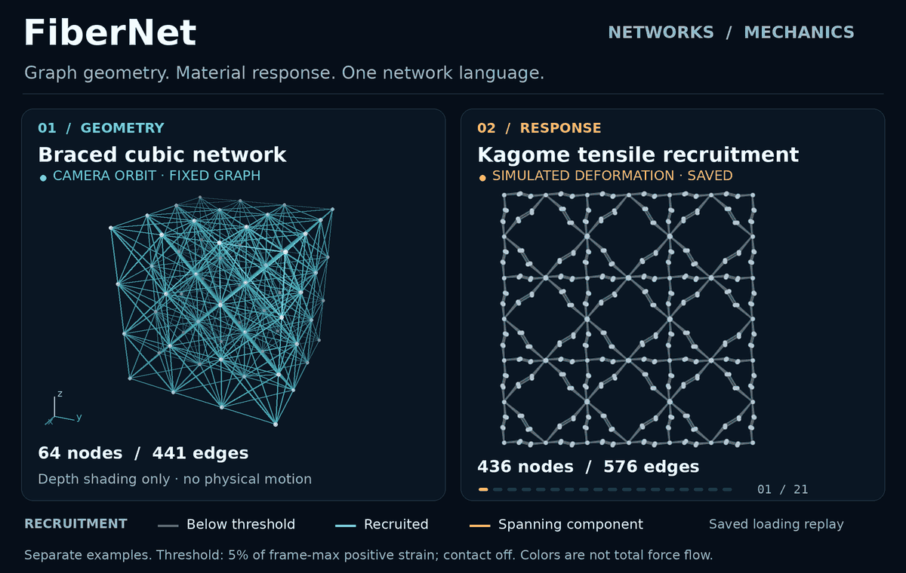

[媒体来源与渲染说明](docs/MEDIA_GALLERY.md) · [静态海报](docs/media/network_workflow_hero_poster.svg)

## 快速开始

### 安装 Python 库

已发布的包版本为 **FiberNet 4.2.0**：

```bash
python -m pip install fibernet==4.2.0
```

如需使用 **4.3.0 开发版源码**及其中的新增接口，请克隆仓库，在仓库根目录安装：

```bash
git clone https://github.com/GellmanSparrowS/fibernet.git
cd fibernet
python -m pip install -e .
```

使用 PyPI 获取已发布版本，使用源码安装体验开发版接口。需要 Python 3.9 及以上版本。按任务选择可选依赖，例如在源码目录运行 `python -m pip install -e ".[ml]"` 或 `python -m pip install -e ".[manufacturing]"`。

### 生成、模拟、保存

```python
import fibernet as fn

graph = fn.pattern_2d(
    unit="honeycomb", box=(10, 10), grid=(2, 2), radius=0.05, seed=23
)
fn.show(graph, save_path="network.png")

result = fn.simulate(graph, backend="fem", mode="stretch", strain=1.01)
result.save("fem_result.json", detailed=True)
print(graph.num_nodes, graph.num_edges, result.max_displacement)
```

这里的 `strain=1.01` 表示**拉伸比**，即 1% 伸长。该显式 FEM 路径使用小应变梁框架模型和核心依赖，不需要 Taichi 或桌面应用。几何与材料参数需采用一致的单位体系，详见[梁 FEM 接口约定](docs/METHODS_BEAM_FEM_CONTRACT.md)。

在源码目录运行完整的“生成结构 → 模拟 → 保存结果 → 重载 → 招募分析”流程：

```bash
python -m examples.open_source_workflow --output-dir demo_output
```

输出包括网络图、模拟结果 JSON 和分析摘要。[查看可执行示例](examples/open_source_workflow.py)。

## 1. 生成网络

<p>


</p>

Octet、diamond 与 gyroid 网络的相机环绕。 [三维参数](docs/media/three_dimensional_topologies.json) · [可编辑三维帧](docs/media/three_dimensional_topologies_final.svg)

四种平面拓扑使用同一位移轮廓：形状变化，连接关系不变。 [制造几何方法](docs/METHODS_MANUFACTURING_UNIFIED.md) · [可编辑矢量关键帧](docs/media/spectrum_four_topologies_peak.svg) · [参数记录](docs/media/spectrum_four_topologies.json)

## 2. 模拟响应

### 拉伸轨迹与招募

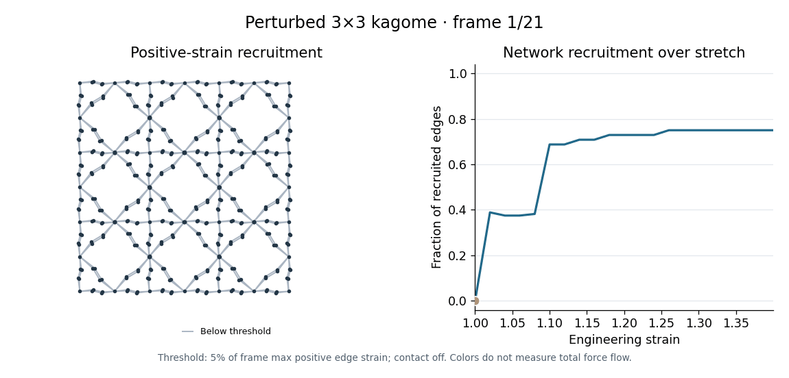

Kagome 拉伸中的纤维招募与跨夹持端路径（简化模型）。 [轨迹示例](examples/reduced_recruitment_workflow.py) · [招募分析方法](docs/METHODS_TENSILE_RECRUITMENT.md) · [来源记录](docs/media/tensile_recruitment_kagome.json)

### LAMMPS 与 Taichi

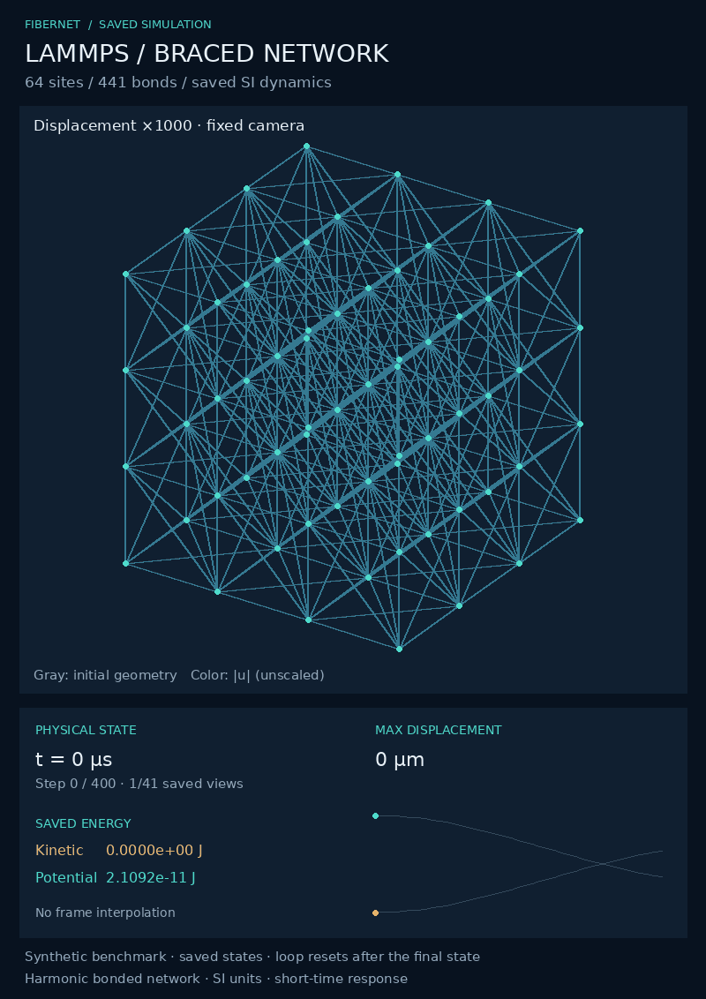

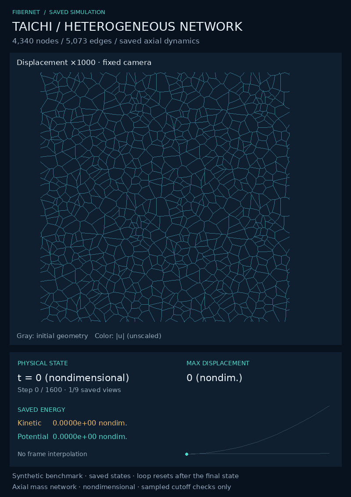

LAMMPS 谐键网络与 Taichi 轴向网络动力学，位移放大 1,000 倍。 [数据、单位与重绘方法](docs/media/new/backends/README.md)

### 黏弹运动与能量

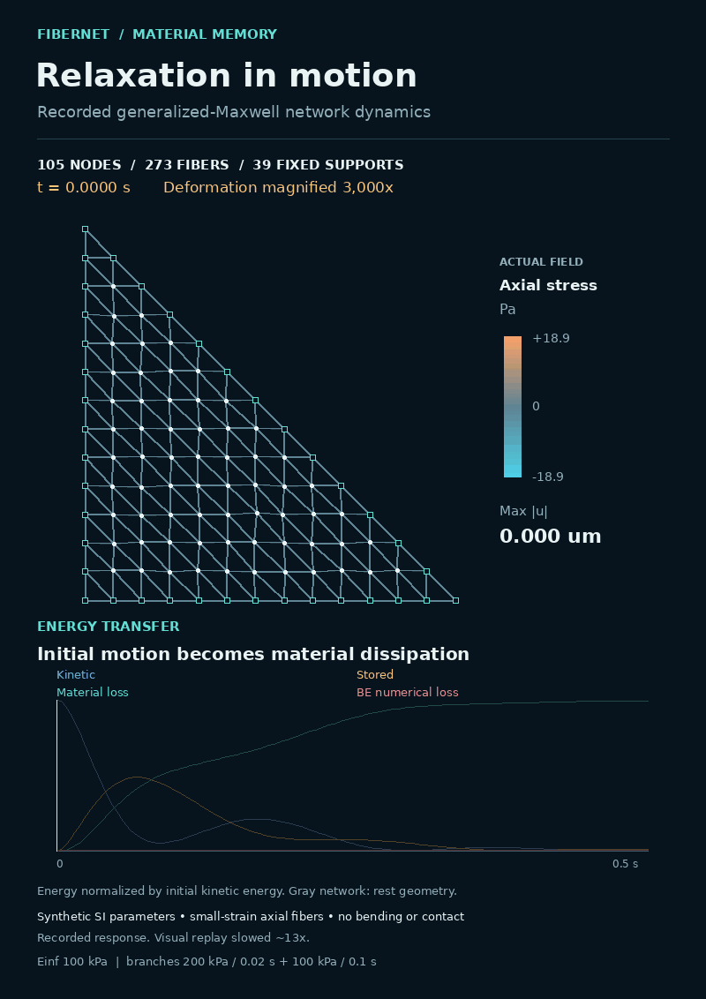

广义 Maxwell 网络的松弛、储能与耗散，位移放大 3,000 倍。 [材料模型、保存轨迹与重绘方法](docs/media/new/viscoelastic/README.md)

### 准静态构件移除

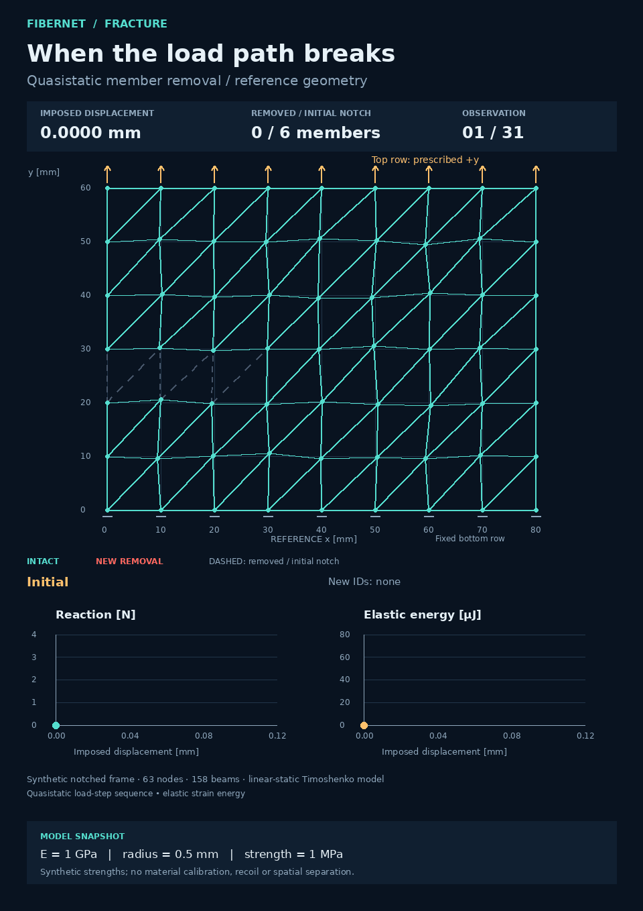

未变形框架上的准静态构件移除，以及对应的反力与弹性储能。 [场景、事件数据与可编辑图件](docs/media/new/fracture/README.md)

### 电场与热过程

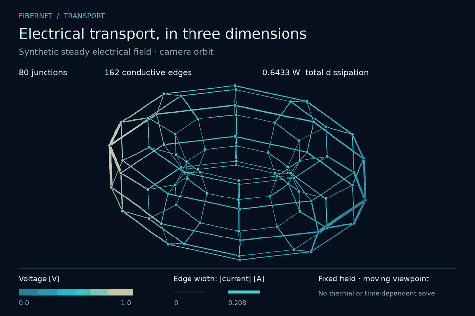

环面网络稳态电压与电流的相机环绕。 [电学场与渲染来源](docs/media/electrical_torus_field.json) · [电传输接口](docs/integrations/LINEAR_TRANSPORT_USAGE.md)

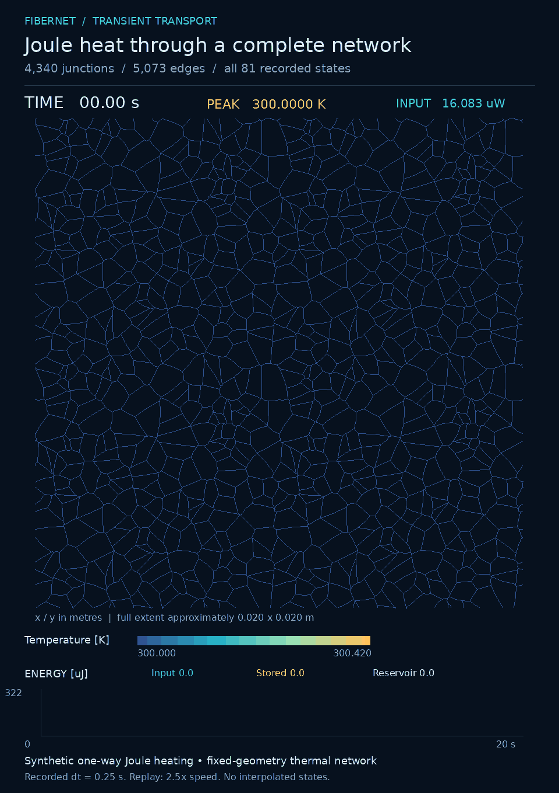

固定几何上的单向焦耳热过程，以及随时间变化的能量平衡。 [热模型、收敛证据与数据](docs/media/new/thermal/README.md)

## 3. 分析与学习

### 比较方向与分析阈值

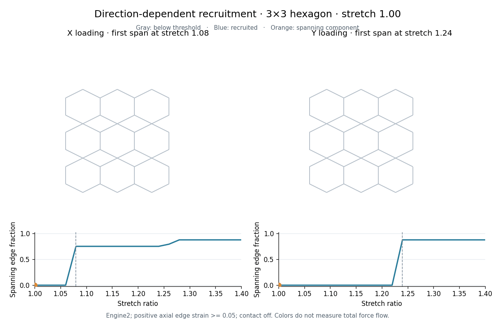

横向与纵向加载的首次跨端招募拉伸比分别为 1.08 和 1.24（简化模型）。 [方向比较参数](docs/media/directional_recruitment_hexagon.json) · [可编辑比较图](docs/media/directional_recruitment_hexagon_final.svg)

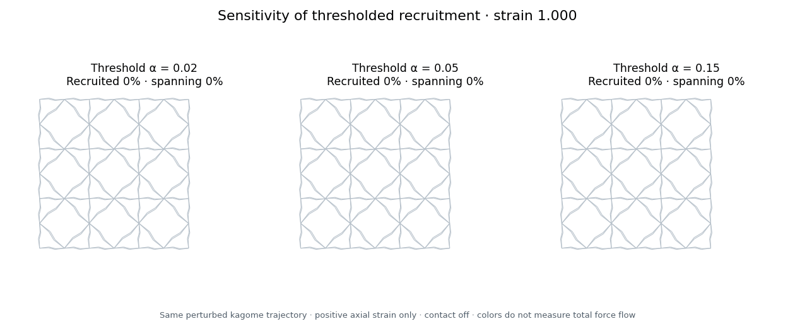

α = 0.02、0.05、0.15 三个阈值，对应同一条变形轨迹。 [分析参数](docs/media/tensile_threshold_sensitivity.json) · [可编辑分析帧](docs/media/tensile_threshold_sensitivity_final.svg)

### 图学习

准备图批次、相互隔离的数据划分，以及仅由训练集计算的度统计。 [图实验输入约定](docs/GRAPH_TRAINING_CONTRACT.md) · [完整示例](examples/graph_training_contract.py)

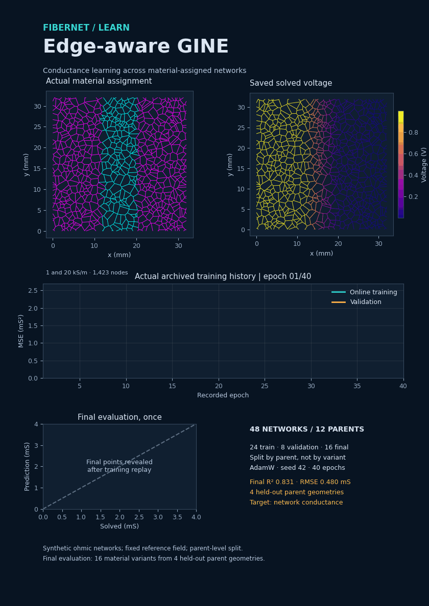

归档 GINE 电导学习研究：40 轮训练，按母图划分评估集。 [研究、数据划分、误差与重绘方法](docs/media/new/learning/README.md)

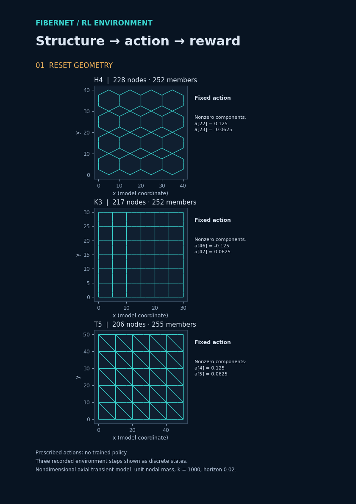

三个 RL 环境中的预设动作、原生响应、奖励与终止条件。 [环境记录与模型范围](docs/media/new/learning/README.md)

## 4. 设计与导出

### 保留路径的结构干预

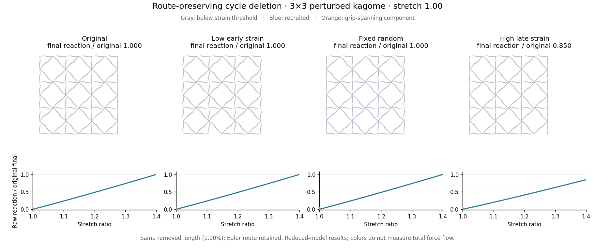

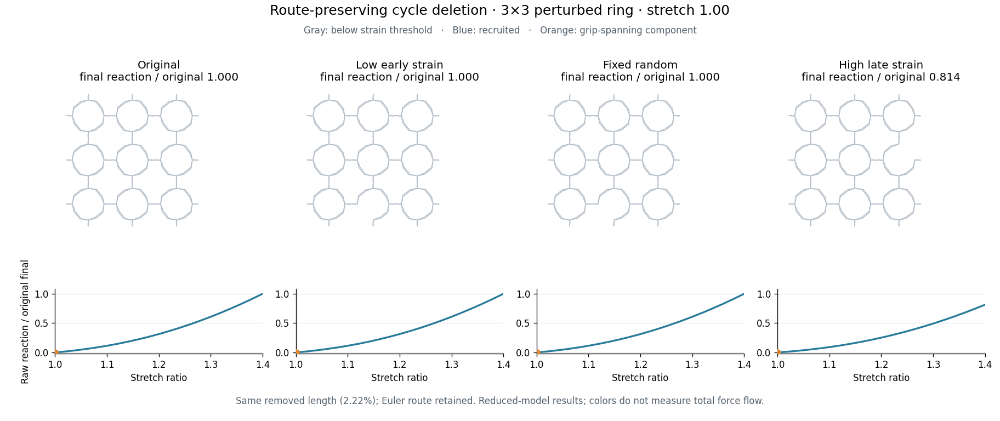

三种删边策略使用相同的移除边长，并保留欧拉路径。 [Kagome 来源](docs/media/route_preserving_intervention_kagome.json) · [环形来源](docs/media/route_preserving_intervention_ring.json) · [比较方法](docs/CONSTRAINED_CYCLE_INTERVENTION_2026-09-24.md)

### 路径与稳定 ID


每条纤维边遍历一次，平行纤维保持独立。 [生成新的平面与曲面路径](examples/manufacturing_workflow.py) · [自定义基元](examples/custom_cell_workflow.py) · [生成新的实体与路径](examples/solid_export_workflow.py)

将当前图导出为闭合路径或多段路径，得到毫米坐标 CSV 与稳定 ID 映射 JSON。输入几何、单位和路径约束见对应指南。 [闭合路径适用范围](docs/MANUFACTURING_GRAPH_MAPPING.md#geometry-and-ownership) · [多段路径适用范围](docs/MULTISTROKE_MANUFACTURING.md#scope-and-input-validation)

### 在 FiberScope 中操作

已保存界面导览：从响应学习到曲面映射与导出。

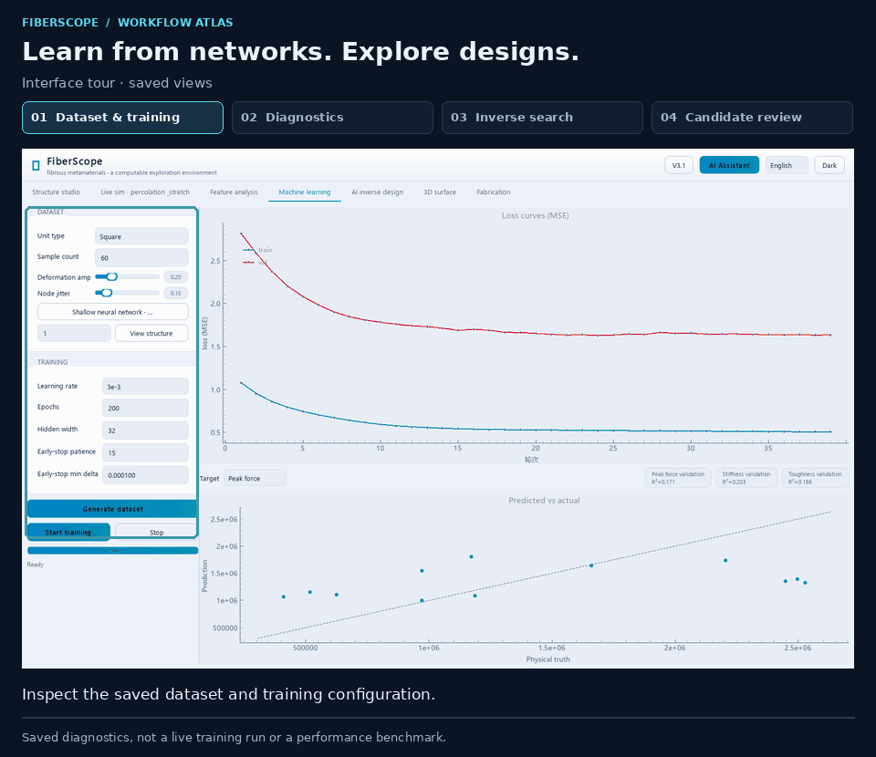

[学习示例](examples/physical_learning_workflow.py) · [逆向设计示例](examples/curve_inverse_workflow.py) · [导览来源](docs/media/module_workflow_tours.json)

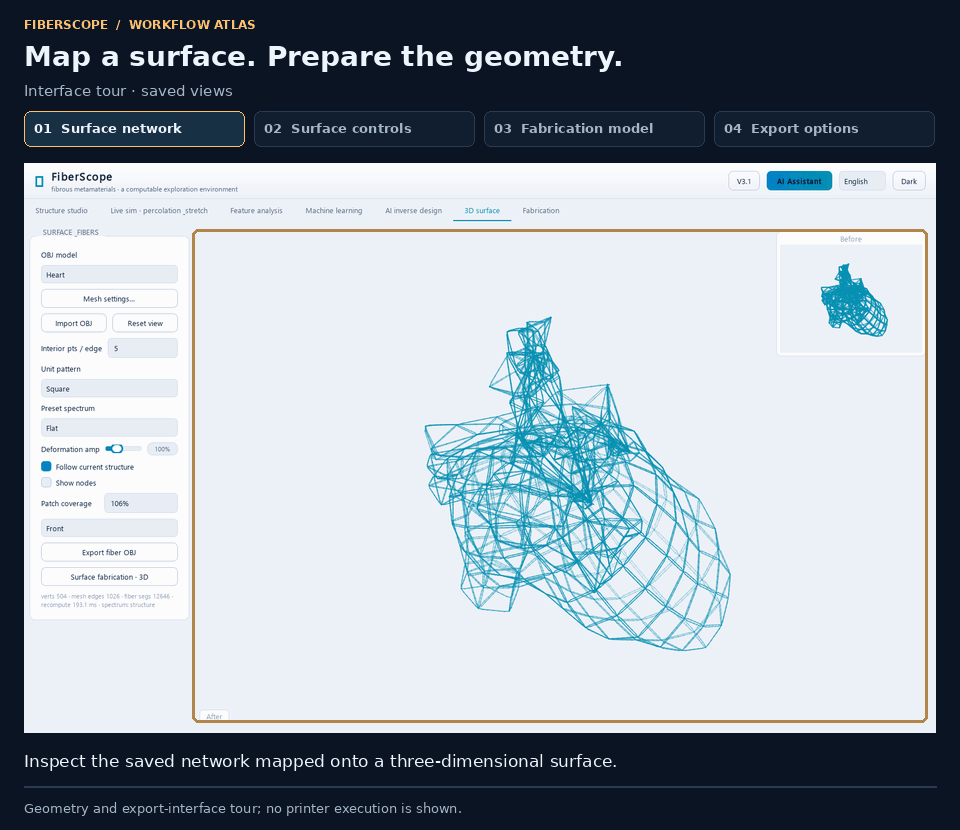

[曲面与路径示例](examples/manufacturing_workflow.py) · [实体导出示例](examples/solid_export_workflow.py) · [导览来源](docs/media/module_workflow_tours.json)

[参数与模型范围](docs/HOMEPAGE_EXAMPLE_NOTES.md) · [媒体来源与可编辑帧](docs/MEDIA_GALLERY.md)

## 选择研究流程

| 研究目标 | Python 入口 | 指南或可执行示例 |
| --- | --- | --- |
| 生成二维、三维结构 | `pattern_2d`、`pattern_3d`、`StructureGraph` | [参数化生成](fibernet/gen/pattern.py) |
| 研究变形与力学响应 | 显式 FEM 或 Taichi 路径；共享简化模型使用 `ReducedBeamSolver` | [接口层次、单位与模型选择](docs/API_LAYERS.md) |
| 量化结构与招募行为 | `SnapshotFeatureExtractor`、`analyze_tensile_recruitment` | [快照特征](examples/snapshot_features_workflow.py) · [招募分析](examples/tensile_recruitment_quickstart.py) |
| 沿用当前 `StructureGraph` 导出路径 | `manufacturing_from_graph` → `export_mapped_route`；`manufacturing_trails_from_graph` → `export_mapped_trails` | [闭合路径与稳定 ID](docs/MANUFACTURING_GRAPH_MAPPING.md) · [多段路径与适用范围](docs/MULTISTROKE_MANUFACTURING.md) |
| 构建复用基元与连续路径 | `CustomCellRegistry`、`compile_planar`、`compile_surface` | [自定义基元方法](docs/METHODS_CUSTOM_CELL_UNIFIED.md) · [制造几何](docs/METHODS_MANUFACTURING_UNIFIED.md) |
| 从模拟响应中学习 | `PlanarPhysicalDataset`、`light_features`、`PhysicalRegressor` | [可续算标签生成](examples/physical_dataset_workflow.py) · [代理模型学习](examples/physical_learning_workflow.py) |
| 搜索目标响应结构 | `CurveInverseDesigner`；可选 `fibernet.rl` 工具 | [目标曲线搜索](examples/curve_inverse_workflow.py) · [学习与搜索方法](docs/METHODS_CURVE_INVERSE_UNIFIED.md) |

### 开发版源码中的扩展接口

- **时变力学：**[黏弹梁框架历史](docs/VISCOELASTIC_NETWORK.md)、[轴向黏弹动力学](docs/DYNAMIC_AXIAL_VISCOELASTICITY.md)与[状态观测](docs/state_observer.md)。
- **传输与热过程：**[线性电传输](docs/integrations/LINEAR_TRANSPORT_USAGE.md)、[瞬态热网络](docs/integrations/TRANSIENT_THERMAL_USAGE.md)与[单向焦耳热](docs/ONE_WAY_JOULE_HEATING.md)。独立的[实验性电热接口](docs/EXPERIMENTAL_ELECTROTHERMAL.md)以显式系数和状态接受检查，处理固定几何、电压驱动的热反馈。
- **外部引擎：**[有界 LAMMPS 谐键动力学](docs/integrations/LAMMPS_HARMONIC_CLI.md)与[粗粒化纤维网络](docs/integrations/LAMMPS_CG_CROSSLINKED_NETWORK.md)，采用显式运行时和单位约定。
- **实验性断裂：**独立的线性静力 Timoshenko 杆件移除后端，保留稳定 ID、事件记录和可续算检查点。[模型范围与来源](docs/FRACTURE_METHODS.md)。
- **图学习：**[边感知 GINE 数据与模型适配器](docs/integrations/EDGE_GINE.md)。

通过[接口地图](docs/API_LAYERS.md)选择各模块的调用入口、输入约定与结果类型。

## 桌面应用

**希望直接通过界面操作？** 下载 [FiberScope 3.1.0 Windows x64 版](https://github.com/GellmanSparrowS/fibernet/releases/tag/v4.2.0)，完整解压 ZIP 后运行 `FiberScope.exe`。桌面可执行程序包含所需运行时，不需要本地安装 Python。

[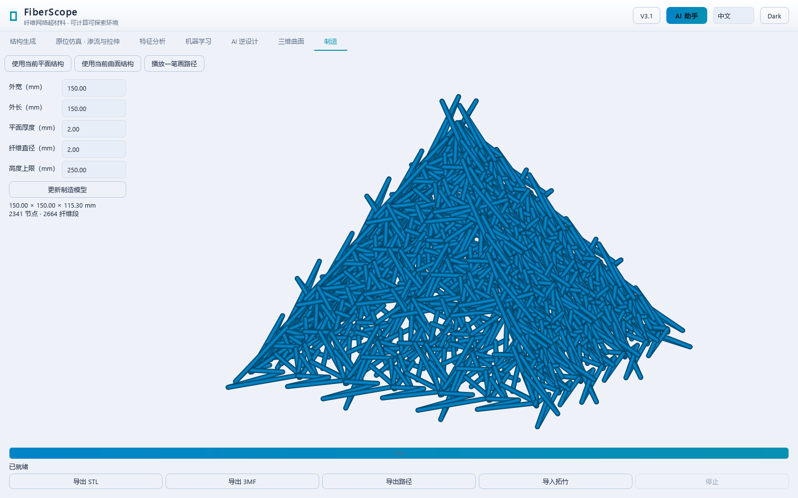](FiberScope/docs/screenshots/README.md)

提供英文和中文界面。可选的 SAC/TD3/DDPG 训练需要单独配置外部 Python 运行时。 [集成说明](docs/INTEGRATION_REPO_MAP.md)

[桌面使用指南](FiberScope/README.md) · [中英文界面截图](FiberScope/docs/screenshots/README.md) · [发布说明](docs/RELEASE_4_2_0.md)

## 方法与复现

比较结果前，先选择合适的模型：梁框架 FEM 与弹簧、弯曲和接触构成的简化模型采用不同的力学描述。 [FEM 方法](docs/METHODS_BEAM_FEM_CONTRACT.md) · [简化模型方法](docs/METHODS_REDUCED_SOLVER_UNIFIED.md) · [示例解读指南](docs/HOMEPAGE_EXAMPLE_SCOPE.md)

- **可检查的媒体：**[来源记录、可编辑矢量帧与渲染命令](docs/MEDIA_GALLERY.md)。
- **研究示例：**[阈值与方向敏感性](docs/RECRUITMENT_SENSITIVITY_2026-09-24.md)、[匹配的保路径结构干预](docs/CONSTRAINED_CYCLE_INTERVENTION_2026-09-24.md)以及[同图跨模型比较](docs/INDEPENDENT_FEM_CYCLE_INTERVENTION_2026-09-24.md)。完整比较记录呈现模型依赖性与各组研究结果。
- **兼容性：**当前开发版将可选 Taichi 后端固定为 **1.7.4**。引擎应在其所属线程上初始化和使用，支持条件见[运行时生命周期约定](docs/architecture/taichi-lifecycle-audit.md)。上面的 FEM 快速开始使用核心依赖。
- **项目资料：**[示例索引](examples/README.md)、[测试](tests/test_tensile_recruitment.py)、[版本记录](CHANGELOG.md)与[能力清单](docs/CAPABILITY_AUDIT_2026-09-24.md)。

## 许可与引用

FiberNet 采用 [MIT 许可证](LICENSE)，第三方声明见[依赖与模型说明](FiberScope/THIRD_PARTY_NOTICES.md)。关于网络拓扑与逆向设计的已发表研究，请参阅 [Nature Communications 论文](https://www.nature.com/articles/s41467-026-76045-x)。
<!-- locale:zh:end -->
