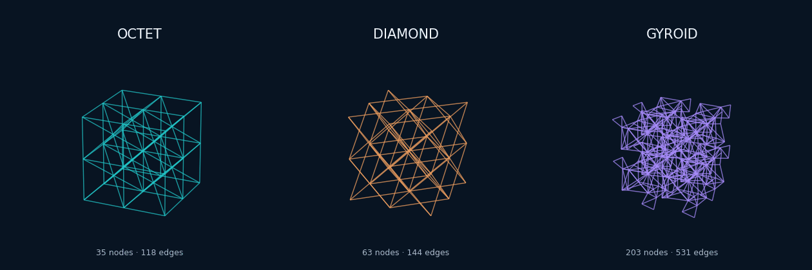
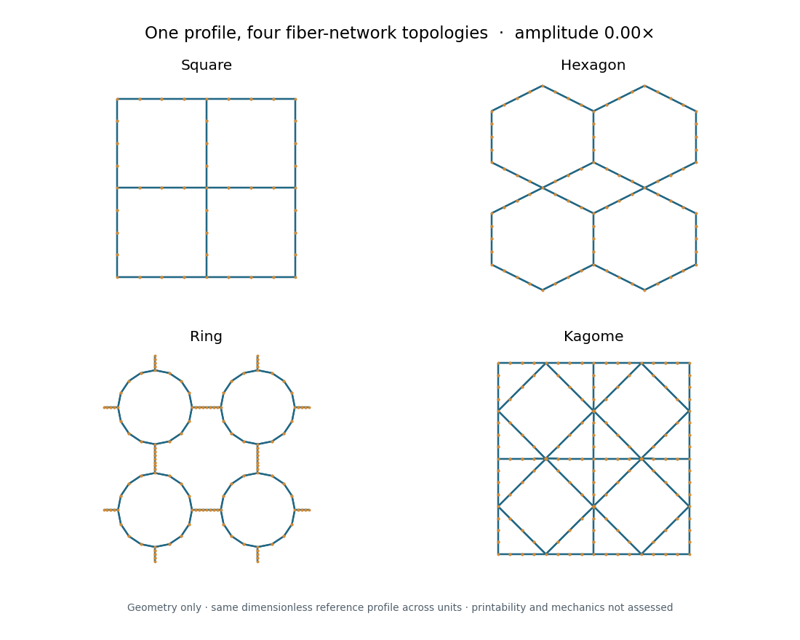
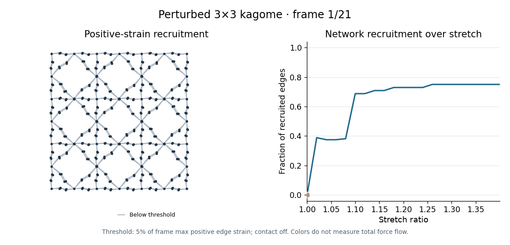
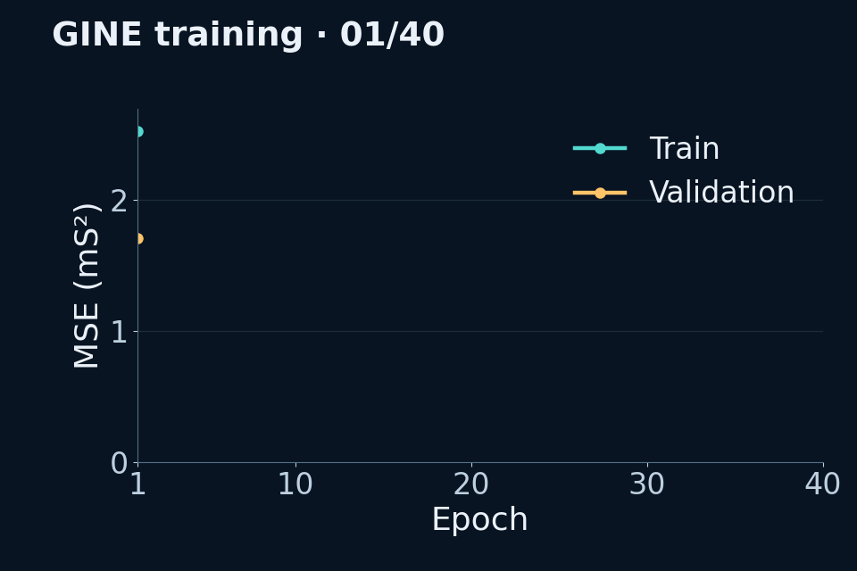
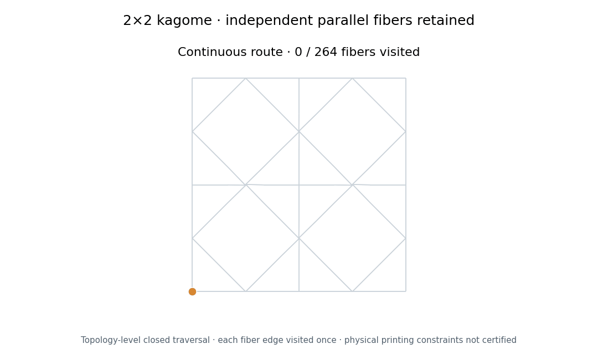
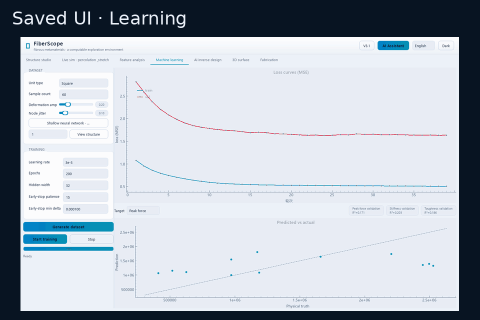

[English / 中文 · 仓库首页](README.md)

[Feature availability and checked dataset selections](docs/FEATURE_AVAILABILITY.md)

<!-- locale:zh:start -->
[快速开始](#快速开始) · [生成](#1-生成网络) → [模拟](#2-模拟响应) → [分析与学习](#3-分析与学习) → [设计与导出](#4-设计与导出) · [功能索引](#选择研究流程)

FiberNet 提供纤维网络建模的 Python 工具，FiberScope 提供桌面界面。

## 快速开始

### 安装并运行源码入门示例

**开发版源码：4.3.0——本页推荐入口**

```bash
git clone https://github.com/GellmanSparrowS/fibernet.git
cd fibernet
python -m pip install -e .
python -m examples.open_source_workflow --output-dir demo_output
```

需要 Python 3.9 及以上版本和基础依赖，本例不需要 Torch 或 Taichi。运行成功后，终端会显示 **18 个节点、22 条边**，`demo_output/` 中会生成 `network.png`、`fem_result.json` 和 `summary.json`。流程会保存并重新读取 FEM 结果，再进行招募分析。[示例与输出](examples/open_source_workflow.py)

可选依赖包括 `.[ml]` 和 `.[manufacturing]`。

### Python 示例：生成、模拟、保存

完成上方源码安装后，可在 Python 或 Notebook 中运行：

```python
import fibernet as fn

# SI units: coordinates and radius in m; E in Pa; forces in N.
graph = fn.pattern_2d(
    unit="honeycomb", box=(10, 10), grid=(2, 2), radius=0.05, seed=23
)
fn.show(graph, save_path="network.png")

result = fn.simulate(
    graph, backend="fem", mode="stretch", stretch_ratio=1.01,
    nonlinear=False, E=1e9, nu=0.3,
)
result.save("fem_result.json", detailed=True)
print(graph.num_nodes, graph.num_edges, result.max_displacement)
```

`stretch_ratio=1.01` 指 1% 伸长；`nonlinear=False` 明确选择小变形线性梁 FEM。坐标和半径按米解释，`E=1e9` Pa，`nu=0.3` 无量纲，输出位移为米、力为牛顿；程序不自动换算单位，也不从图的材料记录读取模量。省略拉伸比仍使用兼容默认值 2.0，二维会进入未验证最终平衡的实验增量路径，不适合作为线性入门调用。[FEM 接口约定](docs/METHODS_BEAM_FEM_CONTRACT.md)

### 已发布版本：4.2.0

如果应用使用已发布的 API，可选择下面的安装方式，**无需再安装上方源码版**：

```bash
python -m pip install fibernet==4.2.0
```

请使用与版本对应的 [4.2.0 入门示例](https://github.com/GellmanSparrowS/fibernet/blob/v4.2.0/PYPI_README.md#generate-simulate-save-and-analyze)。该版本的 FEM 示例使用 `strain=1.01`，上方源码示例使用 `stretch_ratio=1.01`。

## 1. 生成网络





[几何示例与参数](docs/MEDIA_GALLERY.md#three-dimensional-topology) · [制造几何](docs/METHODS_MANUFACTURING_UNIFIED.md)

## 2. 模拟响应



简化模型中的拉伸与边招募。[模型与轨迹](docs/HOMEPAGE_OVERVIEW_MEDIA.md#tensile-recruitment) · [LAMMPS / Taichi 示例](docs/media/new/backends/README.md) · [黏弹性、断裂与热过程](docs/media/new/README.md)

## 3. 分析与学习



GINE 电导学习，按母体划分训练与评估数据。[研究与结果](docs/media/new/learning/README.md) · [图训练接口约定](docs/GRAPH_TRAINING_CONTRACT.md) · [方向与阈值分析](docs/RECRUITMENT_SENSITIVITY_2026-09-24.md)

## 4. 设计与导出



将已有 `StructureGraph` 导出为闭合路径或多段路径，保留毫米坐标 CSV 与稳定 ID 映射 JSON。[闭合路径约束](docs/MANUFACTURING_GRAPH_MAPPING.md#geometry-and-ownership) · [多段路径约束](docs/MULTISTROKE_MANUFACTURING.md#scope-and-input-validation)

[目标曲线设计](examples/curve_inverse_workflow.py) · [保路径结构干预](docs/HOMEPAGE_OVERVIEW_MEDIA.md#static-interventions) · [跨模型研究结果](docs/INDEPENDENT_FEM_CYCLE_INTERVENTION_2026-09-24.md)

## 选择研究流程

| 研究目标 | Python 入口 | 指南或可执行示例 |
| --- | --- | --- |
| 生成二维、三维结构 | `pattern_2d`、`pattern_3d`、`StructureGraph` | [参数化生成](fibernet/gen/pattern.py) |
| 研究变形与力学响应 | 显式 FEM 或 Taichi 路径；共享简化模型使用 `ReducedBeamSolver` | [接口层次、单位与模型选择](docs/API_LAYERS.md) |
| 量化结构与招募行为 | `SnapshotFeatureExtractor`、`analyze_tensile_recruitment` | [快照特征](examples/snapshot_features_workflow.py) · [招募分析](examples/tensile_recruitment_quickstart.py) |
| 沿用当前 `StructureGraph` 导出路径 | `manufacturing_from_graph` → `export_mapped_route`；`manufacturing_trails_from_graph` → `export_mapped_trails` | [闭合路径与稳定 ID](docs/MANUFACTURING_GRAPH_MAPPING.md) · [多段路径与适用范围](docs/MULTISTROKE_MANUFACTURING.md) |
| 构建复用基元与连续路径 | `CustomCellRegistry`、`compile_planar`、`compile_surface` | [自定义基元方法](docs/METHODS_CUSTOM_CELL_UNIFIED.md) · [制造几何](docs/METHODS_MANUFACTURING_UNIFIED.md) |
| 从模拟响应中学习 | `PlanarPhysicalDataset`、`light_features`、`PhysicalRegressor` | [可续算标签生成](examples/physical_dataset_workflow.py) · [代理模型学习](examples/physical_learning_workflow.py) |
| 搜索目标响应结构 | `CurveInverseDesigner`；可选 `fibernet.rl` 工具 | [目标曲线搜索](examples/curve_inverse_workflow.py) · [学习与搜索方法](docs/METHODS_CURVE_INVERSE_UNIFIED.md) |

更多接口：[时变力学](docs/DYNAMIC_AXIAL_VISCOELASTICITY.md) · [传输与热过程](docs/ONE_WAY_JOULE_HEATING.md) · [LAMMPS 集成](docs/integrations/LAMMPS_HARMONIC_CLI.md) · [断裂](docs/FRACTURE_METHODS.md) · [GINE 适配器](docs/integrations/EDGE_GINE.md)

## 桌面应用

下载 [FiberScope 3.1.0 Windows x64 版](https://github.com/GellmanSparrowS/fibernet/releases/tag/v4.2.0)，完整解压 ZIP 后运行 `FiberScope.exe`，所需运行时已包含在内。



[桌面使用指南](FiberScope/README.md) · [界面与图表来源](docs/HOMEPAGE_OVERVIEW_MEDIA.md) · [中英文截图](FiberScope/docs/screenshots/README.md) · [可选训练配置](docs/INTEGRATION_REPO_MAP.md)

## 方法与复现

[模型范围](docs/HOMEPAGE_EXAMPLE_SCOPE.md) · [完整动图、源数据与渲染器](docs/MEDIA_GALLERY.md) · [示例参数](docs/HOMEPAGE_EXAMPLE_NOTES.md) · [Taichi 1.7.4 生命周期](docs/architecture/taichi-lifecycle-audit.md) · [示例索引](examples/README.md) · [版本记录](CHANGELOG.md)

## 许可与引用

[MIT 许可证](LICENSE) · [第三方声明](FiberScope/THIRD_PARTY_NOTICES.md) · [Nature Communications 论文](https://www.nature.com/articles/s41467-026-76045-x)
<!-- locale:zh:end -->
