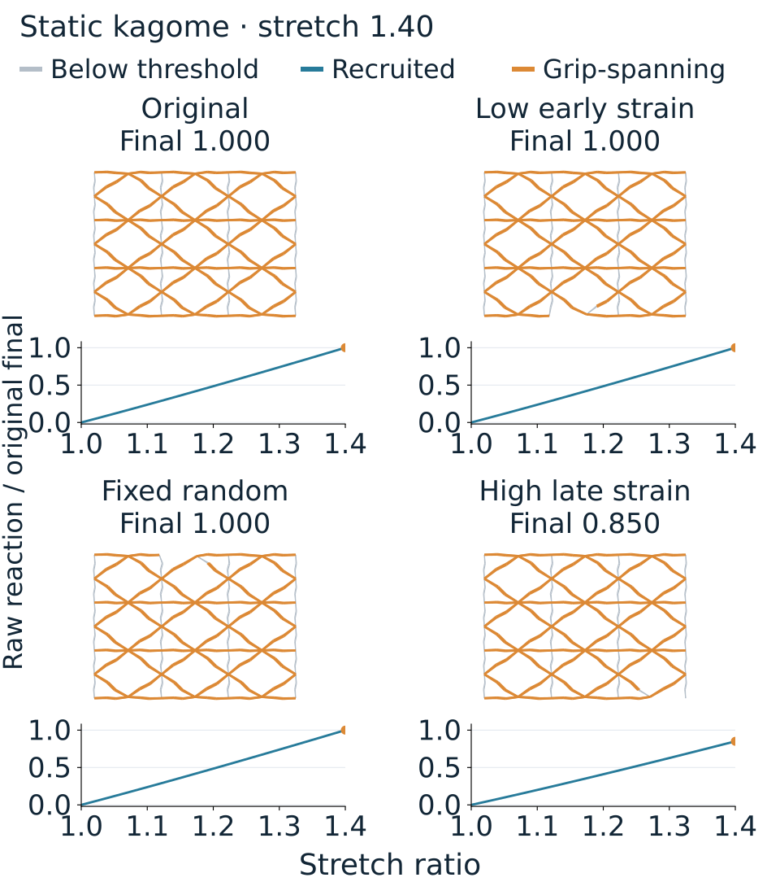
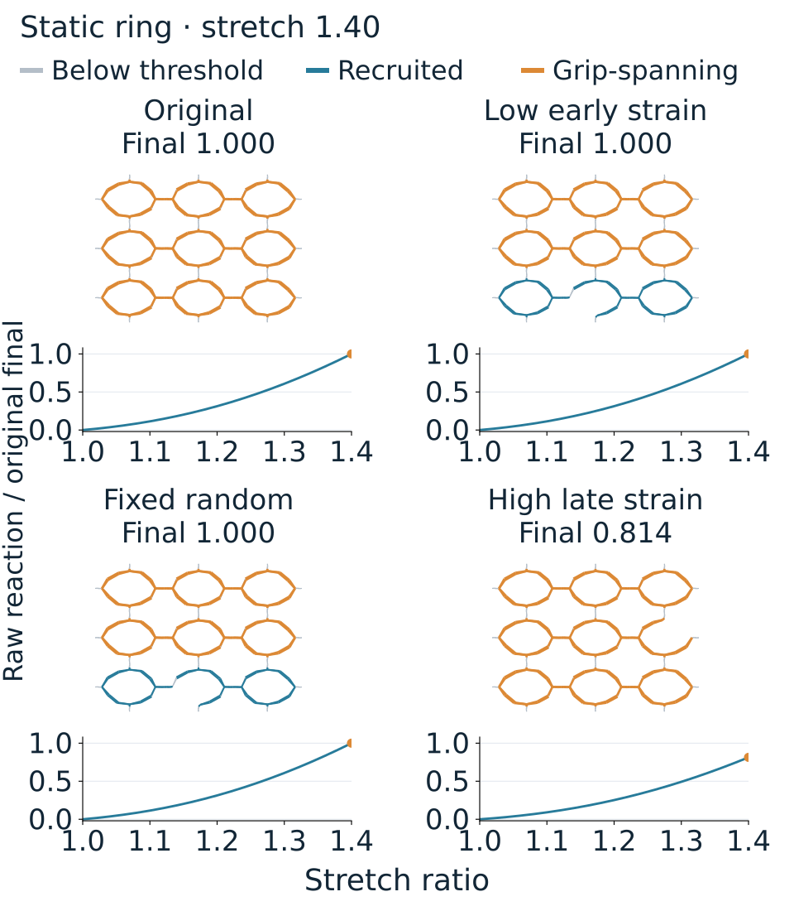

# Homepage media

## Tensile recruitment

The horizontal axis is stretch ratio, L/L₀. The overview retains the original 18 saved frames and timing with the corrected axis label.

[Model and trajectory](MEDIA_GALLERY.md#recorded-stretch-and-recruitment) · [Editable final frame](media/homepage_overview/tensile_recruitment_labeled_final.svg) · [Label renderer](../scripts/relabel_saved_tensile.py) · [Pixel-preservation receipt](media/homepage_overview/tensile_label_receipt.json)

## GINE conductance

The overview replays the 40 saved training epochs, then shows the final predictions for 16 cases from four held-out parent networks. Training and validation loss are in mS²; the evaluation axes are in mS.

[Training history](media/new/learning/data/gine/training.json) · [Final results](media/new/learning/data/gine/final_results.json) · [Study and data splits](media/new/learning/README.md) · [Renderer](../scripts/render_homepage_gine.py) · [Render receipt](media/homepage_overview/gine_receipt.json)

## FiberScope workspaces

Saved screenshots show learning, inverse design, surface mapping and fabrication. Whole-window views alternate with control close-ups. The three export buttons are separate crops from the same saved fabrication screen, arranged vertically for readability.

[Original screenshots](../FiberScope/docs/screenshots/README.md) · [Desktop guide](../FiberScope/README.md) · [Renderer](../scripts/render_homepage_saved_ui.py) · [Crop coordinates and source hashes](media/homepage_overview/fiberscope_receipt.json)

## Static interventions

These grids show saved final networks and complete reaction curves, normalized by the original network's final reaction.

The reduced axial-model cases remove 1% of edge length while retaining an Euler route. Color marks strain-threshold recruitment and grip-spanning components, not force flow. High-late-strain deletion lowers final reaction to 0.850 of the original for kagome and 0.814 for ring. Low-early-strain and fixed-random results coincide in both cases.

[Full study and adverse results](CONSTRAINED_CYCLE_INTERVENTION_2026-09-24.md) · [Cross-model study](INDEPENDENT_FEM_CYCLE_INTERVENTION_2026-09-24.md) · [Saved results](../benchmarks/results/constrained_cycle_intervention.json) · [SVG relayout source](../scripts/relayout_homepage_interventions.py) · [Path-preservation receipt](media/homepage_overview/interventions_receipt.json)

## Original gallery

The original animations, source data, parameters and renderers remain in the [media gallery](MEDIA_GALLERY.md). The [selection manifest](media/homepage_overview/selection.json) records the displayed subset and the hashes of all 19 original GIFs.
