# FiberNet animated gallery

[English homepage](../README.md) · [中文](../README.md#fibernet-zh)

Explore network geometry, saved deformation, thresholded connectivity, and continuous routes. Each visual below has a specific meaning: camera motion, parameterized geometry, recorded simulation, or route traversal. Where linked, manifests record source hashes and parameters, and vector keyframes are editable.

## One topology, two shapes

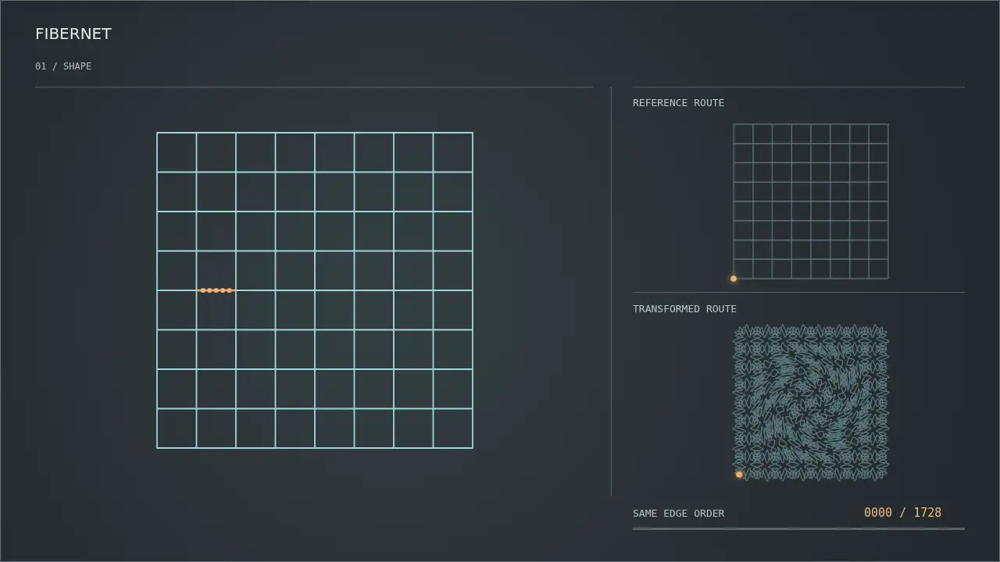

Five interior control points on each reference fiber change the geometry of an 8 × 8 square network. A local twist changes the center while leaving the outer region fixed. The right-hand panels traverse the same 1,728 edge segments in the same order. [Planar geometry and continuous routes](METHODS_MANUFACTURING_UNIFIED.md).

## Tensile fracture of a notched weave

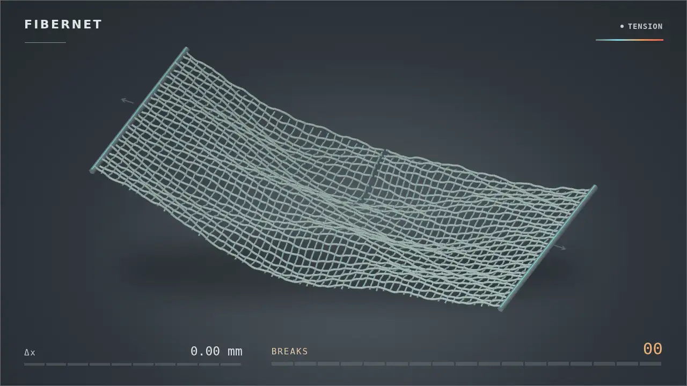

The synthetic weave starts with a notch and is pulled from opposing grips. The motion replays a damped spring-network calculation. The animated grips and colors help locate loading and failure; the model does not include yarn contact or friction. [Explore the reduced mechanical methods](METHODS_REDUCED_SOLVER_UNIFIED.md).

## From orientation field to fibers

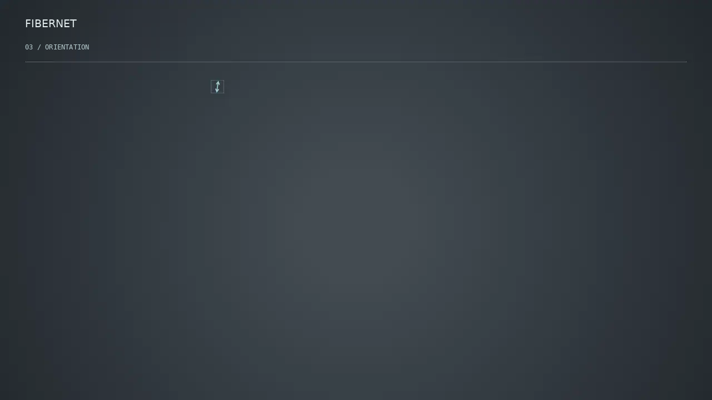

The planar matrix shows unoriented fiber axes using double-headed arrows. Nine display layers reveal a volume with synthetic through-thickness variation. The 298 curves follow the principal axes of the three-dimensional orientation field; their colors and widths distinguish depth and individual fibers in the animation.

## From leaf venation to a graph neural network

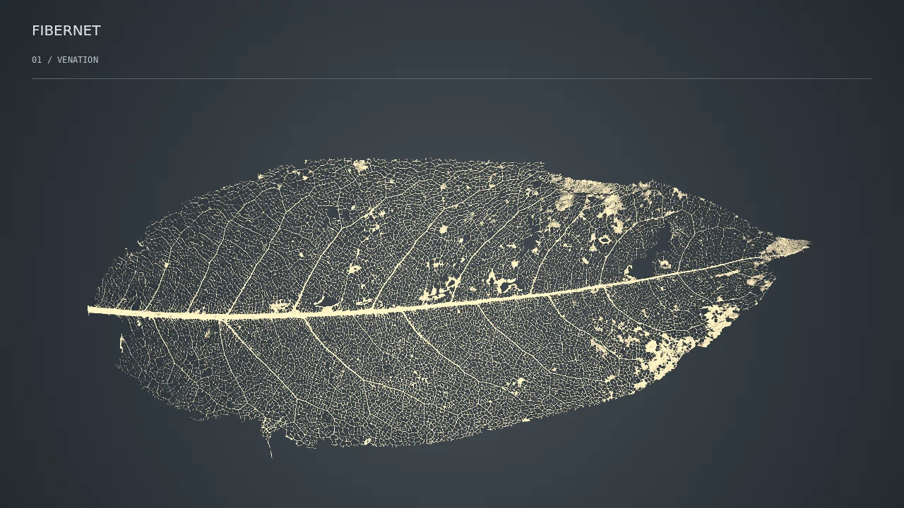

The camera follows a crop of a real magnolia leaf. The ten junctions and their traced connections define the same symmetric adjacency matrix shown in the animation. Light pulses illustrate one- and two-hop message passing on that graph. This is a visual explanation, not a prediction about the leaf.

The animation adapts [Vein skeleton of a leaf](https://commons.wikimedia.org/wiki/File:Vein_skeleton_of_a_leaf.JPG) by Brocken Inaglory (Wikimedia Commons). The source is cropped, recolored and skeletonized. This animation is licensed [CC BY-SA 3.0](https://creativecommons.org/licenses/by-sa/3.0/), separate from the software license.

## Geometry and response hero

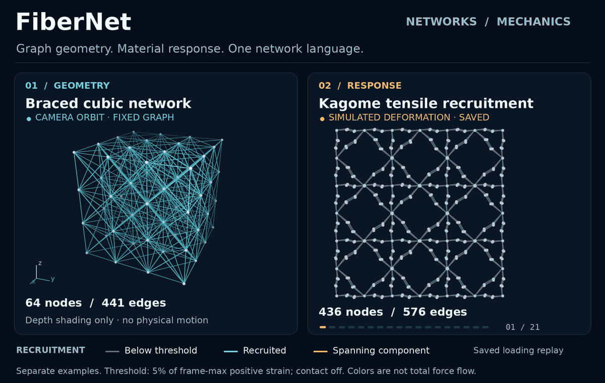

The left panel changes the camera around the saved braced-cubic graph in [`examples/data/lammps_braced_network_si.json`](../examples/data/lammps_braced_network_si.json). It does not replay LAMMPS dynamics. The right panel reuses the saved kagome recruitment animation described below; it does not interpolate or recompute mechanical states. The two panels illustrate separate workflows, not a coupled 3D-to-2D experiment.

[Static poster](media/network_workflow_hero_poster.svg) · [Source and render manifest](media/network_workflow_hero.json) · [Rendering script](../scripts/render_saved_homepage_hero.py)

## Three-dimensional topology

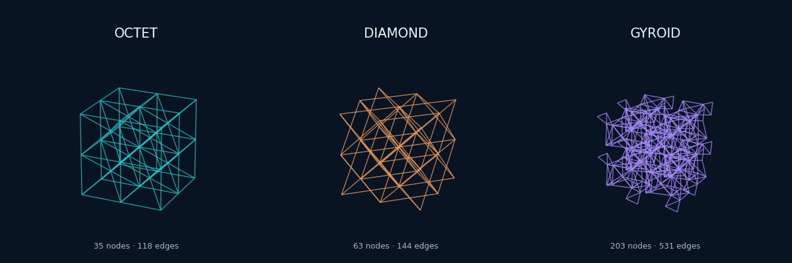

Fixed 2 × 2 × 2 octet, diamond, and gyroid graphs contain **35/118**, **63/144**, and **203/531** nodes/edges, respectively. Only the camera rotates. Generated geometry is not a simulated response or a validated manufacturing path.

[Editable frame](media/three_dimensional_topologies_final.svg) · [Manifest](media/three_dimensional_topologies.json) · [Geometry renderer](../scripts/make_3d_homepage_media.py)

## One profile, four topologies

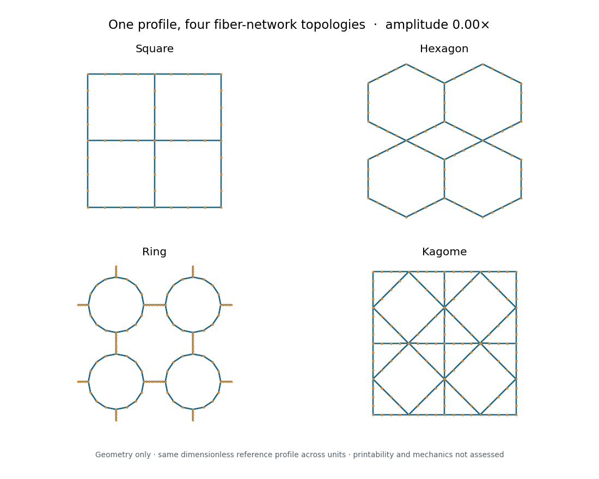

The same dimensionless reference-fiber displacement profile changes the geometry of each topology while retaining its connectivity. The profile is a geometric design control, not a mechanical load.

[Editable peak frame](media/spectrum_four_topologies_peak.svg) · [Manifest](media/spectrum_four_topologies.json) · [Manufacturing methods](METHODS_MANUFACTURING_UNIFIED.md)

## Recorded stretch and recruitment

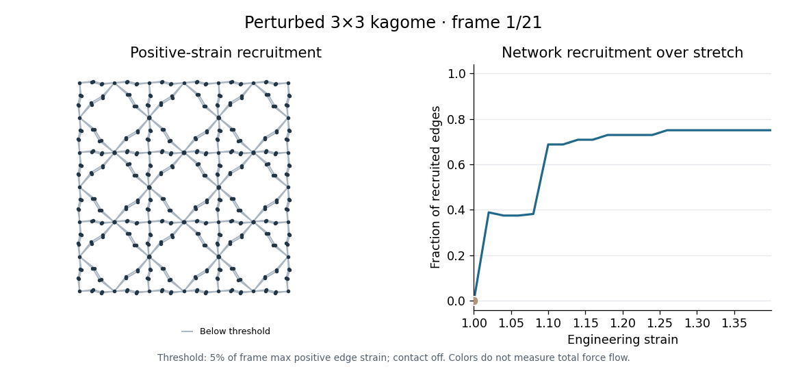

The perturbed 3 × 3 kagome graph has **436 nodes and 576 edges**. The saved reduced spring/bending trajectory uses target stretch 1.4, seed 23, bending enabled, and contact disabled. Blue edges exceed the positive axial-strain threshold; orange edges belong to a recruited component spanning both grips. The trace records recruited-edge fraction. These colors show thresholded connectivity, not a complete force-flow field.

[Editable final frame](media/tensile_recruitment_kagome_final.svg) · [Manifest](media/tensile_recruitment_kagome.json) · [Reduced-model methods](METHODS_REDUCED_SOLVER_UNIFIED.md) · [Recruitment definition](METHODS_TENSILE_RECRUITMENT.md)

### Threshold sensitivity on one trajectory

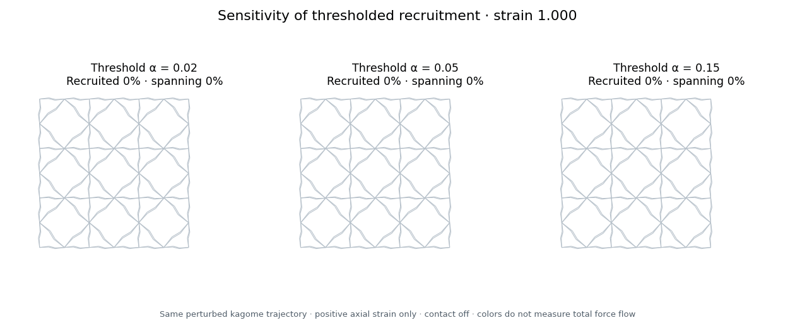

The panels use the same saved node trajectories with relative thresholds α = 0.02, 0.05, and 0.15. Changing the threshold changes the recruited graph, not the simulated deformation. This comparison exposes analysis sensitivity before interpreting a spanning connection.

[Editable comparison](media/tensile_threshold_sensitivity_final.svg) · [Manifest](media/tensile_threshold_sensitivity.json)

### Directional loading on one topology

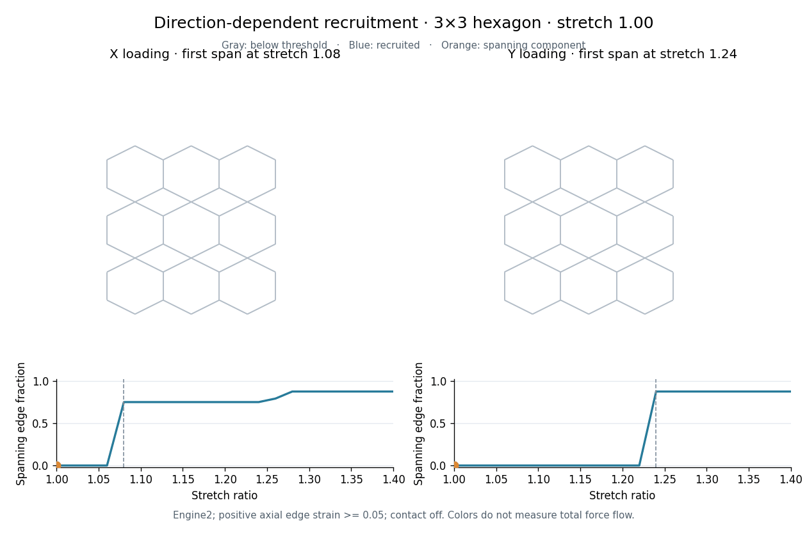

For this 3 × 3 hexagon topology and a positive axial-strain minimum of 0.05, the reduced solver first finds a spanning recruited component at stretch ratios **1.08 horizontally** and **1.24 vertically**. This is a model-specific threshold statistic. An [independent beam-FEM comparison](RECRUITMENT_SENSITIVITY_2026-09-24.md) preserves the directional contrast at stretch 1.24 but not the same onset values.

[Editable comparison](media/directional_recruitment_hexagon_final.svg) · [Manifest](media/directional_recruitment_hexagon.json) · [Renderer](../scripts/make_directional_recruitment_media.py)

## Continuous fiber route

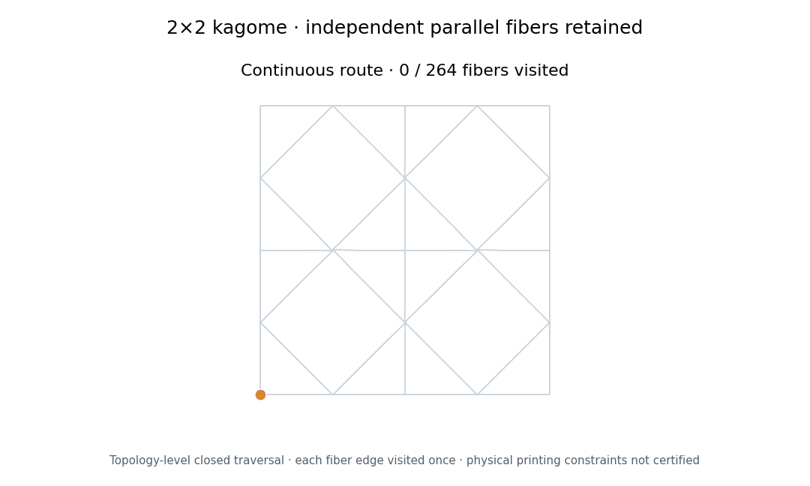

The orange point follows a closed Euler route through a 2 × 2 kagome graph containing **201 nodes and 264 edges**. Every independent edge is visited once, including parallel fibers. Blue segments have been visited; gray segments remain. This is graph traversal, not printer motion, collision clearance, or bond-quality validation.

[Editable final frame](media/continuous_route_kagome_final.svg) · [Manifest](media/continuous_route_kagome.json) · [Planar and curved workflow](../examples/manufacturing_workflow.py)

## Route-preserving interventions

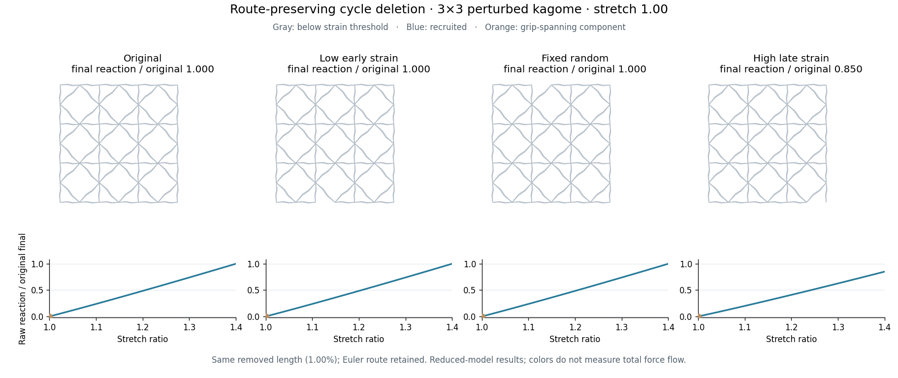

The four panels share the original kagome graph and loading. Each deletion removes the same **1.00% edge-length class** and retains an Euler route. In this saved case, low-early-strain and fixed-random choices retain approximately the original final reduced-model reaction; the high-late-strain choice has a ratio of **0.850**. The [same-graph independent FEM comparison](INDEPENDENT_FEM_CYCLE_INTERVENTION_2026-09-24.md) does not support a general safe-deletion claim.

[Kagome editable frame](media/route_preserving_intervention_kagome_final.svg) · [Kagome manifest](media/route_preserving_intervention_kagome.json)

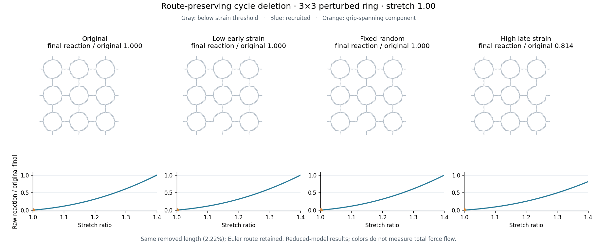

The companion ring example removes a matched **2.22% edge length**. All remaining graphs retain a constructed Euler route. High-late-strain deletion reduces the final raw reaction in this numerical case; the low-early and fixed-random responses are nearly indistinguishable. Colors retain the same thresholded-strain meaning as the recruitment examples.

[Ring editable frame](media/route_preserving_intervention_ring_final.svg) · [Ring manifest](media/route_preserving_intervention_ring.json) · [Full 24-configuration study](CONSTRAINED_CYCLE_INTERVENTION_2026-09-24.md) · [Saved study renderer](../scripts/make_intervention_media.py)

## Learning and inverse-design workspaces

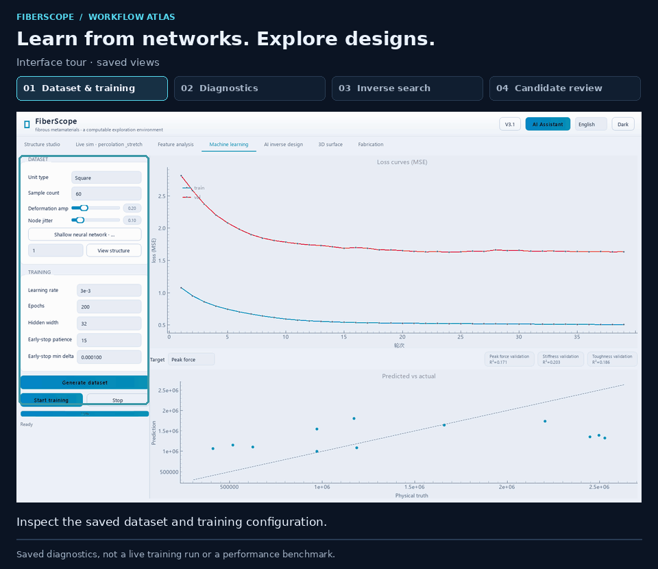

The four stages highlight dataset controls, saved diagnostics, inverse-search controls and candidate review in the existing FiberScope screenshots. Original curves and numbers remain unchanged throughout the tour.

[Editable poster](media/learning_inverse_workflow.svg) · [Screenshot hashes and tour parameters](media/module_workflow_tours.json) · [Render-only script](../scripts/render_module_workflow_tours.py)

## Surface mapping and export workspaces

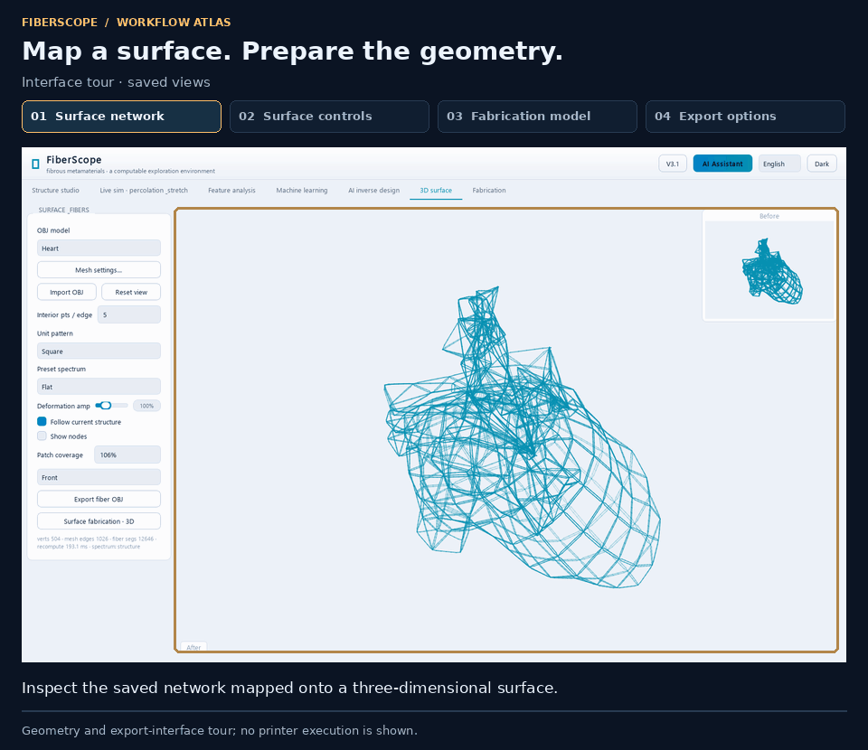

Inspect the surface-bound network, surface controls, fabrication geometry and export controls in the saved interface views. Highlight changes guide the reader through the workspaces; the images do not document printer execution.

[Editable poster](media/surface_export_workflow.svg) · [Screenshot hashes and tour parameters](media/module_workflow_tours.json)

## Electrical field on a toroidal network

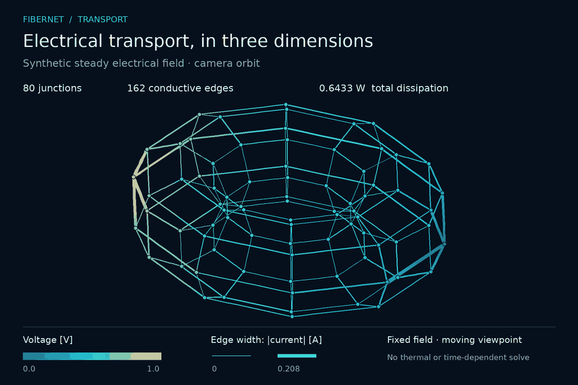

A camera orbit presents the fixed voltage and current field of a saved 80-node, 162-edge toroidal network with synthetic SI parameters. Field values remain unchanged as the view rotates.

[Editable field poster](media/electrical_torus_field_final.svg) · [Source and rendering parameters](media/electrical_torus_field.json) · [Render-only script](../scripts/render_saved_electrical_field.py)

## Reproduce the visuals

The legacy geometry-and-response montage above is a **render-only** composition of saved geometry and saved GIF frames. Its renderer uses NumPy, Pillow, and the DejaVu Sans / Sans Mono fonts:

```bash
python scripts/render_saved_homepage_hero.py
```

The original media renderers are linked above. `scripts/make_homepage_media.py` and `scripts/make_directional_recruitment_media.py` include numerical simulation; run them when deliberately regenerating those scientific examples, rather than to inspect existing media. `scripts/make_intervention_media.py` reads a completed study checkpoint. Regeneration on a different source revision should receive a new manifest instead of overwriting historical provenance.

To check the bilingual homepage and decode its media without running a solver:

```bash
python scripts/check_bilingual_homepage.py
```

Historical manifests retain the original render-time hashes. The checker reports byte-exact matches separately from text files whose only difference is LF/CRLF line endings; it does not rewrite those records.

Keep the source manifests, editable frames, and [project license](../LICENSE) with reused media. The homepage combines the selected examples for navigation; it does not combine their separate physical models into one simulation.


## Recorded simulation and learning processes

The [extended gallery](media/new/README.md) adds LAMMPS and Taichi dynamics, viscoelastic stress and energy, quasistatic member removal, transient Joule heating, a saved GINE study and fixed-action RL environment records. Each module includes data and render-only recipes.
